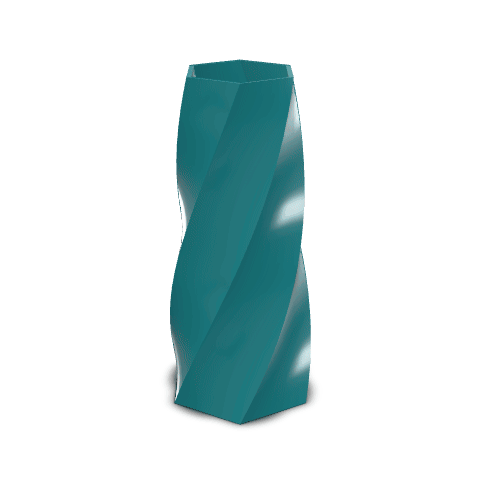
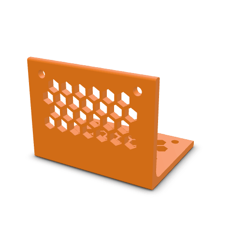
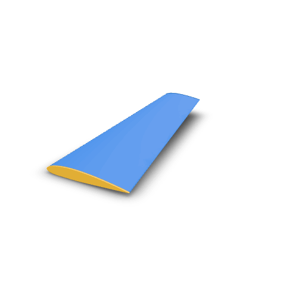
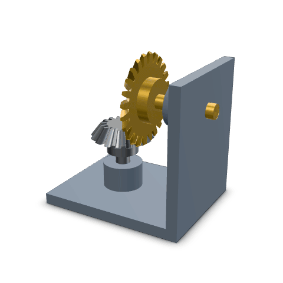
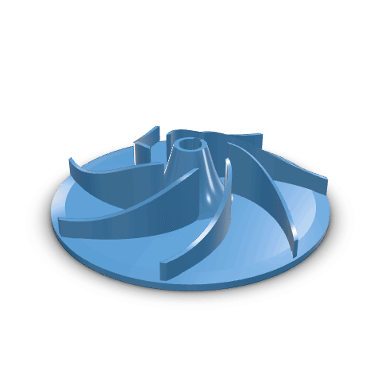
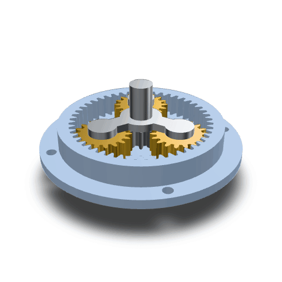
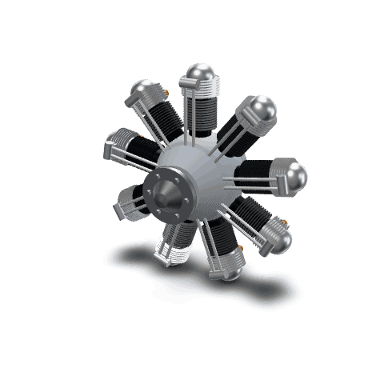

> Source scope: this repository contains the reusable CAD runtime, CLI, MCP tools and headless renderer. Hosted product UI and commercial manufacturing services are maintained separately. Build the reusable tools with `npm run build`; use `npm run dev` for the standalone renderer.

# kernelCAD - CAD runtime for agents

**kernelCAD** turns mechanical intent into editable `.kcad.ts` source,
deterministic review evidence, and exportable manufacturing artifacts.

The core loop is source-first: design brief -> editable `.kcad.ts` ->
evaluated model -> deterministic validation -> guided revision -> export package.

kernelCAD is not trying to be a browser clone of Fusion, Onshape, or SolidWorks.
Replicad/OpenCASCADE are the kernel layer. kernelCAD is the agent-first workflow
layer above the kernel: deterministic CAD source, feature history, diagnostics,
validation, variants, and human review.

## Install

### Already in ChatGPT and Claude: no install

kernelCAD runs as a connected app in **ChatGPT** (Apps SDK, with the Studio
viewer and paint review inside the chat) and in **Claude / claude.ai** (custom
connector). Add it from the chat settings and sign in:

- ChatGPT: [connect guide](https://app.kernelcad.com/connect?client=chatgpt) or [ChatGPT → Settings → Connectors](https://chatgpt.com/#settings/Connectors)
- Claude: [connect guide](https://app.kernelcad.com/connect?client=claude) or [claude.ai → Settings → Connectors](https://claude.ai/settings/connectors), URL `https://mcp.kernelcad.com/mcp`

**One account everywhere.** The coding-agent plugins below use the same hosted
server (`https://mcp.kernelcad.com/mcp`) and the same kernelCAD sign-in. A model
saved from Claude Code, Codex, Cursor, Gemini or Grok opens at the same Studio
share link (`/p/<slug>`) you see in ChatGPT or Claude. Sign in with the same
account in each client.

Ask your agent: **“look at kernelcad.com and install the mcp”**.
[Agent-readable installation instructions](https://kernelcad.com/llms.txt) cover
hosted setup, local CLI setup, and connection verification.

### Local CLI: one line

For Node.js users (Node.js 22.12 or newer):

```bash
npm install --global kernelcad
```

For a self-contained install that includes Node.js, Linux and macOS users can run:

```bash
curl -fsSL https://kernelcad.com/install.sh | sh
```

On Windows PowerShell, run:

```powershell
irm https://kernelcad.com/install.ps1 | iex
```

The direct installers download a platform archive, verify its SHA-256 checksum,
and install it under the user's home directory. Pin a release with
`KERNELCAD_VERSION=vX.Y.Z` on Linux/macOS or `$env:KERNELCAD_VERSION='vX.Y.Z'`
in PowerShell. Builds are available for Linux x64/ARM64, macOS Intel/Apple
Silicon, and Windows x64. Direct installs do not require a separately installed
Node.js.

### Coding agents: one command

One command connects your agent to the hosted kernelCAD MCP server
(`https://mcp.kernelcad.com/mcp`) and adds the kernelCAD skills. Nothing runs
locally and no OpenCASCADE install is needed. Anonymous use works; sign in
through your client's OAuth prompt for account features.

| Agent | One-liner |
|---|---|
| Claude Code | `claude plugin install kernelcad --marketplace w1ne/kernelCAD-web` |
| Codex | `codex plugin marketplace add w1ne/kernelCAD-web && codex plugin add kernelcad@kernelcad` |
| Cursor | [Add kernelCAD MCP to Cursor](cursor://anysphere.cursor-deeplink/mcp/install?name=kernelcad&config=eyJ1cmwiOiJodHRwczovL21jcC5rZXJuZWxjYWQuY29tL21jcCJ9) (MCP only) |
| Gemini CLI | `gemini extensions install https://github.com/w1ne/kernelCAD-web --consent --auto-update` |
| Grok Build | `grok plugin marketplace add w1ne/kernelCAD-web && grok plugin install kernelcad --trust` |
| VS Code / Copilot | `code --add-mcp '{"name":"kernelcad","type":"http","url":"https://mcp.kernelcad.com/mcp"}'` |
| Skills only (any agent) | `npx skills add w1ne/kernelCAD-web` |

Inside Claude Code you can also type `/plugin marketplace add w1ne/kernelCAD-web`
then `/plugin install kernelcad@kernelcad`. Restart the app after installing.
Claude Desktop, ChatGPT, Windsurf, Cline, Zed, Continue, update, uninstall and the Cursor skills install are in
[docs/usage/agent-plugin-install.md](docs/usage/agent-plugin-install.md).

## Showcase

Each model below started from the plain-language prompt shown. An AI agent wrote it through kernelCAD's own authoring loop (CLI / MCP): it wrote `.kcad.ts` source, ran `evaluate`, rendered the seven-view inspection sheet, read the renders, fixed what was wrong, and repeated. None of these is a one-shot generation. Each folder in [`showcase/`](showcase/) holds the parametric source, the turntable GIF (`kernelcad animate --turntable`, publish look), and a short note on what to look at and which checks were run.

| Model | Prompt | Params | Preview |
|---|---|---|---|
| [Twisted hex vase](showcase/twisted-hex-vase/) | Hollow shell ~150 mm tall, tapers 70 → 50 mm, hex section twisting 120°, 2 mm wall, closed bottom | `height` `baseDia` `mouthDia` `twistDeg` `wall` |  |
| [Knurled control knob](showcase/knurled-knob/) | Ø40 × 22 mm, diamond-knurled grip, raised pointer, 6 mm D-shaft bore, M3 set-screw hole | `diameter` `height` `knurlDepth` `knurlTwistDeg` `knurlTeeth` `shaftDia` `dFlatDepth` `boreDepth` `skirtHeight` |  |
| [Honeycomb bracket](showcase/honeycomb-bracket/) | Filleted L-bracket with a generative hex lattice | `thickness` `innerFillet` `cellSize` `web` |  |
| [NACA 2412 wing](showcase/naca-2412-wing/) | True airfoil from the NACA equations, tapered loft | `semiSpan` `rootChord` `tipChord` `leSweep` `dihedralRise` `washoutDeg` |  |
| [Bevel gear drive](showcase/bevel-gear-drive/) | Meshing bevel gear pair at 90° | `gearDeg` `pinionTeeth` `gearTeeth` |  |
| [Centrifugal impeller](showcase/centrifugal-impeller/) | 7 swept backward-curved blades | `bladeCount` `wrapDeg` `backplateThickness` `boreDia` `keyWidth` |  |
| [Planetary gear stage](showcase/planetary-gear-stage/) | Sun, planets, ring, carrier | `carrierDeg` `sunTeeth` `planetTeeth` `planetCount` |  |
| [9-cylinder radial engine](showcase/radial-engine/) | Round crankcase, nine finned cylinders in a star, domed heads, prop hub | `cylinderCount` `barrelLength` |  |

Some checks go past the picture:

- **Mechanisms that are checked, not just drawn.** The planetary stage and the bevel drive are assemblies with revolute mates, gear ratios coupled from the tooth counts, and declared gear-pair transmissions. kernelCAD's mechanism-truth check (`evaluate_script` → `mechanism: "real"`) turns each mechanism through its limits with the couplings applied and looks for overlapping teeth. `kernelcad validate --include-interference` reports both assemblies clean.
- **Manufacturing evidence.** The honeycomb bracket declares an FDM print gate. `kernelcad dfm` passes it (thinnest wall 2.0 mm, no unsupported overhang), and `kernelcad export step` writes a B-rep whose holes read back with `kernelcad inspect step`.

## Philosophy

1.  **Agent-First**: The primary interface is `.kcad.ts`, CLI, and MCP. The UI reviews and steers generated designs.
2.  **Editable Source**: Geometry is deterministic source code with explicit feature history, params, assemblies, and diagnostics.
3.  **Validation-Centered**: Useful CAD output needs deterministic review for constraints, hardware fit, clearances, and exportability.
4.  **Workflow Over Primitives**: Product progress is measured by intent-level workflows, not by copying every traditional CAD button.

## Reference-parts accuracy

The headless OCCT gate checks 27 native `.kcad.ts` reference parts against
analytic or recorded OCCT volume, surface-area, and bounding-box values. The
current headline is 25/27 reference parts match; the expected-pass gate is
25/25, with two documented known failures and their reasons listed in the
scorecard. See the
[reference-parts scorecard](docs/reference-parts-scorecard.md) and its
[local validation demo](docs/demos/reference-parts-scorecard/README.md).

The [SolidCraft oracle ledger](docs/solidcraft-ledger.md) vendors that project's
public reference cases (Apache-2.0) and checks the kernelCAD parts that have
been modelled so far. Cases without a kernelCAD source stay pending and do not
fail CI. Pull-request CI runs the fast subset; the nightly job runs every
implemented part.

## Agent workflow

For agents and contributors, `.kcad.ts` source is the design source of truth.
Rendered PNG/MP4 files, STEP/STL exports, score JSON, and capture-run metadata
are generated evidence or deliverables. Prompt briefs, source files, and
provenance metadata remain source. Change source first, regenerate explicit
targets, and avoid broad artifact refreshes unless you are intentionally
rebuilding a demo or release bundle.

Use deterministic checks before visual judgment:

```bash
kernelcad evaluate model.kcad.ts
# then run review_cad from an MCP client connected through `kernelcad mcp`
kernelcad export step model.kcad.ts -o model.step
kernelcad export stl model.kcad.ts -o model.stl
```

Translate an assembly exported from SolidWorks or another CAD application as
STEP into a KernelCAD project:

```bash
kernelcad import-step robot.step --out robot-kcad
kernelcad evaluate robot-kcad/robot.kcad.ts
```

The bundle contains a `.kcad.ts` root assembly, `manifest.json` with the source
product paths, units, placements, colors, and geometry measurements, and exact
native OCCT BREP assets content-addressed by geometry. Byte-identical product
definitions share an asset. The original STEP assembly hierarchy is recorded
in the manifest; the current KernelCAD scene is flattened into independently
placeable occurrences. Local STEP `DOCUMENT_FILE` dependencies are read
recursively, included in the import provenance hashes, and must stay inside the
input directory. Component colors are preserved; per-face color mapping is not
part of this import. It does not infer mates, joints, motion, feature history,
or read native SolidWorks/Parasolid data.
See the [retained import demo, bundle, and verification evidence](docs/demos/step-to-kernelcad/README.md).

When a rendered artifact is produced, inspect the image/video itself and report
what is visible: proportions, interfaces, floating geometry, occlusion, camera
framing, and whether required features are legible. Passing tests are not a
substitute for visual evidence.

When visual evidence matters, keep a deterministic inspection bundle:

```bash
kernelcad render inspect model.kcad.ts model.inspect
```

The v1 bundle writes a manifest and canonical RGB views. It can also emit
machine-readable `mask`, `depth`, and `normals` channels:

```bash
kernelcad render inspect model.kcad.ts model.inspect --channels rgb,mask,depth,normals
```

Use `--focus <names>` or `--hide <names>` when a specific feature id or
assembly part needs isolated review. Keep richer channels in the same manifest
packet; do not replace the canonical RGB views.

For real hardware, prefer catalog/vendor geometry via `lib.fromSTEP(...)`
instead of fake placeholder boxes or cylinders. This keeps mounts, clearances,
and mechanism checks tied to physical components.

## Features

-   **Headless Core**: Run CAD operations in Node.js or Web Workers without a DOM.
-   **Agent API**: kernelCAD APIs for params, assemblies, NURBS, SDF bodies, sheet metal workflows, introspection, and feedback loops.
-   **Review Cockpit**: Browser-based 3D preview for inspecting generated designs and validation results.
-   **Standard Exports**: STEP/STL generation.
-   **Robust Kernel**: Built on OpenCASCADE, with Replicad kept as a kernel implementation detail where it is still used.
  
## Get Started

```bash
npm install --global kernelcad
```

The npm package requires Node.js 22.12 or newer. For a self-contained install,
use the platform installer above.

Drop this in `bracket.kcad.ts`:

```typescript
const w = param('Width', 60, { unit: 'mm' });
const h = param('Height', 40, { unit: 'mm' });
const t = param('Thickness', 5, { unit: 'mm' });

const base = box(w, h, t);
const hole = cylinder(t + 2, 4).translate(w / 2, h / 2, -1);
return base.subtract(hole).fillet(1);
```

Run it:

```bash
kernelcad evaluate bracket.kcad.ts
kernelcad export stl bracket.kcad.ts -o bracket.stl
```

That's it. For agents: `kernelcad mcp` runs an MCP server with dynamic model
introspection tools. Object tool responses include `structuredContent` alongside
the serialized JSON text so MCP clients can validate advertised output schemas.
See `SKILL.md` (bundled with the install) for the full API
surface and authoring guide.

## Use with Claude Desktop

kernelCAD runs as an MCP server, so Claude Desktop can drive it locally. After
the one-line install, add an entry to your Claude Desktop config file:

- **macOS:** `~/Library/Application Support/Claude/claude_desktop_config.json`
- **Windows:** `%APPDATA%\Claude\claude_desktop_config.json`
- **Linux:** `~/.config/Claude/claude_desktop_config.json`

```json
{
  "mcpServers": {
    "kernelcad": {
      "command": "kernelcad",
      "args": ["mcp"]
    }
  }
}
```

Restart Claude Desktop. The kernelCAD MCP tools (`review_cad`, model
introspection, export helpers, etc.) appear in the tools list.

The first full local `evaluate_script` build returns `viewerUrl`. Open it in
Studio once: later full builds and source-edit tool calls replace the source,
history, and geometry behind that same session link. The viewer is served on
`127.0.0.1` by the MCP process and lasts until that process closes; it is not a
public share link. Dry runs leave it unchanged. A build failure keeps the last
built model visible; a successfully built model with DFM failures remains
viewable. Build diagnostics shown there are not a full CAD/physics review.

Published packages include the Studio bundle. When running MCP from a checkout,
run `npm run build:mcp-viewer` first. If the bundle cannot be served, the build
result includes `viewerError` separately from its CAD diagnostics. Hosted MCP
and `--cloud` continue to use the gateway's Studio/project URLs.

[Local viewer workflow](docs/demos/mcp-viewer-link/README.md).


For hosted workflows, sign in at [the existing connection guide](https://app.kernelcad.com/connect?client=claude).
It gives the current connector and OAuth steps for your client. The hosted tool
set depends on authentication, your selected profile, and server-native tools;
use the connected server's discovery rather than assuming the local list.

The local installer is available. Preview the config change before applying it:

```bash
kernelcad install --claude-desktop --dry-run
kernelcad install --claude-desktop
```

Other hosted setup guides: [ChatGPT](https://app.kernelcad.com/connect?client=chatgpt),
[Claude](https://app.kernelcad.com/connect?client=claude),
[Claude Code](https://app.kernelcad.com/connect?client=claude-code),
[Codex](https://app.kernelcad.com/connect?client=codex),
[Gemini CLI](https://app.kernelcad.com/connect?client=gemini),
[Grok Build](https://app.kernelcad.com/connect?client=grok),
[Cursor](https://app.kernelcad.com/connect?client=cursor), and
[VS Code](https://app.kernelcad.com/connect?client=vscode).

Browse the generated [local MCP tool reference](https://kernelcad.com/docs/mcp-tools)
for complete input/output schemas and behavior annotations, or search the
[design guide](https://kernelcad.com/docs/design-guide) for existing recipes and
cited, dated manufacturing catalog snapshots.

For local Studio, [`get_selection` and `set_selection`](docs/guide/shared-selection.md)
share face/edge picks with your MCP agent. Open the same script in Studio and
use its session token; picks expire on model rebuild.

For opt-in kernel selection and fallback diagnostics, see the
[experimental guarded SMLib kernel guide](docs/smlib-kernel.md) and its
[workflow demo bundle](docs/demos/smlib-guarded/README.md).

## Privacy and network

kernelCAD runs locally. It has no install-time scripts and makes no network calls
except the ones below.

| Host | When | What is sent |
|---|---|---|
| `telemetry.kernelcad.com` | Anonymous usage stats, opt-out | Tool name, outcome, duration, counts, versions. Never prompts, code, geometry, paths or env vars. See [TELEMETRY.md](TELEMETRY.md). |
| `api.kernelcad.com`, `app.kernelcad.com` | Only when you use the hosted gateway, Studio links, or ordering/pricing tools | The request you make |
| `api.step.parts`, `kernelcad-parts.pages.dev`, `raw.githubusercontent.com`, vendor sites | Only when you call `find_part` / `fetch_part` | The part search query or part URL |

Turn telemetry off with `kernelcad telemetry disable`, `KERNELCAD_TELEMETRY=0`
or `DO_NOT_TRACK=1`. It is off in CI. Demo scripts under `scripts/` and
`eval/` call subprocesses and test URLs; they are developer tools and are not
part of the published package.

## Contributing

Web app + dev workflow (clone the repo, `npm install`, `npm run dev`) for contributors who want to hack on the kernel or the visual debugger:

```bash
git clone https://github.com/w1ne/kernelCAD-web.git
cd kernelCAD-web
npm install
npm run setup-hooks  # optional: enable the local pre-commit hook
npm run dev          # web visual debugger at localhost:5173
npm run build:cli    # build the CLI bundle into dist/cli/
npm run test         # full vitest suite
npm run qc           # quick quality gate (lint + typecheck + tests)
```

## Attribution

Exported files name kernelCAD in their metadata field (STEP `FILE_NAME`, GLB
`asset.generator`, the STL header, a DXF or XML comment), and public viewer
pages show a small "Made with kernelCAD" link. Self-hosters and forks change
this in `src/shared/links/attribution.ts`. See [ATTRIBUTION.md](ATTRIBUTION.md).

## License

MIT — see [LICENSE](LICENSE). The kernelCAD name is covered by the
[trademark policy](TRADEMARKS.md).
