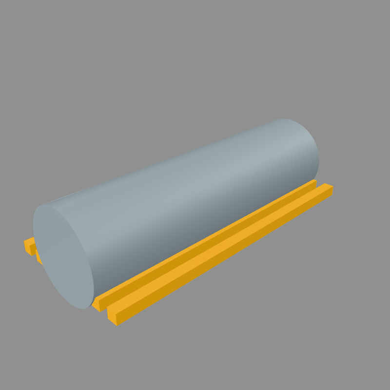
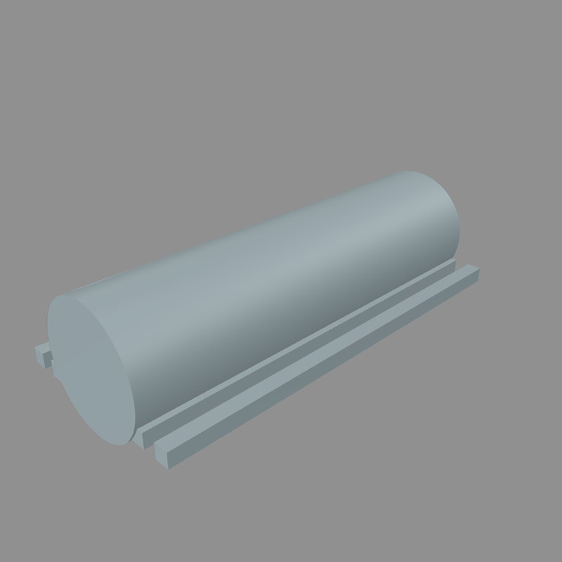

# Road reclaimer cutting-tooth material review — 18 November 2026

This handoff records a five-preview semantic audit and one material-role
correction in the existing `construction-equipment/road-reclaimer` asset. The
seven modeled cutting teeth now use the existing `structuralSteelColor` control;
the machine paint stays on the engine cover, operator deck, canopy and milling
hood. Geometry, dimensions, controls, presets and the 816-triangle mesh did not
change.

The source regression checks all seven exported-GLB tooth colors, representative
painted parts, existing presets and the triangle budget. The normal catalog
preview remains byte-identical because the selected teeth sit behind the hood.
The focused images isolate the cutter drum and teeth:

| Before | After |
|---|---|
|  |  |

Both focused images were rendered with kernelCAD `render_preview`, using the
same source-driven `iso` view, part focus, 800 × 800 size and
`no_mechanism_check: true`. Settings and per-image manifests record the source
hashes, render bounds and server build. The render reports `mechanism:
unverified`; these are static software previews, not a simulation. An attempt
to capture through this checkout's CLI and attached Chrome is retained in
`verification/render-before.txt`; the demo-player did not initialize in that
browser session, so the successful focused images use the kernelCAD static
preview service instead.

## Five-preview ledger

[`preview-review.md`](preview-review.md) records the five checked source files,
rendered images, indexed envelopes and tri counts, overlap checks, the selected
material mismatch, and unresolved geometry or scale concerns. The selected
asset's regular preview and public detail page were checked before the branch
change. The branch has not been deployed.

## Verification

Exact invocations and outputs are under [`verification/`](verification/):

- exported-GLB regression: passed;
- construction-equipment ESLint: passed;
- construction-equipment quality gate: 60/60 assets (100%);
- global material/preset gate: 2,398/2,402 assets (99.83%); four unchanged
  thin assets are in `standard-components`;
- catalog preview render and generated index rebuild: completed; the generated
  road-reclaimer `sourceSha256` matches the source and its preview path exists;
- full catalog integration suite: 151/151 files and 221/221 tests passed,
  including the full index-freshness check (`catalogIndex.test.ts`);
- compact review video: [`construction-road-reclaimer-cutting-tooth-material-review.mp4`](construction-road-reclaimer-cutting-tooth-material-review.mp4).

The video is 15 seconds, 1280 × 720, H.264, and retains its generation script,
settings and inspected-frame evidence beside it. The scale and silhouette
concerns noted in the ledger remain unresolved. Nothing in this bundle claims
equipment specification accuracy, simulation, deployment, manufacturing
suitability or hardware acceptance.
