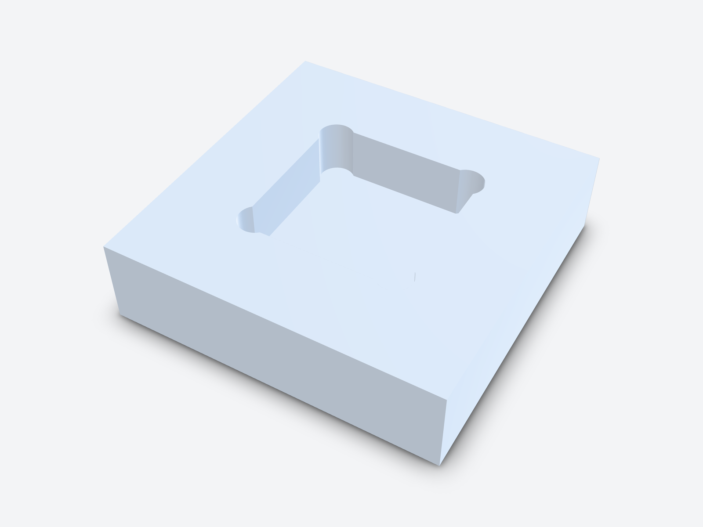
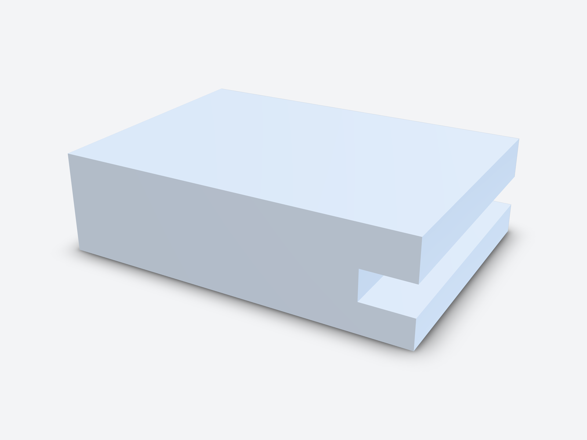

A CNC-milled pocket can't have sharp vertical inside corners. The end mill
is round, so every internal corner gets a radius at least as big as the
tool's radius. Make the corner radius a little larger than the tool radius,
and at least one third of the pocket depth. Keep pockets no deeper than
about four times their width. If a square part has to fit, add dogbone
reliefs instead of asking for a sharp corner.

Corners are one of the most common reasons a quote comes back with
questions. One square corner can mean a smaller tool, a slower job or
electrical discharge machining (EDM). If you find it after the quote, you
also lose a day to a new revision. This guide gives the rules, where the
numbers come from, and how to check a part as you design it.

## Contents

1. [Why internal corners can't be sharp](#1-why-internal-corners-cant-be-sharp)
2. [Choosing the corner radius](#2-choosing-the-corner-radius)
3. [Deep pockets and tool length](#3-deep-pockets-and-tool-length)
4. [Floor-to-wall corners](#4-floor-to-wall-corners)
5. [Mating square parts: dogbone and T-bone reliefs](#5-mating-square-parts-dogbone-and-t-bone-reliefs)
6. [Undercuts and setups](#6-undercuts-and-setups)
7. [Checking it in kernelCAD](#7-checking-it-in-kernelcad)
8. [FAQ](#8-faq)

## The rules at a glance

| Feature | Rule of thumb | Why |
| --- | --- | --- |
| Vertical inside corner | Radius ≥ ⅓ of cavity depth, and slightly larger than the tool radius | A round cutter can't leave a smaller radius, and a larger one lets it keep moving instead of stopping in the corner |
| Pocket depth | ≤ about 4 × cavity width; 2–3 × tool diameter is comfortable in hard materials | Long tools bend, chatter and clear chips badly |
| Floor-to-wall corner | Sharp, 0.5 mm or 1 mm | These match flat and standard corner-radius end mills |
| Square mating part | Dogbone or T-bone relief, at least the tool radius | The insert seats fully without a sharp corner in the pocket |
| Undercut or side feature | Add a setup, or use a standard T-slot or dovetail cutter | A tool coming from the top can't reach under an overhang |
| Number of setups | 3–4 is usually fine; more gets expensive | Each refixture costs time and adds a small position error |

Sources for each number are linked in the sections below.

## 1. Why internal corners can't be sharp

An end mill is a spinning cylinder. Where two vertical walls meet, the
cutter's edge leaves an arc with the same radius as the tool. It doesn't
matter how small the tool is. A Ø1 mm cutter still leaves R0.5. As
[Hubs' design guide](https://www.hubs.com/knowledge-base/how-design-parts-cnc-machining/)
puts it, a milled internal corner always has some radius.

A truly sharp corner needs a different process, such as EDM or a broach.
Both add cost and lead time. Usually the better fix is to change the
design, not the process.

**How kernelCAD helps.** The model is a `.kcad.ts` source file, so the
corner radius is a named value next to the reason for it, such as
`cornerR = 4 // > R3 of a 6 mm end mill`. Whoever opens the file next sees
why the number is what it is, and the fillet doesn't get dropped in a
cleanup.

## 2. Choosing the corner radius

Two rules of thumb work together.

**Relative to depth.** Hubs recommends a vertical corner radius of at least
one third of the cavity depth, and suggests going about 1 mm above that
so the tool can follow a circular path
([Hubs](https://www.hubs.com/knowledge-base/how-design-parts-cnc-machining/)).
For a 12 mm deep pocket that means R4 or more.

**Relative to the tool.** Make the corner a little bigger than the cutter
radius. Then the tool sweeps the corner in an arc instead of stopping and
changing direction, which marks the wall and loads the tool.
[Xometry](https://www.xometry.com/resources/machining/cnc-machining-optimizing-internal-corner-radii/)
suggests adding 0.02–0.05 in (about 0.5–1.3 mm) to the corner radius, so a
0.25 in tool radius becomes a 0.27–0.30 in corner.

In practice, pick the largest end mill the pocket allows, then make the
corner 0.5–1 mm larger than that tool's radius. A bigger tool removes
material faster and bends less, so a generous radius also lowers the price.

**How kernelCAD helps.** `dfm_review` checks every vertical inside corner
against the end mill you name. It reports both sharp corners and fillets
that are too small for the tool, with their positions. That's a check in
seconds, not a question from the shop two days later.

## 3. Deep pockets and tool length

Pocket depth matters as much as the corner. A long, thin cutter bends,
chatters and struggles to clear chips. Hubs recommends a cavity depth of
up to four times the cavity width. It treats anything deeper than six
times the tool diameter as a deep cavity that needs special tooling
([Hubs](https://www.hubs.com/knowledge-base/how-design-parts-cnc-machining/)).
In hard materials the limit is lower. One titanium guide calls 2–3 × the
tool diameter practical with standard tools, and recommends reduced-neck
tools and through-spindle coolant from 3 to 5 ×
([Boze Metal](https://cnc.bozemetal.com/blog/titanium-cnc-design-guide-machinability-rules/)).

Corner radius and depth are linked. A deep pocket needs a longer tool, a
longer tool has to be thicker to stay stiff, and a thicker tool needs a
bigger corner radius. That's why the ⅓-of-depth rule works.

If a pocket must be deep, make it wider at the top or step it. Let a large
tool clear most of the material and a smaller tool finish only the bottom.

**How kernelCAD helps.** Because the part is code, the depth can be
computed from the tool, for example `const pocketDepth = 3 * toolD`. The
rule then holds when someone changes the tool or the pocket later.

## 4. Floor-to-wall corners

The edge where the pocket floor meets the wall is a different case. A flat
end mill leaves it sharp, and a corner-radius (bull-nose) end mill leaves a
small radius. Hubs recommends a floor radius of 0.5 mm, 1 mm or none,
because those match standard tools
([Hubs](https://www.hubs.com/knowledge-base/how-design-parts-cnc-machining/)).

Don't copy the vertical corner radius onto the floor edge. A large floor
fillet needs a ball-nose cutter and many fine passes to produce, which
costs time and leaves a scalloped finish. Ask for a floor radius only when
you need it for stress or cleaning, and choose a standard size.

## 5. Mating square parts: dogbone and T-bone reliefs

Sometimes the pocket has to take a square part, such as a bearing block, a
square nut, a sensor or another milled block. A filleted pocket corner
stops the part's sharp edge from seating. The fix is a relief cut beyond
the corner.

- **Dogbone.** The cutter goes into the corner along the diagonal until its
  edge passes through the corner point. Placing the tool centre R/√2 from
  each wall does exactly that. You get a small round notch that both walls
  run into
  ([Get It Made](https://get-it-made.co.uk/resources/machining-square-corners-with-cnc-milling)).
- **T-bone.** The relief runs into one wall only. Use it when one wall
  needs to stay unbroken or a diagonal notch would show. Push it into the
  part by at least the cutter radius
  ([Get It Made](https://get-it-made.co.uk/resources/machining-square-corners-with-cnc-milling)).

The relief radius follows the cutter, so choose the largest tool the
design can take. If nothing mates with the corner, a plain fillet is
simpler and looks better.

**How kernelCAD helps.** A dogbone is four lines of code: one cylinder
subtracted at each corner, positioned from the insert size and the tool
radius. Change the insert or the tool and every relief moves with it.

## 6. Undercuts and setups

A 3-axis mill reaches the part only from the direction the tool points.
Any face hidden under an overhang is an undercut from that side. That
includes a groove in a side wall, a slot under a lip or a cross hole. You
have three options:

- Machine it in a **second setup**, with the part turned so the tool comes
  from the side.
- Use a **standard undercut cutter**. Hubs notes that T-slot cutters come
  in widths from 3 to 40 mm, and that 45° and 60° dovetail cutters are
  standard
  ([Hubs](https://www.hubs.com/knowledge-base/how-design-parts-cnc-machining/)).
- **Redesign** so the feature opens upwards.

Each setup costs fixturing time. Three or four setups are usually
acceptable, and more gets expensive. Features that must line up closely
should be cut in the same setup
([Hubs](https://www.hubs.com/knowledge-base/how-design-parts-cnc-machining/)).

**How kernelCAD helps.** `dfm_review` takes the setups you plan as a list
of approach directions. It reports the unreachable area in mm², so you know
before quoting whether a part needs one setup or two.

## 7. Checking it in kernelCAD

The examples below are real runs of the MCP `dfm_review` tool with
`processes: ["cnc"]`. All four parts are in
`examples/gallery/cnc-corner-examples.kcad.ts`. Change `variant` to switch
between them.

### A fillet that suits one tool but not another

A 70 × 50 × 20 mm block with a 40 × 30 × 10 mm pocket and R2.5 corners:

```ts
const pocket = box(40, 30, 10)
  .fillet(2.5, { parallel: [0, 0, 1] })
  .translate(15, 10, 10);
return box(70, 50, 20).subtract(pocket);
```

With the default Ø6 mm end mill (R3) the review fails:

```text
cnc.internal-corner-radius  fail
4 internal fillet(s) as small as R2.5 mm below the R3 mm tool radius
(Ø6 mm end mill); add fillets ≥ R3 mm or use a smaller tool.
```

The result lists the four tight fillets with radius, axis and location,
for example `{ "location": [52.5, 37.5, 15], "radiusMm": 2.5, "axis":
[0, 0, 1] }`. Run it again with `tool_diameter_mm: 4` and it passes: "All
internal corners along the approach axes are ≥ R2 mm." Now you know your
options: a smaller tool and a longer cycle, or R4 corners and a faster
Ø6 job.

### A square insert pocket with dogbones



A 30 × 30 × 10 mm pocket for a square insert, with sharp corners, fails
the Ø6 check with "4 sharp internal corner(s) (radius 0) below the R3 mm
tool radius". It also gives each corner's location, such as
`[15, 15, 11]`, and length, 10 mm. Adding an R3.2 dogbone at each corner
fixes it:

```ts
const d = reliefR / Math.SQRT2; // tool centre on the diagonal
for (const [cx, cy, sx, sy] of corners) {
  part = part.subtract(
    cylinder(depth, reliefR).translate(cx + sx * d, cy + sy * d, plateT - depth),
  );
}
```

The review passes both checks: "No undercuts: every surface is reachable
from the allowed approach axes" and "All internal corners along the
approach axes are ≥ R3 mm."

### A side groove: one setup or two



A 10 mm deep, 6 mm tall groove in the side of a 70 × 50 × 20 mm block.
From the default `approach_axes: ["+z"]`:

```text
cnc.undercuts  fail
1300 mm² of surface is unreachable from the allowed tool approach axes;
needs another setup, a 4/5-axis machine or a redesign.
```

1300 mm² is the groove floor (500), its ceiling (500) and its back wall
(300). With `approach_axes: ["+z", "+x"]`, which means a second setup from
the side, the verdict is `pass`. The setup count you quote is now based on
the geometry, not a guess.

To run any of these yourself, ask your assistant to review the file for
CNC with the tool you plan to use:

```json
{ "code": "…", "processes": ["cnc"], "tool_diameter_mm": 6, "approach_axes": ["+z", "+x"] }
```

For the other problems that come up late in a design, see
[Ten problems design engineers keep running into](design-engineer-challenges.md).

## Key takeaways

- Every milled inside corner has a radius. Make it at least ⅓ of the
  cavity depth and 0.5–1 mm larger than the tool radius.
- Keep pockets within about 4 × their width, and lower in hard materials.
- Leave floor corners sharp or use 0.5 mm or 1 mm.
- Use dogbone or T-bone reliefs when a square part has to seat.
- Count your setups. Every side feature may need one more.
- Check corners and undercuts against the actual tool before you send the
  part for a quote.

## 8. FAQ

**What is the minimum internal corner radius for CNC milling?**
It equals the radius of the smallest end mill that can reach the corner.
For a good price, design for ⅓ of the cavity depth and slightly more than
the radius of a common tool size.

**Can a CNC mill cut a sharp inside corner?**
Not in a vertical wall. Use a dogbone or T-bone relief if a square part has
to fit, or ask for EDM if the corner really must be sharp.

**What is a good pocket depth to tool diameter ratio?**
2–3 × the tool diameter is comfortable. About 4 × is a common upper limit
for standard tooling, and beyond 6 × counts as a deep cavity that needs
special tools.

**What is a dogbone fillet?**
A round relief cut past the corner of a pocket, along the diagonal, so a
square part can seat fully. Its radius follows the cutter.

**Do floor-to-wall edges need a radius?**
No. Sharp, 0.5 mm or 1 mm all match standard end mills. Large floor fillets
take longer to machine.

**Try kernelCAD free. Connect it to ChatGPT or Claude in a minute:
https://app.kernelcad.com/connect**
