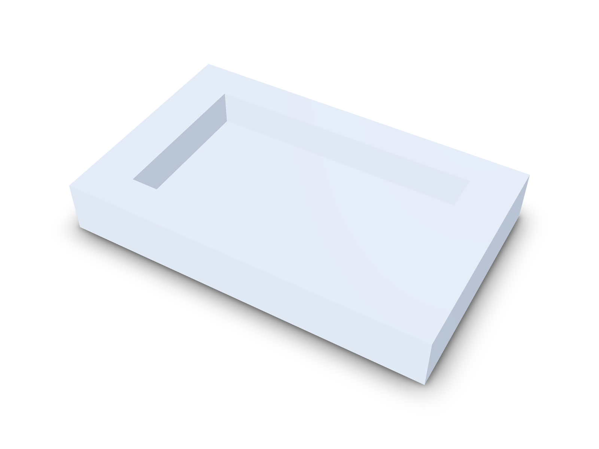

Design engineers are hired to solve hard problems. Yet most of the week goes
to routine work: re-checking hole sizes, redrawing parts after a change,
hunting for the latest revision, and answering a supplier who says a corner
can't be machined. Each of these is small on its own. Together they push
launches back by weeks.

They are also expensive. In one published case study of a handheld device,
every engineering change to an injection mould cost about $5,000. The two
cover tools needed three changes each, $30,000 in total, and the launch
slipped by four weeks
([Bhargava, *Plastics Engineering*, October 2016](https://read.nxtbook.com/wiley/plasticsengineering/october2016/productdesign_eyeopeningimpact.html)).
None of those changes needed new engineering. Every one was an error that
could have been caught in CAD.

This article covers the ten challenges we hear about most from mechanical
design teams, why each one happens, and how kernelCAD helps you overcome it.

**Contents**

1. [Manufacturing feedback arrives too late](#1-manufacturing-feedback-arrives-too-late)
2. [Design intent gets lost](#2-design-intent-gets-lost)
3. [Nobody is sure which revision is current](#3-nobody-is-sure-which-revision-is-current)
4. [Fasteners and holes don't match](#4-fasteners-and-holes-dont-match)
5. [Drawings fall out of sync with the model](#5-drawings-fall-out-of-sync-with-the-model)
6. [Assemblies only fail once they are built](#6-assemblies-only-fail-once-they-are-built)
7. [Small geometry defects break downstream work](#7-small-geometry-defects-break-downstream-work)
8. [Vendor parts are re-modelled by hand](#8-vendor-parts-are-re-modelled-by-hand)
9. [Design reviews happen in screenshots and email](#9-design-reviews-happen-in-screenshots-and-email)
10. [Cost is unknown until the quote comes back](#10-cost-is-unknown-until-the-quote-comes-back)

## 1. Manufacturing feedback arrives too late

Manufacturability is usually checked after the model is finished, often by
the supplier when they quote it. By then a small fix means a new revision, a
new quote and a lost week. For 3-axis milling the most common rejection is
the internal corner: a round end mill can't cut a corner sharper than its own
radius.

**How kernelCAD helps.** kernelCAD reviews your part for CNC machining and
3D printing while you design, in seconds, and points to exactly where the
problem is. Here is a real run on an 80 × 50 × 12 mm aluminium cover plate
with a 60 × 34 × 8 mm pocket:



```text
cnc.internal-corner-radius  fail
4 sharp internal corner(s) (radius 0) below the R3 mm tool radius
(Ø6 mm end mill); add fillets ≥ R3 mm or use a smaller tool.
```

The review lists all four corners by position. One line of code fixes them,
with R4 corners that clear a 6 mm end mill:

```ts
pocket = pocket.fillet(4, { parallel: [0, 0, 1] });
```


The review now passes: "All internal corners along the approach axes are
≥ R3 mm." That's a rejected quote avoided before it happened.

<!-- check: source contains pocketCornerR = 4 -->

## 2. Design intent gets lost

A dimension in a feature tree doesn't say why it has that value. When a
colleague edits the part, a 40 mm hole spacing chosen to match a mating
bracket looks like any other number, and gets changed.

**How kernelCAD helps.** Every kernelCAD model is a readable `.kcad.ts`
source file. Key values have names, the reason sits right next to them, and
everything else is derived from them. In the cover plate, `pocketCornerR = 4`
carries the note "> R3 of a 6 mm end mill", and the pocket stays centred
whatever size the plate becomes. The intent travels with the part.

## 3. Nobody is sure which revision is current

CAD files are binary and hard to compare. Two files called
`bracket_v3_final.step` and `bracket_v3_final2.step` tell you nothing about
what changed or why.

**How kernelCAD helps.** Because models are source, they live in git like
the rest of your product: every revision is a commit with a message and a
readable diff. Visual diffs show added material in green and removed
material in red, with the volume change and the largest surface deviation.
Assembly diffs list every part, mate and parameter that changed. Everyone
works from one source of truth.

## 4. Fasteners and holes don't match

Clearance holes, counterbores and countersinks are sized from tables by
hand, and screw lengths are picked separately. One wrong column and the screw
doesn't fit, the head sits proud, or the bolt is too short for the nut.

**How kernelCAD helps.** kernelCAD sizes the whole joint from one fastener
table. `lib.insert` reads the holes your part already has, matches each one
to the ISO 273 close, normal or loose clearance size, and cuts the
countersink or counterbore the head needs. `lib.stack` picks the bolt length
from the actual grip: for an M5 through a 12 mm grip with washers and a nut
it chooses M5 × 25, because M5 × 20 would be 0.3 mm short. See
[Fasten a part from its holes with lib.insert](hole-driven-fastening.md) and
[Bolted joints from one fastener table](standard-parts-library.md).

## 5. Drawings fall out of sync with the model

The 3D model changes, but the 2D drawing is a separate document that someone
has to remember to update. The shop builds from whichever one they were sent.

**How kernelCAD helps.** In kernelCAD the drawing is generated from the
model. Dimensions show directly on the 3D view, and one click downloads a
dimensioned A3 PDF built from the current model, in baseline, chain or
symmetry style. No redrawing, no mismatches. See
[Download a drawing in one click](drafting-review.md).

## 6. Assemblies only fail once they are built

Parts are checked one at a time. Whether they can actually be put together,
or taken apart for service, is often found out on the bench. Fits that work
at nominal size can fail at the edge of their tolerance.

**How kernelCAD helps.** kernelCAD checks the assembly as a whole. It tests
whether every part can be removed, finds the parts that block each other,
and plans a build sequence. Parameter sweeps re-run the model across a range
of values and pinpoint exactly where a requirement starts to fail, for
example "wall fails below 1.840 mm". Rigid tube runs come with a bend table
and their clearance to every nearby part. See
[Routing bent tubes between ports](tubes-how-to.md).

## 7. Small geometry defects break downstream work

Tiny faces, very short edges and parts that are almost symmetric but not
quite creep in through imports and repeated edits. You can't see them on
screen, but they break meshing, simulation and CAM later.

**How kernelCAD helps.** kernelCAD measures the model instead of relying on
your eyes. The geometry-quality check lists every tiny face and short edge
with its size and location, and confirms mirror symmetry about the plane you
specify. Find and fix defects before they ever reach your supplier. See
[Check tiny faces, short edges and mirror symmetry](geometry-quality.md).

## 8. Vendor parts are re-modelled by hand

Motors, bearings and connectors get drawn as rough boxes to save time. Then
the real part turns out to be bigger, or its mounting holes are somewhere
else.

**How kernelCAD helps.** `lib.fromSTEP(...)` drops the supplier's own STEP
model straight into your design, converted to millimetres. The built-in
standard parts library adds fasteners and fixture parts with catalogue
dimensions. Your assembly is built from the real thing from day one.

## 9. Design reviews happen in screenshots and email

Feedback on a 3D part usually arrives as a screenshot with a red circle. The
person fixing it has to guess which face was meant, seen from which angle.

**How kernelCAD helps.** Reviewers mark up the model itself. A Studio markup
snapshot captures the camera view, the exact faces and edges picked, the
measurements taken and the notes, and sends them straight to the AI agent
that makes the change. Saved models get a share link that opens in any
browser, so reviewers need no CAD seat. See
[Studio markup snapshots](studio-markup-snapshot.md).

## 10. Cost is unknown until the quote comes back

Cost depends on material, process, quantity and geometry, and designers
rarely see a number until procurement asks for quotes. By then the design is
locked.

**How kernelCAD helps.** kernelCAD puts cost drivers in front of you while
the design can still change. The manufacturability review catches the
features that make parts expensive. The bill of materials lists every part
with quantity, material, mass and whether it is made or bought, ready to
export as CSV. And you can request a price for a part straight from the chat.

## Key takeaways

- Most delays come from routine checks done by hand, late in the process.
- A late change can cost thousands per tool change and weeks of schedule.
- Catch manufacturability problems while you design, not when you quote.
- Keep one source of truth: named parameters, version control and drawings
  generated from the model.
- Check fasteners, fits and assemblies as a whole, before anything is built.

## Start designing without the rework

kernelCAD turns these ten challenges into checks that run on every change,
so your team spends its time on engineering instead of rework.

**Try kernelCAD free: connect it to ChatGPT or Claude in a minute at
[app.kernelcad.com/connect](https://app.kernelcad.com/connect).** Prefer
the terminal? Run:

```bash
npx -y kernelcad mcp
```
