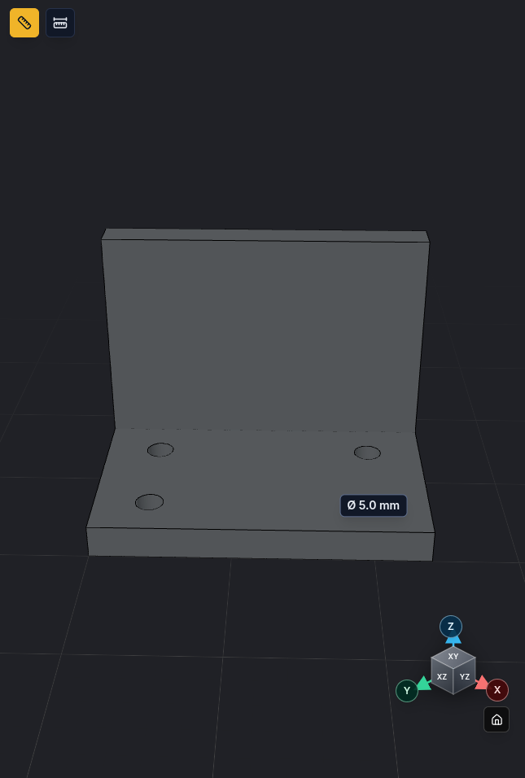
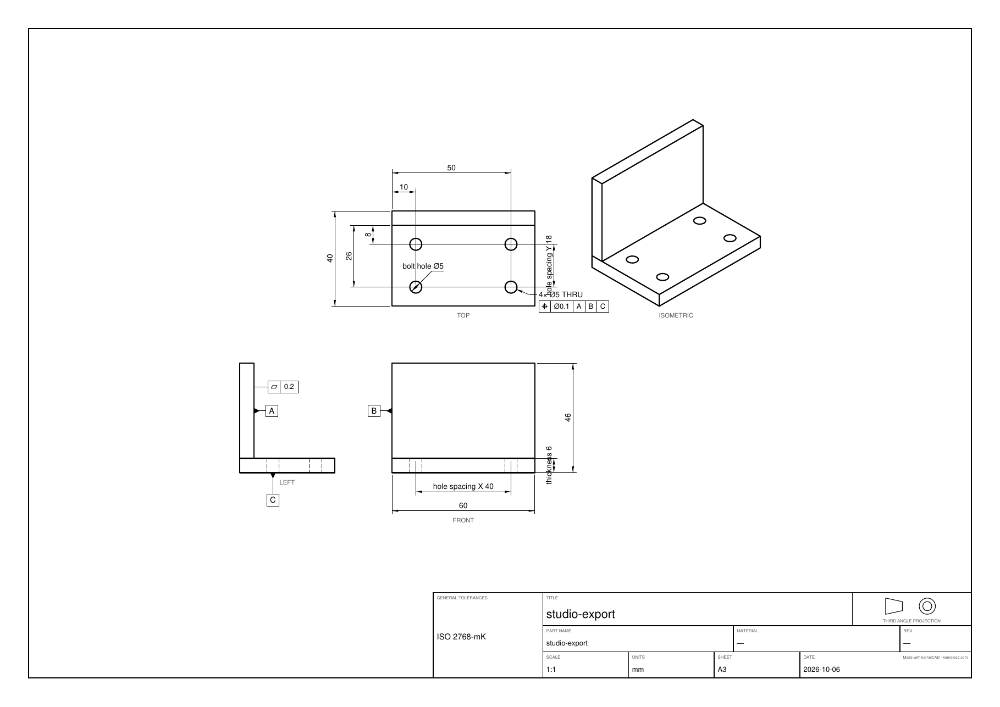

<!-- The blog post for this feature, built by site/scripts/build-blog.ts. The full reference is docs/guide/dimensions-measure-drawings-reference.md. -->

You can now read the size of a part straight off the 3D view, measure anything you click, and download a dimensioned drawing as a PDF.

## Dimensions on the model

There is a new button next to Measure, top-left of the viewer. Press it and kernelCAD draws the overall size, the holes ("2× Ø5"), the spacing between holes, radii ("12× R3") and chamfers. It works in Studio, on shared project pages and in the ChatGPT viewer.

 and overall size (grey).")

It is off by default, so the view stays clean. If the model declares its own dimensions, it starts on.

Declared dimensions are blue. Automatic ones are grey. Big assemblies show overall size only, to keep the picture readable.

## Measure

Click the ruler, click two points. You get the distance and the difference along X, Y and Z. It snaps to corners, edges and faces. Click once on a round edge and you get its diameter. Esc clears it.



## Say which dimensions matter

Automatic dimensions are a good start. The ones that matter are the ones you pick, so you can declare them in the script:

```ts
bracket = bracket
  .dimension({ kind: 'linear', from: hole(10, 8), to: hole(50, 8), label: 'hole spacing X' })
  .dimension({ kind: 'diameter', edge: hole(10, 8).edge, label: 'bolt hole' });
```

The viewer shows "hole spacing X 40" and "bolt hole Ø5". A circular edge as an anchor means the hole centre, so you get centre-to-centre distances. You can open the full mounting bracket and try it.

An agent can do the same, and `evaluate_script` returns the values, so it can check its own numbers.

## Drawings

On a shared project page, the Download dropdown now has "Drawing (PDF)". Studio has "Export Drawing (PDF)" in the export menu and command palette. You get an A3 sheet with the dimensions on it. If you declared dimensions, those are on the sheet instead of the plain bounding box sizes.



## Try it

[Open the mounting bracket example](https://app.kernelcad.com/p/C3RFHCzF?version=1&dims=1), or add `?dims=1` to any project link. Models saved earlier show only the overall size until you republish them.

See the [docs](/docs/) for the full API.
