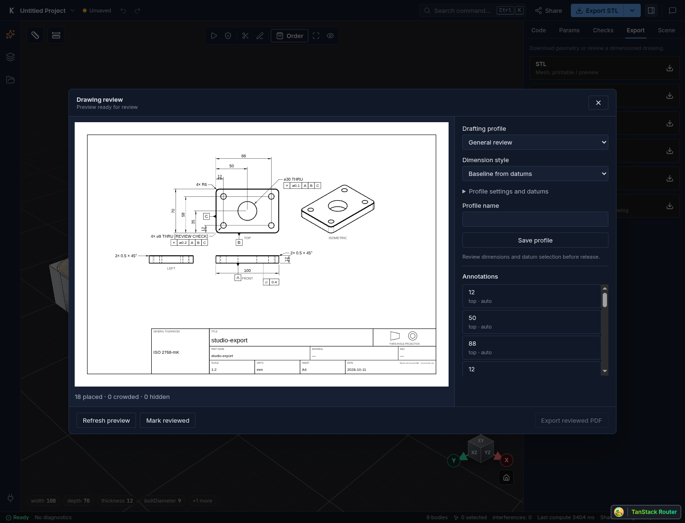
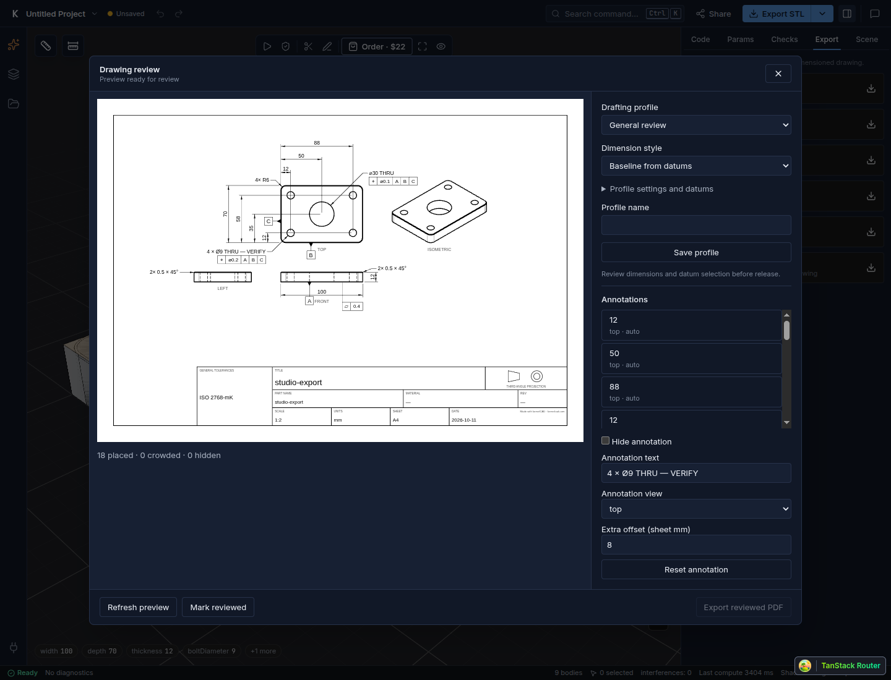

Choose how dimensions appear, tidy up a label, and download your drawing. Here is the whole workflow in Studio.

## 1. Open the drawing

[Open the mounting plate in Studio](https://app.kernelcad.com/p/12HP6xje?version=2&view=studio), or use your own part. In the right-hand **Export** tab, click **Drawing (PDF)**, then **Generate preview**.

## 2. Choose a style

Use **Dimension style**, then **Refresh preview**. These three drawings show the same mounting plate.

[Baseline PDF](/blog/drafting-review/mounting-plate-baseline.pdf) · [Chain PDF](/blog/drafting-review/mounting-plate-chain.pdf) · [Symmetry PDF](/blog/drafting-review/mounting-plate-symmetry.pdf)

## 3. Tidy up a callout

Click a label in **Annotations**. Edit **Annotation text**, use **Extra offset (sheet mm)** to give it more room, or tick **Hide annotation**. Click **Refresh preview** to see the change.

## 4. Download

Check the sheet, click **Mark reviewed**, then **Export reviewed PDF**. If you change the part or drawing settings, review the new preview again.

Want the same paper size and style next time? Enter a **Profile name** and click **Save profile**.

[Watch the Studio walkthrough](/blog/drafting-review/walkthrough.mp4). The video and Studio screenshots show a local walkthrough. These example parts have not been manufactured or tested.
