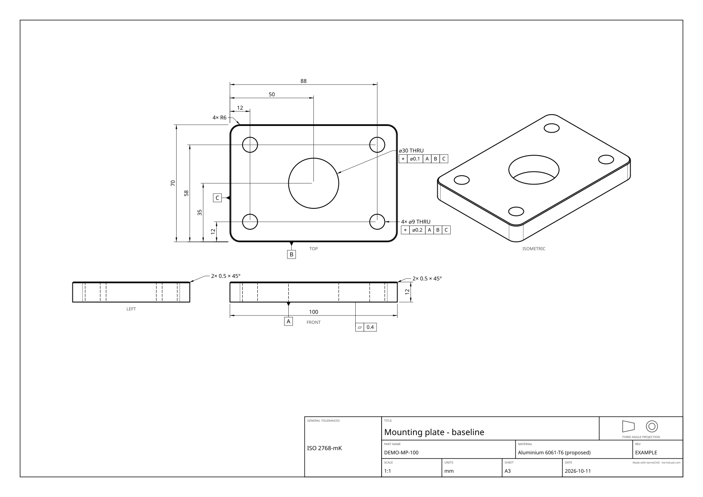
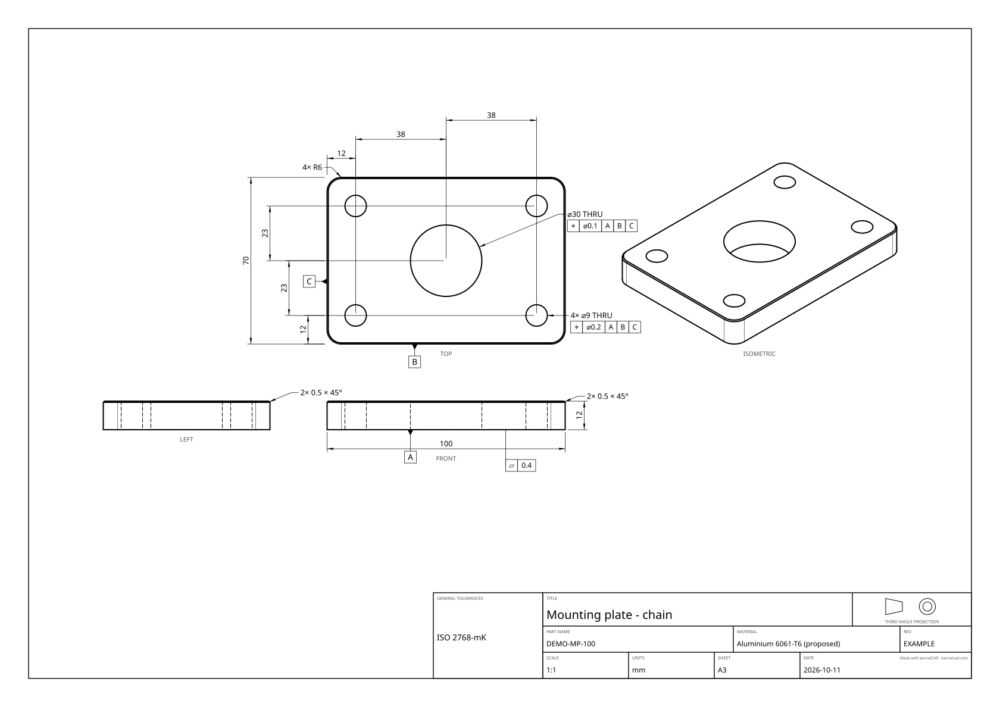
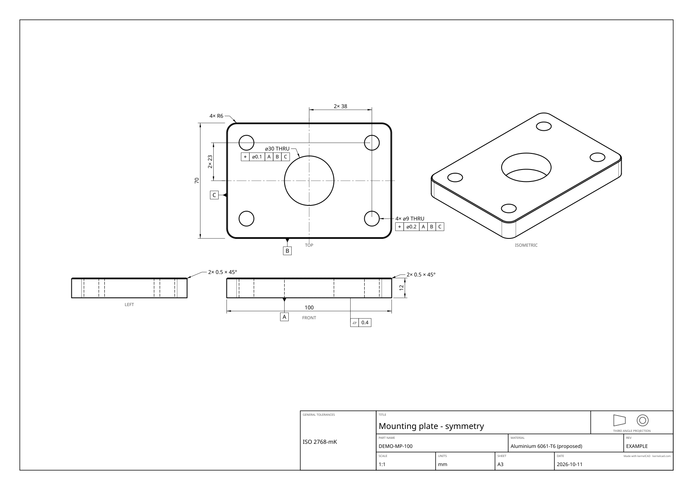
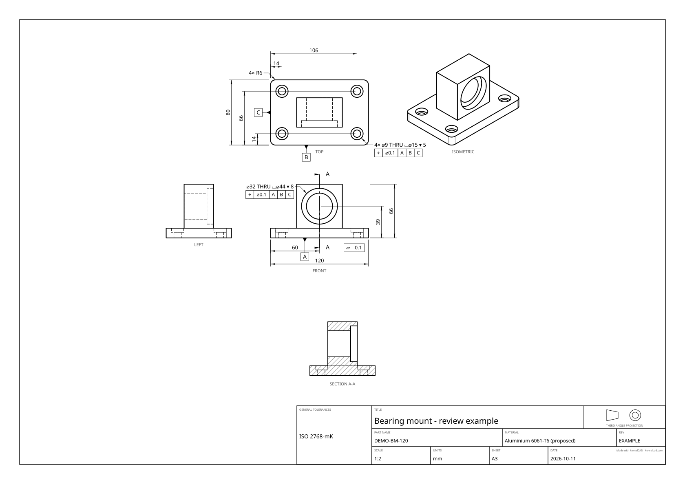

A drawing communicates how a part is made and inspected. Generating a sheet is the beginning of that work: a geometric feature recogniser does not know the mating part, the intended fit, the setup, or the inspection method.

This worked tutorial includes editable source, vector SVG and PDF sheets, PNG previews and reports. Its mounting plate and bearing mount are illustrative designs. They have not been manufactured, load-tested or approved for release. The video records the local Studio preview, annotation edit, refresh, review and PDF export workflow.

## Reproduce the examples

From a checkout with dependencies installed:

```bash
npx tsx examples/drafting-review/run.ts
npm run site:build-blog
```

The first command rebuilds this tutorial's drawing assets under `site/blog/drafting-review/`. The second generates the blog page and index from this guide and copies the recorded Studio video. The manifest records source hashes, options and files. The same mounting plate is exported in three styles; the bearing mount also gets a section and a saved annotation review. Edit `.kcad.ts` source and rerun the command. Do not edit generated SVG paths or PDF content.

The mounting plate is 100 × 70 × 12 mm, with a nominal 30 mm central bore, four 9 mm through holes at X 12/88 and Y 12/58, R6 corners and a real 0.5 mm top-edge chamfer. Datum A is the underside; B and C are the front and left side planes. The source's position tolerance of 0.2 mm is an illustrative declared requirement, not a fit derived from an M8 screw or a manufacturing capability.

[Download mounting-plate source](/blog/drafting-review/mounting-plate.kcad.ts) · [generation manifest](/blog/drafting-review/manifest.json)

## Choose a dimensioning style

These options require a checkout containing this change, or a matching installed release. To use the checkout's CLI, build it first:

```bash
npm run build:cli
node dist/cli/index.js export pdf-drawing \
  examples/drafting-review/mounting-plate.kcad.ts -o plate.pdf \
  --options '{"draftingProfile":"machining","autoAnnotate":{"dimensioningStyle":"baseline"}}'
```

Use `autoAnnotate.dimensioningStyle`:

- `baseline`: measure each unique hole coordinate from a common datum-side origin. Use this to communicate where the feature lies in the setup or inspection frame.
- `chain`: join consecutive unique coordinates with separate dimensions. Use this to communicate local spacing between adjacent features.
- `symmetry`: use centreline-based offsets for symmetric locations; asymmetric sets fall back to baseline. Use this when matching features are intentionally mirrored about the midpoint.

For this plate, baseline X coordinates are 12, 50 and 88; chain spans are 12, 38 and 38; symmetry has a 38 mm X offset and 23 mm Y offset about the centre. These are alternative presentations of the same geometry. A chain of toleranced lengths can accumulate variation, while baseline measurements relate each feature to the same origin. The exporter chooses a presentation, not a tolerance strategy.

### Baseline: one origin for each coordinate



[Full-size SVG](/blog/drafting-review/mounting-plate-baseline.svg) · [vector PDF](/blog/drafting-review/mounting-plate-baseline.pdf) · [annotation report](/blog/drafting-review/mounting-plate-baseline.report.json)

### Chain: successive local spacings



[Full-size SVG](/blog/drafting-review/mounting-plate-chain.svg) · [vector PDF](/blog/drafting-review/mounting-plate-chain.pdf) · [annotation report](/blog/drafting-review/mounting-plate-chain.report.json)

### Symmetry: offsets about the midpoint



[Full-size SVG](/blog/drafting-review/mounting-plate-symmetry.svg) · [vector PDF](/blog/drafting-review/mounting-plate-symmetry.pdf) · [annotation report](/blog/drafting-review/mounting-plate-symmetry.report.json)

## Drafting profiles

`draftingProfile` accepts `general`, `machining`, `sheet-metal`, or a JSON object. Built-ins set sheet size, projection and style. General uses A4, third angle and baseline; machining uses A3, third angle and baseline; sheet metal uses A3, third angle and chain.

```json
{
  "draftingProfile": {
    "id": "shop-review",
    "name": "Shop review",
    "sheet": "a3",
    "projection": "third",
    "dimensioningStyle": "baseline",
    "tolerance": "ISO2768-m",
    "notes": ["Check bearing fit and mounting interfaces before release."]
  }
}
```

Explicit export settings override profile defaults. Profiles are preferences. Their notes provide human review guidance; they are not automatically printed fabrication notes. A sheet-metal profile does not calculate a flat pattern, bend allowance or bend table.

## Review the sheet in Studio

In Studio, open the inspector's **Export** tab and choose **Drawing (PDF)** to open Drawing review. Start with **Generate preview** so the annotation list and sheet come from the same export. The header's Export menu and the command palette export directly using the saved project drafting preferences; use the inspector dialog to edit and review those choices first.

1. Choose a drafting profile and dimension style. Under **Profile settings and datums**, adjust sheet size, first/third-angle projection and the general-tolerance class. Datum face queries are JSON; **Apply datums** validates them. A declared datum in source remains the source of design intent.
2. Select a row in **Annotations**. **Hide annotation** controls whether it appears; **Annotation text** edits its primary label; **Annotation view** moves it to front, top, left or iso; **Extra offset (sheet mm)** adds space to the dimension line or leader. Datum and tolerance symbols have no editable text field: change their declarations. **Reset annotation** removes that row's edits.
3. Press **Refresh preview** after an edit. The placed, crowded and hidden counts are review aids. Inspect the full sheet, including hidden lines and tolerance frames. Saving a preference does not mean the drawing is reviewed.
4. When the current preview is acceptable, press **Mark reviewed**, then **Export reviewed PDF**. Changing source, profile or annotations invalidates that review; generate and review the current preview again.
5. To reuse your preferences, enter a **Profile name** and press **Save profile**. Saved profiles live in this browser. They can carry sheet, projection, style, tolerance preference and human review notes; they do not carry another part's annotation edits.

Annotation edits and datum overrides are bound to the exact source fingerprint. After a source change, the dialog withholds those saved overrides and asks for a new review. If a geometry or style change removes an annotation ID, the dialog lists the missing overrides; **Clear missing overrides** removes them. Do not assume a reviewed old sheet describes the edited part.

## Declare design intent

```ts
return part
  .datum('A', { atZ: 0 })
  .datum('B', { atY: 0, near: [50, 0, 6] })
  .datum('C', { atX: 0, near: [0, 35, 6] })
  .tolerance({
    type: 'position', value: 0.2, modifier: '⌀',
    datums: ['A', 'B', 'C'],
    edge: { ofCurveType: 'CIRCLE', near: [12, 12, 12] },
  });
```

`datum()` and `tolerance()` capture declarations; they do not change the solid. Queries must resolve to one feature. The `near` disambiguator selects the intended side plane after edge finishing creates adjacent faces. Inspect every declaration when geometry changes.

Automatic annotations can suggest datums and add general-tolerance notes and frames. Treat them as proposals. ISO general dimensional tolerances are not a substitute for a deliberately specified positional tolerance or bearing fit. The examples retain these proposals so their review status remains visible.

## Review annotations by ID

Export with `--json` and read `drawingReport.annotations`. Each annotation carries `id`, `source`, `kind`, `view`, `text` and `overlapped`; edited text also records `originalText`. The report includes placed, overlapping and suppressed counts. IDs identify the annotation's geometry or semantic role, so do not replace them with row numbers.

```json
{
  "annotationOverrides": {
    "auto:overall:x": { "suppress": true },
    "<id copied from the current hole report>": {
      "text": "4× ⌀9 THRU ⌴⌀15 ▾ 5",
      "view": "top",
      "offset": 8
    }
  }
}
```

The placeholder above must be replaced by a real ID. Hole-label edits replace the primary label and retain attached feature-control frames. Reviewed dimension labels also retain their declared dimensional tolerances. The report's optional `primaryText` separates the editable label from a tolerance suffix. Suppression removes the annotation from placement. A stale ID warns instead of quietly editing a different annotation. The source remains the place to change geometry, datum selection and tolerance values.

The bearing mount demonstrates an actual edit: automatic recognition reports counterbore depths 5.01 and 8.01 mm because the B-rep contains the hole tool's 0.01 mm boolean allowance. The source specifies nominal depths 5 and 8. The generator finds the current hole IDs and restores those source nominal labels, saves the before/after decisions in `bearing-mount-review.json`, and exports again. It does not round arbitrary measurements or change the solid.

[Unreviewed sheet](/blog/drafting-review/bearing-mount-unreviewed.svg) · [saved review decisions](/blog/drafting-review/bearing-mount-review.json)

## Sections and acceptance

The bearing mount has a 120 × 80 × 12 base, a connected 56 × 36 × 54 pedestal, a 32 mm through throat and a nominal 44 × 8 mm front seat. A YZ section at X 60 exposes the counterbore shoulder and through passage. This example uses an axis-aligned section; explicit oblique planes are also supported through an auxiliary view. Sections cut real geometry and hatch material rather than clipping only the picture.



[Full-size SVG](/blog/drafting-review/bearing-mount.svg) · [vector PDF](/blog/drafting-review/bearing-mount.pdf) · [editable source](/blog/drafting-review/bearing-mount.kcad.ts) · [annotation report](/blog/drafting-review/bearing-mount.report.json)

Before releasing a drawing, check the datum setup, every hole count and depth, all required interface dimensions, the tolerance meaning, section geometry, units, projection, scale, material and revision. Inspect the full-size PDF and SVG visually even when the overlap count is zero. Check the source geometry separately. Physical fit, strength, manufacturing capability and inspection acceptance require their own evidence.
