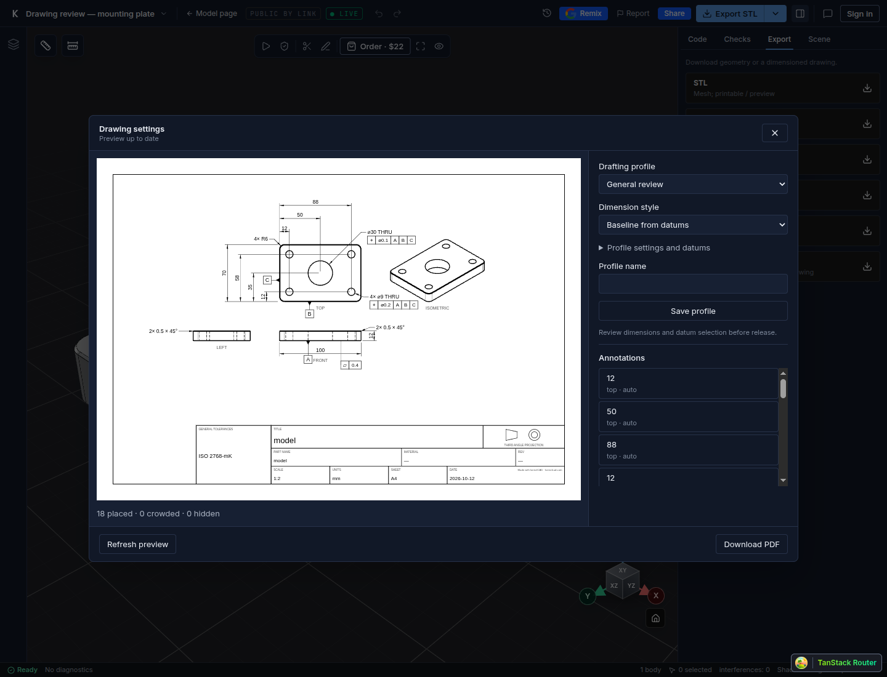
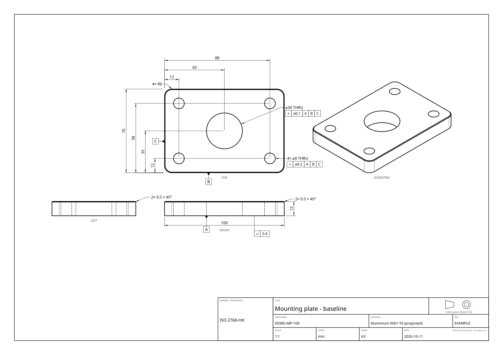
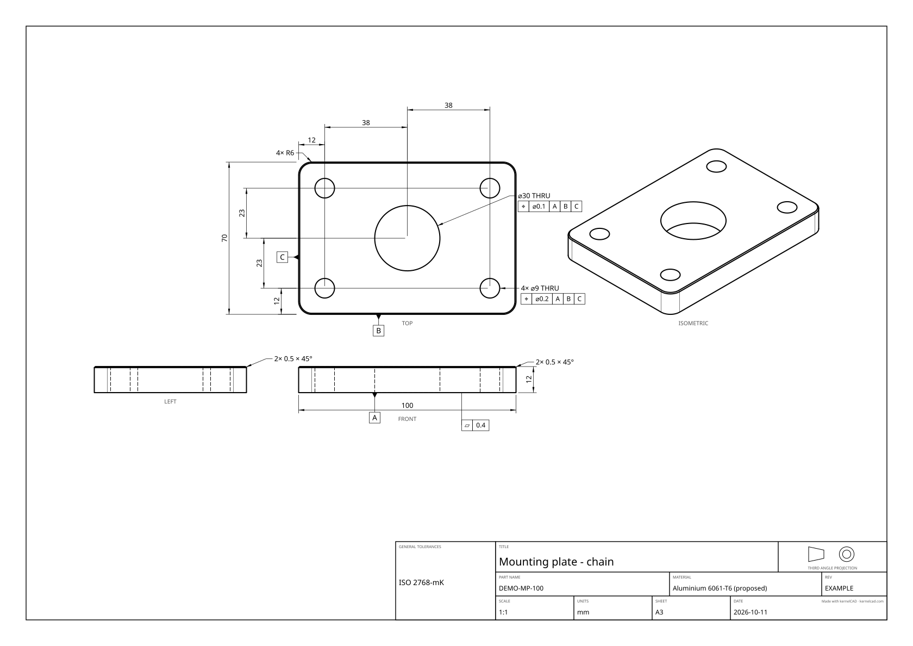
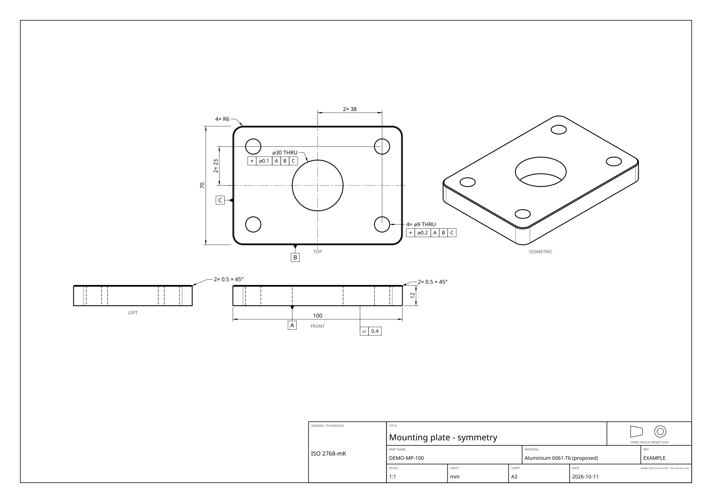
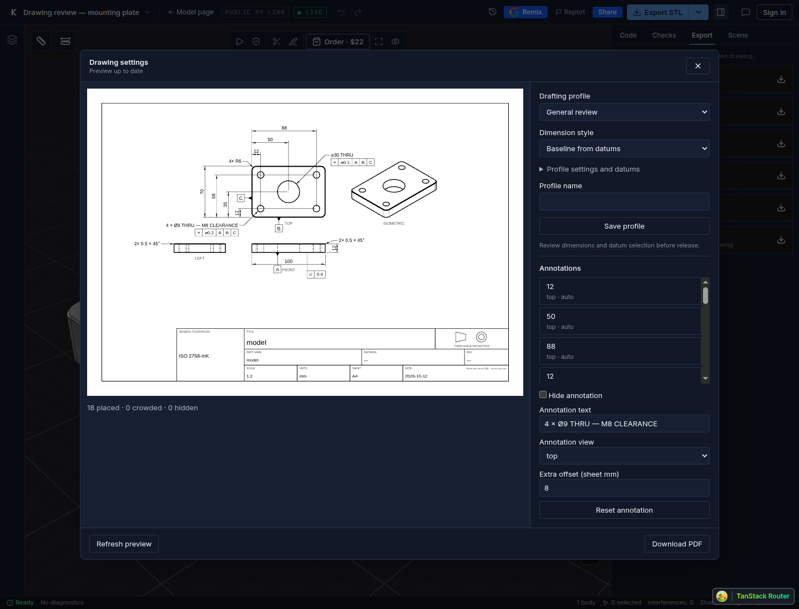

Click **Drawing (PDF)** to download your drawing. Want a different layout or label? Open the optional **Drawing settings**.

## 1. Download the drawing

[Open the mounting plate in Studio](https://app.kernelcad.com/p/12HP6xje?version=2&view=studio), or use your own part. In the right-hand **Export** tab, click **Drawing (PDF)**. Your PDF downloads directly.



## 2. Choose a style

In **Drawing settings**, click **Generate preview**. Use **Dimension style**, then **Refresh preview**. These three drawings show the same mounting plate.







[Baseline PDF](/blog/drafting-review/mounting-plate-baseline.pdf) · [Chain PDF](/blog/drafting-review/mounting-plate-chain.pdf) · [Symmetry PDF](/blog/drafting-review/mounting-plate-symmetry.pdf)

## 3. Tidy up a callout

Click a label in **Annotations**. Edit **Annotation text**, use **Extra offset (sheet mm)** to give it more room, or tick **Hide annotation**. Click **Refresh preview** to see the change.



## 4. Download your changes

Click **Download PDF**. It uses your current settings; refreshing the preview is optional.

Want the same paper size and style next time? Enter a **Profile name** and click **Save profile**.

Using an AI assistant? Ask: “Export this mounting plate as a PDF drawing with baseline dimensions.” Your assistant returns a PDF download link through MCP.

## Optional automatic drawing QA for agent exports

The existing MCP `export` action can check the finished SVG and vector PDF,
then retry a crowded layout without changing the CAD model:

```json
{
  "target": "model",
  "file": "fixture.kcad.ts",
  "format": "pdf-drawing",
  "output_path": "/tmp/fixture.pdf",
  "options": {
    "format": "pdf-drawing",
    "sheet": "a4",
    "visualQa": { "autoRepair": true, "maxAttempts": 3 }
  }
}
```

The response includes `drawing_report.visualQa`, with detected sheet issues,
attempted repairs and PDF readback evidence. An agent can adjust annotation
placement or choose a larger standard sheet only when measured defects decrease.
It does not invent dimensions, tolerances or manufacturing requirements.

**A successful PDF export is not engineering approval.** A drawing without
declared critical requirements remains `incomplete`. Check and approve the
part interfaces, material, fit and manufacturing process before fabrication.
The [reproducible PDF QA demonstration](../../docs/demos/drawing-visual-qa/README.md)
shows an A4 clipping failure and an accepted A3 layout repair on a real export.

[Watch the Studio walkthrough](/blog/drafting-review/one-click.mp4). The video and Studio screenshots show a local walkthrough. These example parts have not been manufactured or tested.
