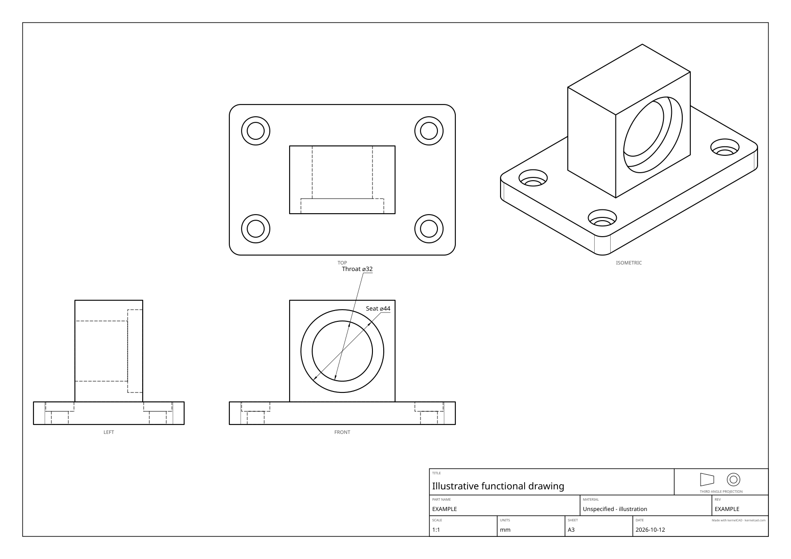
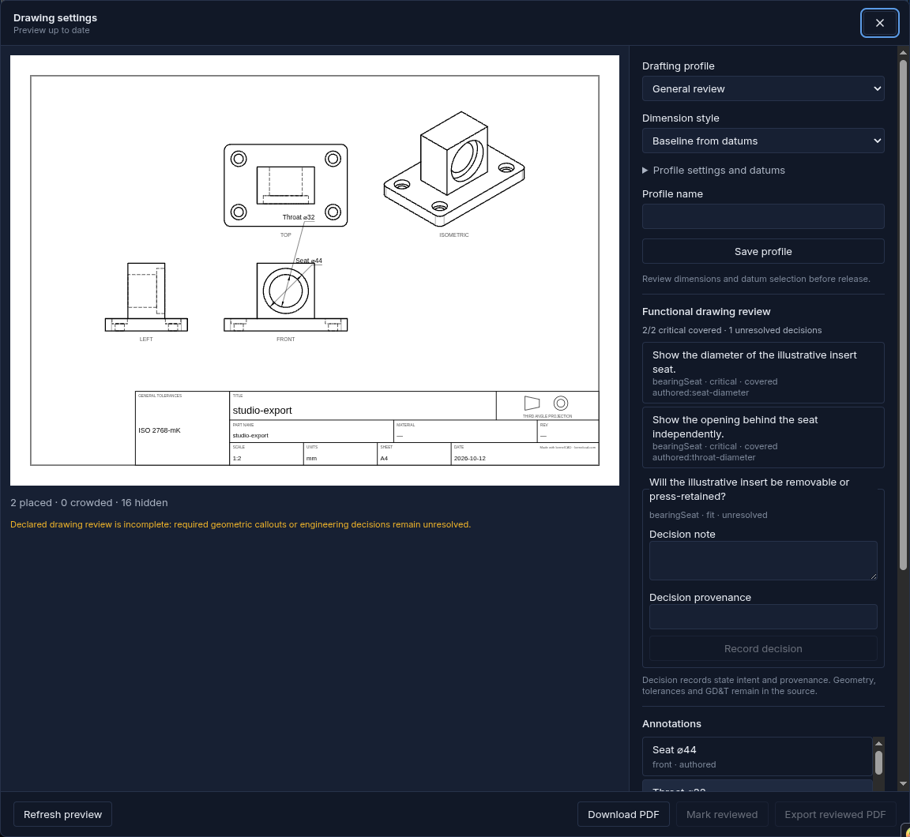
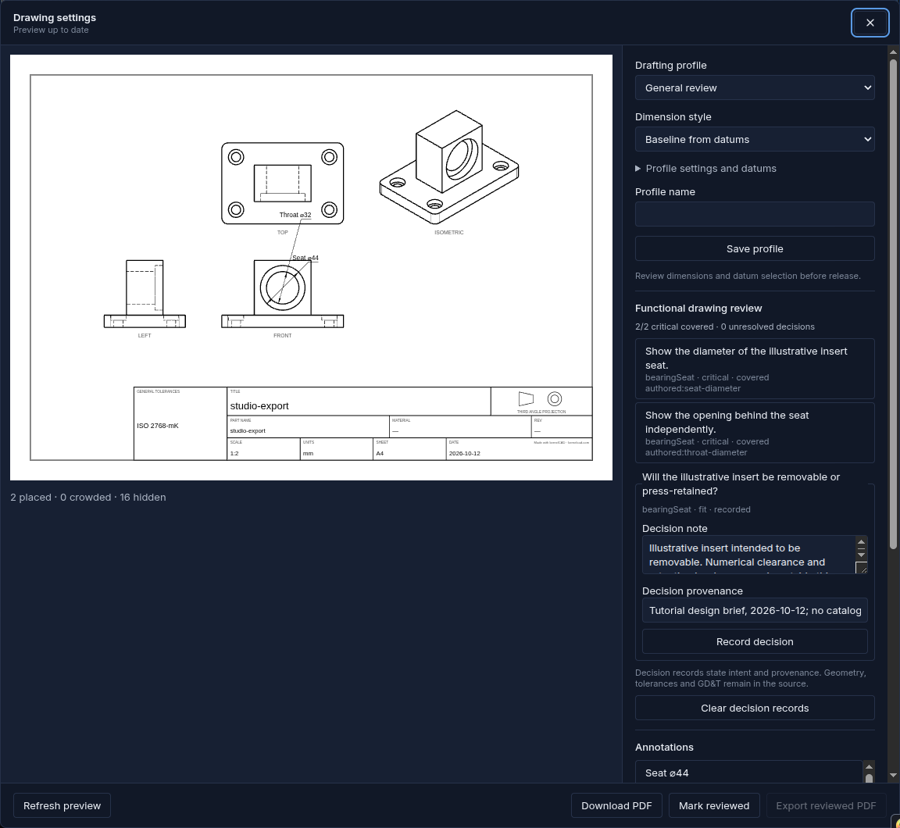

A measured bore diameter does not explain whether an insert should slide out for servicing or stay retained in its seat. kernelCAD drawing plans can keep that unresolved decision visible until a reviewer records both the intended choice and where it came from.

## A seat with an open question

This illustrative mount has a 120 × 80 × 12 mm base with R6 corners, four Ø9 mounting holes and Ø15 × 5 mm nominal counterbores. A 56 × 36 × 54 mm pedestal starts at (32, 22, 12). Its horizontal axis lies at Z = 39 mm. A nominal Ø44 × 8 mm seat opens at the front, with a Ø32 throat through the pedestal's 36 mm depth.

There is no purchased bearing or catalog fit in this exercise. The brief requires the measured Ø44 seat, measured Ø32 throat and a recorded answer to one question: “Will the illustrative insert be removable or press-retained?” It does not specify a production insert, numerical clearance, retention hardware, tolerance or GD&T.



## Select the seat, not its neighbour

[Download the complete editable source](/blog/drawing-decisions/bearing-seat.kcad.ts) and run it in the current Studio. The source reuses the tutorial geometry and removes its unrelated datum/tolerance declarations to keep the review exercise focused.

The concentric bore contains several circular edges. A nearby point alone can select the throat depending on edge orientation. Restricting the seat query to the actual front entry plane makes the intent explicit. The exported computed label is independently checked as Ø44; the throat is checked as Ø32.

```ts
.dimension({
  id: 'seat-diameter', kind: 'diameter',
  edge: {
    ofCurveType: 'CIRCLE', atY: 22, tolerance: 0.001,
    near: [82, 22, 39],
  },
  label: 'Seat',
})
```

`tolerance: 0.001` here is a query-selection tolerance, not a manufacturing tolerance. The selector constrains the front plane. It does not change the solid, prescribe a fit class or claim that all parameter edits preserve the selector.

## Declare the question in the source

The full source plan has two critical diameter requirements and this decision:

```ts
.drawingReview({
  id: 'bearing-mount',
  requirements: [/* exact authored seat/throat IDs in the full source */],
  decisions: [{
    id: 'insert-retention', kind: 'fit', featureId: 'bearingSeat',
    prompt: 'Will the illustrative insert be removable or press-retained?',
  }],
})
```

The initial report shows 2/2 critical callouts covered and one unresolved decision. Review completeness requires both coverage and a resolution for every declared decision. Decision records have a note and provenance; both must be nonempty. A record is an explanation of engineering intent, not an automatic engineering conclusion.



## Record, refresh, review and export

Open **Export → Drawing settings**, then **Generate preview**. For this tutorial sheet, hide automatic annotation rows outside the declared scope. The captured receipt identifies the real report rows and why they were hidden. Select the throat requirement and give its **Extra offset (sheet mm)** 20 mm to separate the two concentric-diameter labels.

In **Functional drawing review**, fill **Decision note** with:

“Illustrative insert intended to be removable. Numerical clearance and retention hardware remain outside this exercise.”

Fill **Decision provenance** with:

“Tutorial design brief, 2026-10-12; no catalog or physical fit verification.”

Click **Record decision**. An edited draft alone does not resolve the decision. Recording it changes the options, so the preview needs another **Refresh preview**. The new report shows 2/2 critical covered and zero unresolved decisions. Inspect the sheet, click **Mark reviewed**, then **Export reviewed PDF**.



Changing source or drafting criteria invalidates the current preview and withholds stale source-bound choices. **Reset source-bound choices** clears those choices for the new source. **Clear decision records** removes stored resolutions; **Clear missing decisions** removes records whose declared keys no longer exist. Draft edits also reset the human review mark. Refresh and review the current result before strict export.

## Use the same record through the export API

Decision overrides use a key formed by encoding each ID separately and joining them with a colon. In this example it is `bearing-mount:insert-retention`; the shared `drawingDecisionKey(planId, decisionId)` helper produces it without namespace collisions.

```ts
{
  decisionResolutions: {
    'bearing-mount:insert-retention': {
      note: 'Illustrative insert intended to be removable. Numerical clearance and retention hardware remain outside this exercise.',
      provenance: 'Tutorial design brief, 2026-10-12; no catalog or physical fit verification.',
    },
  },
  requireCompleteReview: true,
}
```

Pending ordinary SVG/PDF exports retain the incomplete report and warning. Pending strict exports refuse bytes. Resolved strict exports emit actual PDF bytes when the measured critical labels also pass. The record does not cut material, create a tolerance, add GD&T or certify a numerical fit. Producing a production fit would require a separately chosen component and specification in the source, followed by appropriate engineering and physical acceptance.

The recorded Studio sheet prints **ISO2768-mK** in its general-tolerances cell as an inherited exporter default. The tutorial does not select or approve that default as engineering acceptance. The authored-only generator sheets omit it. Review completeness does not approve a printed tolerance label.

## Reproduce the two outcomes

Use the current Studio or a source checkout with Node 22 and installed dependencies:

```sh
npm run build:cli
npx tsx examples/functional-drafting/run.ts
```

No release tag was cut for this walkthrough; do not assume the latest npm package contains these methods. The generator verifies one valid connected solid, exact 120 × 80 × 66 mm bounding box, analytical volume and real bore/counterbore dimensions before checking review status. The hole recognizer measures 8.01 mm seat depth and 5.01 mm mounting counterbore depths because the boolean cutters include a 0.01 mm allowance. This exercise leaves those noncritical depth callouts out of the minimal sheet and never replaces a critical computed number with typed text.

Pending and resolved options use the same source geometry. Their drawing reports match between printable SVG and PDF. The PNG drawings show the same front-seat rings and throat; only the recorded review decision changes. This proves the declared example scope, not manufacturing completeness or physical acceptance.

[Pending SVG](/blog/drawing-decisions/bearing-pending.svg) · [Pending PDF](/blog/drawing-decisions/bearing-pending.pdf) · [Pending settings](/blog/drawing-decisions/bearing-pending.options.json) · [Pending report](/blog/drawing-decisions/bearing-pending.report.json)

[Resolved SVG](/blog/drawing-decisions/bearing-resolved.svg) · [Resolved PDF](/blog/drawing-decisions/bearing-resolved.pdf) · [Strict resolved PDF](/blog/drawing-decisions/bearing-resolved.strict.pdf) · [Resolved settings](/blog/drawing-decisions/bearing-resolved.options.json) · [Resolved report](/blog/drawing-decisions/bearing-resolved.report.json) · [Geometry evidence](/blog/drawing-decisions/bearing-seat.geometry.json) · [SHA-256 manifest](/blog/drawing-decisions/manifest.json)

[Actual Studio reviewed PDF](/blog/drawing-decisions/reviewed-bearing.pdf) · [Studio request settings and reports](/blog/drawing-decisions/studio-evidence.json) · [Capture receipt](/blog/drawing-decisions/studio-receipt.json)

The generated downloadable sheets use a minimal authored-only layout; the Studio capture retains its actual automatic-row suppression settings and HTTP/PDF evidence separately. For missing or hidden callouts, follow [the fixture-plate walkthrough](/blog/functional-drafting/). The existing [one-click drawing download](/blog/drafting-review/) remains available when no declared review is needed.
