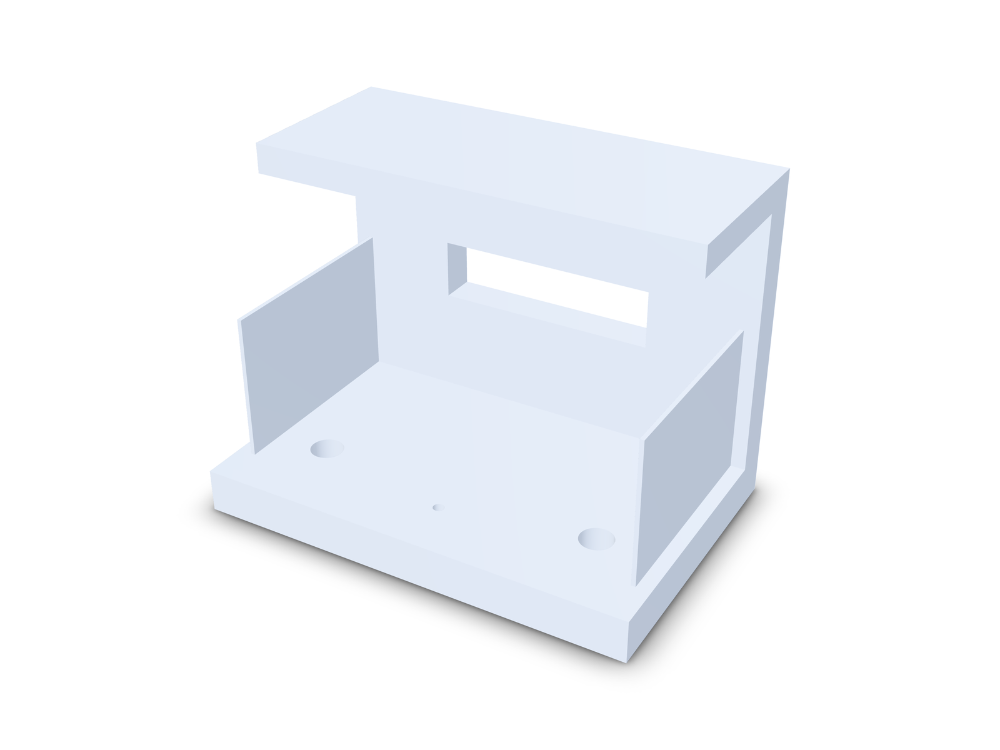
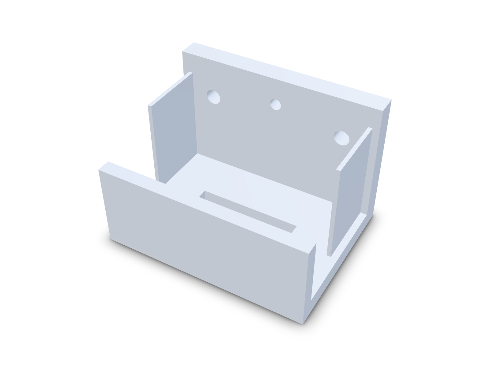

The core FDM design rules are short. Keep unsupported overhangs at 45° from vertical or less. Keep flat bridges to about 10 mm, and under 5 mm if the underside has to look clean. Make walls a whole multiple of the nozzle width and at least two nozzle widths thick, so 0.8 mm for a 0.4 mm nozzle. Keep holes at 2 mm or larger, and expect vertical holes to print a little small. Then choose the print orientation that leaves the fewest faces hanging in the air.

Many failed prints break one of these rules, and you usually find out in the slicer preview, after the model is finished. Every fix then means back to CAD, export again, print again. This guide gives the sourced numbers and shows a real bracket going from four failed checks to a clean pass.

## Contents

1. [Rules at a glance](#rules-at-a-glance)
2. [Overhangs](#1-overhangs)
3. [Bridges](#2-bridges)
4. [Wall thickness](#3-wall-thickness)
5. [Holes and pins](#4-holes-and-pins)
6. [First layer and elephant's foot](#5-first-layer-and-elephants-foot)
7. [Print orientation](#6-print-orientation)
8. [Worked example: a bracket from fail to pass](#7-worked-example-a-bracket-from-fail-to-pass)
9. [Key takeaways](#key-takeaways)
10. [FAQ](#faq)

## Rules at a glance

| Rule | Typical value | Why |
| --- | --- | --- |
| Unsupported overhang | 45° from vertical or less | Each layer needs about half its width resting on the layer below |
| Flat bridge | Up to 10 mm. Under 5 mm for a clean underside | Strands stretched between two supports sag as the span grows |
| Wall thickness | At least 2 × nozzle, in whole multiples (0.8, 1.2, 1.6 mm at 0.4 mm) | The slicer fills walls with whole perimeters. Odd widths leave gaps or get dropped |
| Minimum hole | 2 mm | Smaller holes close up or come out badly undersized |
| Vertical hole size | Prints undersized. Compensate or drill | Each perimeter is pulled slightly inward as it goes round |
| Horizontal hole | Teardrop with a 45° roof, or turn the part | A round roof is a flat overhang at its very top |
| Vertical pin | 5 mm or more for strength | Thinner pins print as perimeters only, with no infill |
| Bed edges | 45° chamfer or a radius | Stops elephant's foot and helps the part come off the bed |

These are starting points; material, layer height and printer move them. Sources are linked in each section.

## 1. Overhangs

An overhang is a face that points down and leans out past the layer below it. Most guides put the limit at about **45° from vertical**. Above that, the face needs support material or a different design ([Hubs](https://www.hubs.com/knowledge-base/how-design-parts-fdm-3d-printing/), [Xometry](https://xometry.pro/en/?p=154421), [UZH design guideline](https://www.amf.uzh.ch/dam/jcr:fd1ee024-1a98-488b-89ec-ffd85befa786/Design-Guideline-FDM.pdf)). A flat ceiling is 90°, the worst case.

Fix it with a 45° chamfer, a gusset, or by rotating the part so the face points sideways. Supports work too, but cost material and time and leave a rough surface.

**How kernelCAD helps.** `dfm_review` finds every downward face steeper than your limit (45° by default, configurable). Each region comes back with its area, angle, reach and a selectable face reference, plus the fix in plain words, down to the exact rotation that removes the overhang ("Rotate -90° about X"), instead of a red patch in a slicer.

## 2. Bridges

A bridge is a flat span held up at both ends, such as the top of a window or a slot. The printer stretches strands across the gap and they sag a little. One guide lists **10 mm** as the longest unsupported bridge ([Xometry](https://xometry.pro/en/?p=154421)). Another says some sag or support marks show on any bridge **over 5 mm** ([Hubs](https://www.hubs.com/knowledge-base/how-design-parts-fdm-3d-printing/)). Use 10 mm as the hard limit and 5 mm when the underside is visible.

Shorten it with a mid-span rib, a pointed or arched top, or by turning the part so the opening runs vertically.

**How kernelCAD helps.** `fdm.bridging` measures every flat ceiling and fails any span over `max_bridge_mm` (10 mm by default), with its location, so you know where the rib goes before anything reaches the printer.

## 3. Wall thickness

The slicer builds a wall from whole perimeters, each about one nozzle width wide. Design walls as **whole multiples of the nozzle diameter**, and make them **at least twice the nozzle**. For a 0.4 mm nozzle that means 0.8 mm, 1.2 mm or 1.6 mm ([Pollen AM](https://pollen.am/design_guidelines_dimensioning/)). A 0.6 mm wall can vanish from the toolpath entirely. For walls that carry load, 1.5 mm is a common recommendation ([Xometry](https://xometry.pro/en/?p=154421)).

**How kernelCAD helps.** `fdm.min-wall` samples thickness over the whole part against 2 × `nozzle_mm` and returns every thin spot with an XYZ location. The model is a `.kcad.ts` source file, so the fix is usually one number, such as `ribT = 1.2`, and every rib follows.

## 4. Holes and pins

**Minimum size.** About **2.0 mm** is the smallest hole that prints reliably. Long holes and holes in thin walls need more ([UZH design guideline](https://www.amf.uzh.ch/dam/jcr:fd1ee024-1a98-488b-89ec-ffd85befa786/Design-Guideline-FDM.pdf)).

**Vertical holes print small.** Perimeters get pulled slightly inward, more so on small holes. When the size matters, print the hole a little small and drill it to size ([Hubs](https://www.hubs.com/knowledge-base/how-design-parts-fdm-3d-printing/)), or make it bigger in the model after a test print. One guide gives the example of adding about 0.2 mm to a 4 mm hole ([Pollen AM](https://pollen.am/design_for_3d_printing_holes)).

**Horizontal holes droop.** The top of a round horizontal hole is a short flat overhang, so it sags. A teardrop profile with a roof of 45° or steeper prints without support at almost any size, and holes up to about 8 mm usually print fine as plain circles ([Makerverse](https://www.makerverse.com/resources/the-fused-deposition-modeling-fdm-design-guide/)). You can also turn the part so the hole is vertical.

**Pins.** A vertical pin thinner than **5 mm** prints with perimeters only and no infill, which makes it weak. Add a small fillet at the base, or press a metal pin into a drilled hole instead ([Hubs](https://www.hubs.com/knowledge-base/how-design-parts-fdm-3d-printing/)).

**How kernelCAD helps.** `fdm.min-hole` flags any hole under 5 × nozzle (2 mm at 0.4 mm) with its diameter and location, and `fdm.min-pin` warns about slender pins. Horizontal hole roofs are reported as bridged spans with their length. Hole sizes live as constants in the source, so shrinkage compensation is a single edit.

## 5. First layer and elephant's foot

The first layer is pressed onto the bed, so it spreads slightly wider than the layers above. This lip is called elephant's foot. The usual design fix is a **45° chamfer or a small radius on every edge that touches the build plate** ([Hubs](https://www.hubs.com/knowledge-base/how-design-parts-fdm-3d-printing/)).

**How kernelCAD helps.** `fdm.bed-contact` reports contact area, footprint ratio and tip risk for the chosen orientation. A bed-edge chamfer is one feature in the source and survives every later change.

## 6. Print orientation

Orientation decides which faces become overhangs, which openings become bridges and which holes run horizontal. It also sets layer direction, and FDM parts are weakest between layers. Start with the largest flat face on the bed, check what is left hanging, and keep layers running along the main load.

**How kernelCAD helps.** `dfm_review` scores all six axis-aligned build directions. Each comes with unsupported area, bed contact, height, bed fit for your printer profile (for example `bambu-a1`, `prusa-mk4s`) and the code to apply, such as `.rotateX(-90)`. You choose from numbers instead of dragging the part around a slicer.

## 7. Worked example: a bracket from fail to pass

The model is a small shelf bracket. It has a 60 × 40 × 6 mm base with two Ø4.5 screw holes and a centre hole, a 40 mm upright, a 20 mm shelf lip at the top, a 30 × 8 mm cable window and two side ribs. The first draft has easy mistakes: 0.6 mm ribs, a Ø1.5 centre hole, and the part printed base-down as modelled.



`dfm_review({ processes: ['fdm'], printer: 'bambu-a1' })` on the first draft:

```
fdm.overhangs  fail  1200 mm² of unsupported overhang steeper than 45° in 1 region(s); add supports, reorient or chamfer.
fdm.bridging   fail  1 bridge(s) longer than 10 mm (longest 30 mm).
fdm.min-wall   fail  Walls as thin as 0.6 mm, below 2 × nozzle (0.8 mm).
fdm.min-hole   fail  1 hole(s) below the 2 mm minimum (smallest Ø1.5 mm); they print undersized or close up.
fdm.min-pin    pass  No pins below the robust minimum diameter.
fdm.bed-fit    pass  Fits the 'bambu-a1' bed (60 x 40 x 46 mm).
fdm.bed-contact pass Bed contact is adequate.
```

The overhang is the lip's underside, `@kc[boolean_2/face/bottom]`, "90.0° from vertical, reaching 20.0 mm past its nearest support". The thin walls come back at four XYZ points on the two ribs. The hint gives the fix: "Rotate -90° about X (.rotateX(-90), or dfmSpec buildDirection: '-y'): unsupported area drops from 1350.0 to 0.0 mm²." The orientation ranking agrees, with `-y` first, 0 mm² unsupported and `apply: ".rotateX(-90)"`.

The fix is three edits in `examples/gallery/fdm-bracket.kcad.ts`:

```ts
const smallHole = FIXED ? 3.4 : 1.5; // M3 clearance instead of a pilot hole
const ribT = FIXED ? 1.2 : 0.6;      // 3 × 0.4 mm nozzle
return FIXED ? bracket.rotateX(-90) : bracket; // the ranking's apply string
```

With the back of the upright on the bed, the lip becomes a vertical wall and the window a vertical slot.



```
fdm.overhangs  pass  No unsupported overhang steeper than 45°.
fdm.bridging   pass  All bridges within 10 mm.
fdm.min-wall   pass  Walls are at least 2 × nozzle (0.8 mm).
fdm.min-hole   pass  No holes below the printable minimum diameter.
fdm.min-pin    pass  No pins below the robust minimum diameter.
fdm.bed-fit    pass  Fits the 'bambu-a1' bed (60 x 46 x 40 mm).
fdm.bed-contact pass Bed contact is adequate.
```

Verdict: `pass`, thinnest wall 1.2 mm. The holes now run horizontally, and the review lists their roofs as bridged spans of 3.1 mm and 2.4 mm, inside the limit. All of this ran before any slicing. For other problems that surface too late, see [design engineering challenges](design-engineer-challenges.md).

## Key takeaways

- Keep overhangs at 45° from vertical or less. Chamfer, add a gusset or reorient before you reach for supports.
- Keep flat bridges to 10 mm, or 5 mm where the underside shows.
- Size walls in whole nozzle multiples, never under 2 × nozzle.
- Use 2 mm as the smallest hole. Plan for vertical holes printing small and horizontal holes drooping.
- Chamfer edges that touch the bed to stop elephant's foot.
- Choose orientation first. It often fixes several rules at once.
- Check before slicing, so one source edit replaces a reprint.

## FAQ

**What is the maximum overhang angle for FDM printing?**
About 45° from vertical without support. That is the safe design value.

**What is the maximum bridge length in 3D printing?**
About 10 mm is a common upper limit for an unsupported flat bridge. Spans under 5 mm show the least sag.

**What is the minimum wall thickness for FDM?**
Two nozzle widths: 0.8 mm for a 0.4 mm nozzle, in whole multiples, thicker for load.

**Why do 3D printed holes come out too small?**
Perimeters pull inward, most on small holes. Enlarge the hole after a test print, or drill to size.

**What is the best orientation for a 3D print?**
The one with the least unsupported area and a large flat face on the bed, with layers running along the main load. Score all six directions and pick from the numbers.

**Try kernelCAD free. Connect it to ChatGPT or Claude in a minute: https://app.kernelcad.com/connect**
