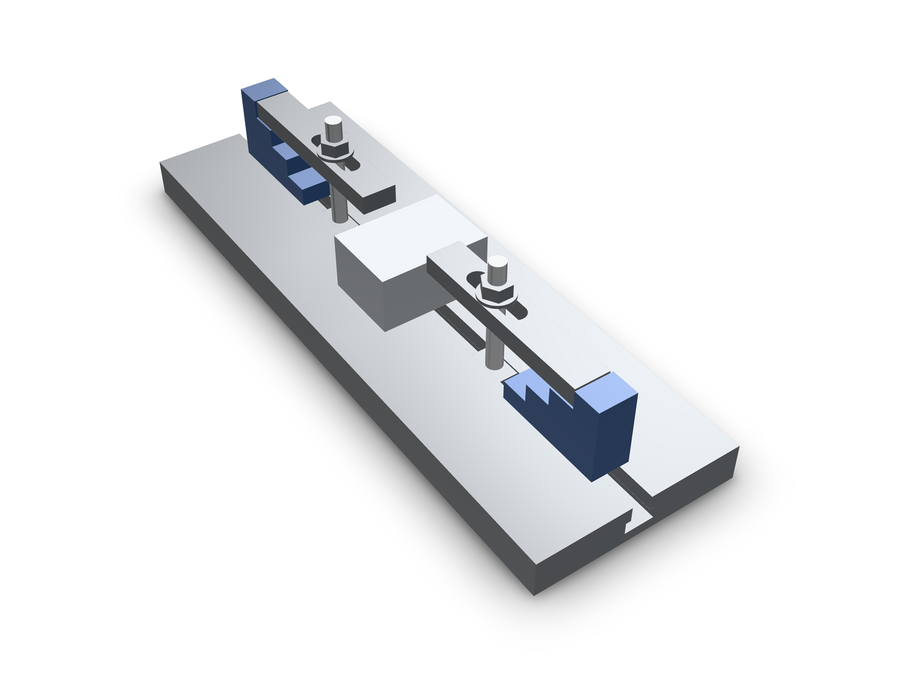
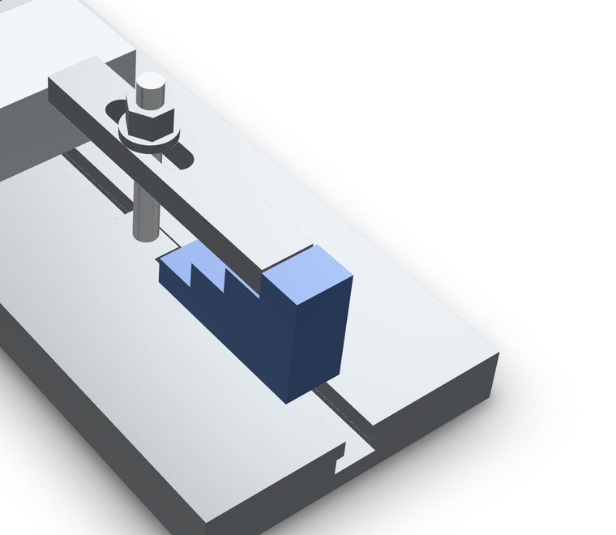

`lib.fixture.*` is the clamping kit for a T-slot machine table. Five
families, keyed by the thread the hardware uses (M8, M10, M12), each with
its stock dimensions and placement connectors. The solids are nominal
envelope values from the stock table, so a setup can be laid out and
checked before anything is bolted down.

## What is in the kit

- **`tSlotNut({ thread })`** — T-slot nut, DIN 508: slot 10 mm for M8,
  12 mm for M10, 14 mm for M12; heights 12/14/16 mm, head height 6/7/8 mm. The bore axis is +Z, the top face sits at
  z = 0 and the wide base hangs below it. Connectors: `mating-face`
  (the wing tops that pull against the slot), `top-face`, `thread-bore`.
- **`clampStud({ thread, lengthMm })`** — clamping stud, DIN 6379 form;
  stocked lengths 63 and 100 mm (M8), 80 and 125 mm (M10), 100 and 160 mm
  (M12). Connectors: `table-end`, `clamp-end`, `axis`.
- **`flangeNut({ thread })`** — collar (flange) nut, DIN 6331 form: across
  flats 13/16/18 mm, height 12/15/18 mm, collar 18/22/25 mm. Connectors:
  `mating-face`, `top-face`, `inner-bore`.
- **`strapClamp({ thread })`** — strap clamp. The slot center is the
  origin and the nose points toward -X, so `slot-axis` is where the stud
  goes and `nose-bearing`/`tail-bearing` are the ends that do the work.
- **`stepBlock({ thread })`** — step block whose treads rise along +X at
  10/20/30/40 mm (M8), 12/24/36/48 mm (M10), 15/30/45/60 mm (M12).
  `base-face` sits on the table and `step-1` … `step-4` name the treads.

```kcad
const tNut = await lib.fixture.tSlotNut({ thread: 'M10' });
const stud = await lib.fixture.clampStud({ thread: 'M10', lengthMm: 80 });
const clamp = await lib.fixture.strapClamp({ thread: 'M10' });
const block = await lib.fixture.stepBlock({ thread: 'M10' });
const nut = await lib.fixture.flangeNut({ thread: 'M10' });
const set = assembly('clamp-set');
set.part('t-nut', tNut);
set.part('stud', stud.translate(0, 0, -9));
set.part('clamp', clamp.translate(0, 0, 36));
set.part('step-block', block.translate(60, 0, 0));
set.part('flange-nut', nut.translate(0, 0, 48));
return set.model();
```



## Planning a real setup

The committed example is the same five parts, twice, around a workpiece:
a 400 × 130 × 24 mm table section with a 12 mm channel, a 50 × 70 × 36 mm
workpiece, and M10 hardware. The dimensions chain together, and each link
is a named stock value rather than a guess:

- The channel is cut to the T-nut's envelope plus clearance: 12.0 mm
  opening, 18.3 mm internal width, so the DIN 508 nut's 11.4 mm neck and
  17.5 mm base slide in.
- The stud's `table-end` sits 7.6 mm below the table surface (the DIN 508
  M10 head height plus 0.6 mm clearance), on the channel ceiling the T-nut's
  `mating-face` pulls against.
- The workpiece is 36 mm tall, which is exactly the M10 step block's
  `step-3` tread, so the clamp lies level: nose on the workpiece, tail on
  the tread, `flange-nut` on top.
- An 80 mm stud is the shortest stocked M10 length that clears the clamp
  and nut.



The same chain is one call when the workpiece height is known. It must equal
a stocked tread of the thread's step block (10/20/30/40 for M8, 12/24/36/48
for M10, 15/30/45/60 for M12):

```kcad
const set = await lib.fixture.clampSet({ thread: 'M10', workpieceHeightMm: 36 });
const fixture = assembly('clamp-set');
for (const member of set.members) fixture.part(member.role, member.shape);
return fixture.model();
```

The example's own five lines are the whole API surface for the hardware:

```ts
  const tNut = await lib.fixture.tSlotNut({ thread: 'M10' });
  const stud = await lib.fixture.clampStud({ thread: 'M10', lengthMm: 80 });
  const clamp = await lib.fixture.strapClamp({ thread: 'M10' });
  const block = await lib.fixture.stepBlock({ thread: 'M10' });
  const nut = await lib.fixture.flangeNut({ thread: 'M10' });
```

<!-- check examples/fixture/table-clamp-set.kcad.ts: source contains block -->

## What the evidence says, and does not say

`examples/fixture/verify-fixture.mts` re-evaluates the example and writes
`docs/demos/fixture-library/geometry-evidence.json`: 66 part pairs checked
with zero positive-volume overlaps, and the spans that document each mating
face (T-nut wing tops at 16.4 mm, clamp underside level with the workpiece
top at 60 mm, DIN 6331 flange nut at 72–87 mm).

That is placement and stock dimensions, not clamping force. Nothing here
proves stud deflection, fixture stiffness, torque or machining loads, and
the envelope solids carry no thread. The example evaluates to 28 features
with 0 diagnostics. Check the supplier drawing before ordering: the table
is nominal, not a certified standard-dimension source.

<!-- check examples/fixture/table-clamp-set.kcad.ts: featureCount = 28 -->
<!-- check examples/fixture/table-clamp-set.kcad.ts: diagnostics.length = 0 -->

## Reproduce

In a repository checkout with dependencies installed:

```sh
npx tsx examples/fixture/verify-fixture.mts
npx tsx src/agent/cli/index.ts render examples/fixture/table-clamp-set.kcad.ts --preset publish --pose 55,42 -o docs/demos/fixture-library/fixture.hero.png
```

