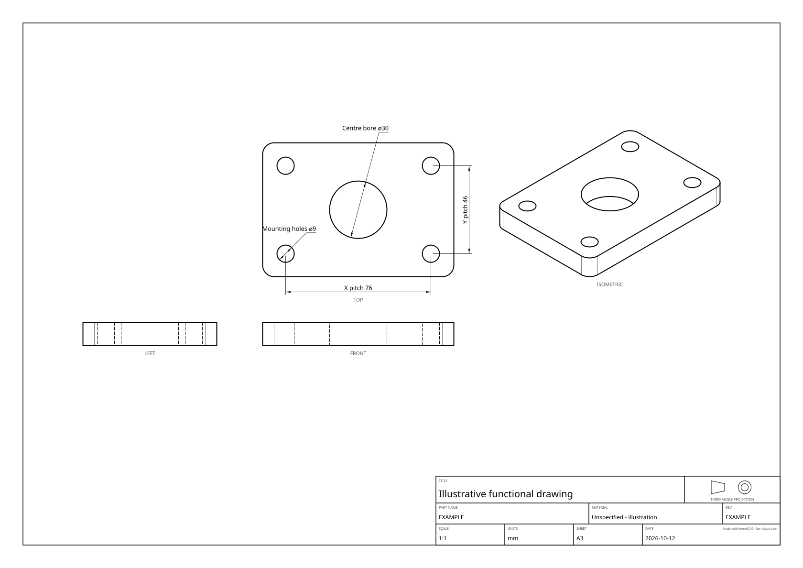
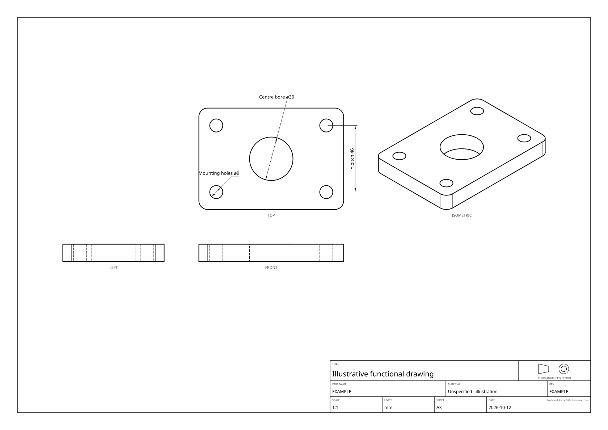
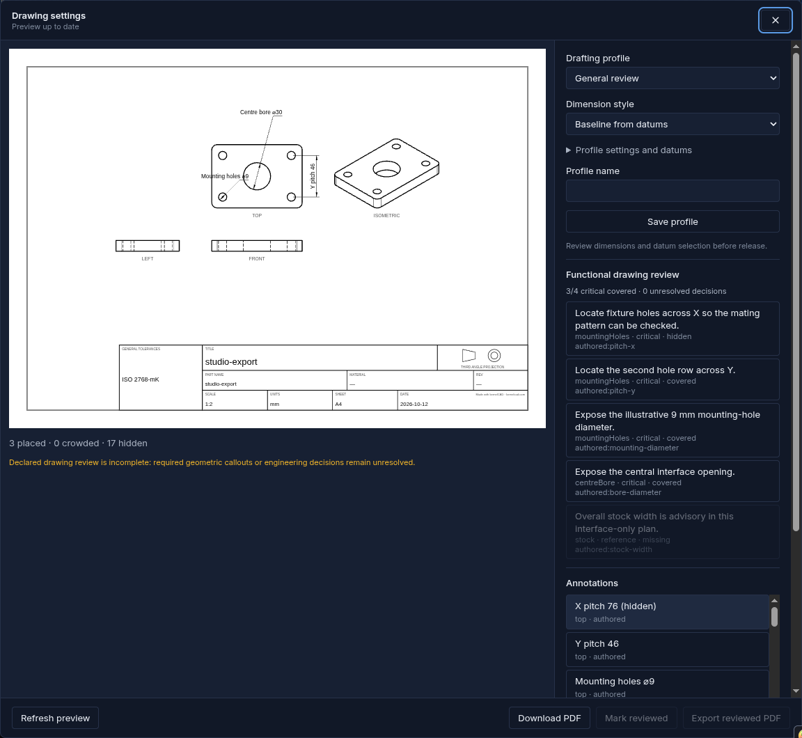
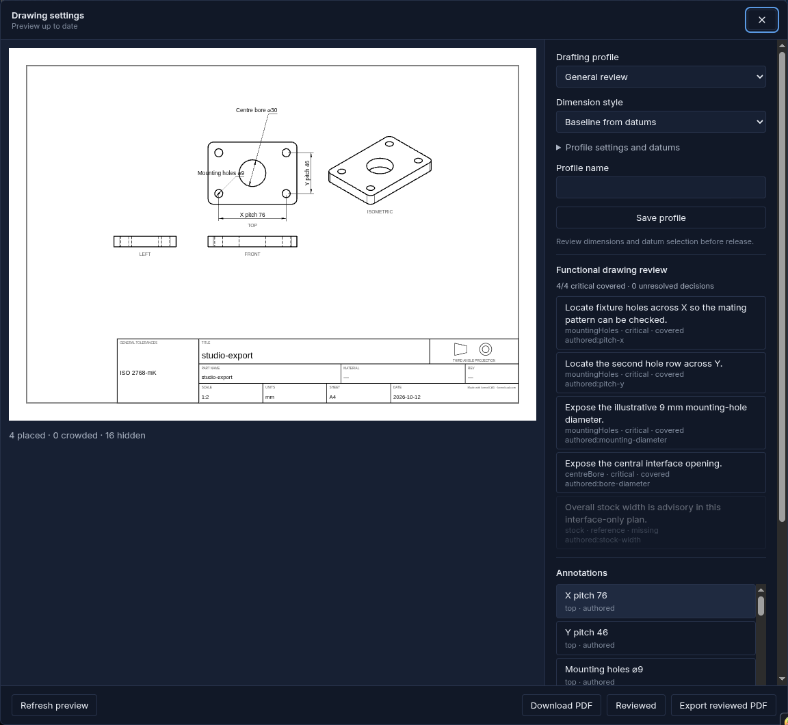

A drawing can look finished while omitting the distance that makes two parts line up. kernelCAD lets the source declare the measured callouts that matter to a particular interface, then checks whether those callouts survived the final drawing layout and review edits.

## Start with a concrete interface

This illustrative fixture plate uses 100 × 70 × 12 mm stock with R6 corners. Four Ø9 through-holes sit at (12, 12), (88, 12), (12, 58), and (88, 58) mm. A Ø30 through-bore sits at (50, 35). The brief asks the drawing to expose the 76 mm X pitch, 46 mm Y pitch, mounting-hole diameter and central opening. Ø9 is an illustrative M8 clearance choice; no catalog fastener fit or load acceptance is claimed.

The plan intentionally treats stock width as a reference requirement. It is absent from this sheet and remains advisory. Manufacturing details beyond those four critical measurements are outside the declared scope.



## Attach measurements to the model

[Download the full editable source](/blog/functional-drafting/fixture-plate.kcad.ts). Paste it into the current Studio editor and run it. The file uses fixed geometry constants so the brief stays explicit; it makes no claim that these selectors follow arbitrary parameter edits.

The hole-centre anchors select actual circular edges. A circular edge anchor resolves to its centre for the linear measurement. The source gives the dimension a stable ID and a descriptive label; the exporter computes the number.

```ts
const holeCentre = (x, y) => ({
  edge: { ofCurveType: 'CIRCLE', near: [x, y, 12] },
});

.dimension({
  id: 'pitch-x', kind: 'linear',
  from: holeCentre(12, 12), to: holeCentre(88, 12),
  label: 'X pitch',
})
```

The corresponding requirement names the exact final annotation ID, its measurable kind, its engineering role and the reason it must be present. `featureId` explains the intended interface; it is not a topology selector.

```ts
.drawingReview({
  id: 'plate',
  requirements: [{
    id: 'pitch-x', featureId: 'mountingHoles',
    annotationId: 'authored:pitch-x', expectedKind: 'linear',
    role: 'critical',
    reason: 'Locate fixture holes across X so the mating pattern can be checked.',
  }],
  decisions: [],
})
```

This fragment shows one requirement. The full source declares four critical measurements and the reference stock-width requirement. Plans follow the shape through later modeling operations without adding geometry. Additional export `reviewPlans` append to the source plans; an empty option list does not erase them.

## Catch a missing or hidden callout

[The missing-callout source](/blog/functional-drafting/fixture-plate-missing.kcad.ts) keeps the solid and declared plan but omits the X-pitch dimension. It produces `missing` and 3/4 critical coverage. The geometry evidence independently verifies that both source variants have the same exact bounding box and volume.



Hiding the existing `authored:pitch-x` row produces `hidden` instead. A crowded critical label, kind mismatch or manual numerical-text replacement also blocks critical coverage. A free-text note cannot substitute for a measured dimension, even if it uses the same ID. A descriptive source label such as “X pitch” keeps its computed 76 mm value.



## Review the actual sheet in Studio

Open **Export → Drawing settings**, then **Generate preview**. In **Functional drawing review**, inspect the critical coverage count. Click a requirement to select its exact callout; the row shows the reason, feature name, status and annotation ID.

For this focused tutorial, use **Annotations** to hide the automatic heuristic rows outside the interface brief. The capture receipt records their report IDs and reasons. Select the authored rows and set **Annotation view** to **top**. Give the mounting diameter 4 mm and the central bore 20 mm of **Extra offset (sheet mm)** so the labels clear the geometry. These edits preserve the computed measurements.

Click the X-pitch requirement, tick **Hide annotation**, and **Refresh preview**. The count falls to 3/4. **Download PDF** remains available for an ordinary incomplete drawing. Restore the row and refresh again. With 4/4 covered and no unresolved decisions, click **Mark reviewed**, then **Export reviewed PDF**. The video shows these actual local actions and downloaded PDF bytes.



The exporter evaluates the final rendered rows. `requireCompleteReview: true` refuses incomplete or undeclared SVG/PDF exports before emitting bytes. Ordinary exports retain the incomplete report and warning. A successful export checks the declared plan; it does not establish physical fit, manufacturing acceptance, tolerance approval or load capacity. Undeclared physical criteria stay outside the report.

The recorded Studio sheet prints **ISO2768-mK** in its general-tolerances cell as an inherited exporter default. The tutorial does not select or approve that default as engineering acceptance. The authored-only generator sheets omit it. Review completeness does not approve a printed tolerance label.

## Reproduce and inspect the evidence

Use the current Studio or this repository source checkout with Node 22 and installed dependencies. This functionality has not been established in the latest published npm package; the commands below build this checkout's CLI.

```sh
npm run build:cli
npx tsx examples/functional-drafting/run.ts
```

The generator validates one connected B-rep solid, exact 100 × 70 × 12 bounding box, 72,093.239802 mm³ volume, and all five bore diameters/positions separately from drawing review. It checks printable SVG/PDF report equality, missing/hidden warnings and strict refusals, and a real strict PDF for the complete case. Fixed date and revision keep the drawing inputs reviewable. Each named case runs in a fresh OCCT process to bound kernel lifetime.

[Complete SVG](/blog/functional-drafting/plate-complete.svg) · [Complete PDF](/blog/functional-drafting/plate-complete.pdf) · [Strict complete PDF](/blog/functional-drafting/plate-complete.strict.pdf) · [Export settings](/blog/functional-drafting/plate-complete.options.json) · [Complete report](/blog/functional-drafting/plate-complete.report.json)

[Missing SVG](/blog/functional-drafting/plate-missing.svg) · [Missing PDF](/blog/functional-drafting/plate-missing.pdf) · [Missing report](/blog/functional-drafting/plate-missing.report.json) · [Missing settings](/blog/functional-drafting/plate-missing.options.json)

[Hidden SVG](/blog/functional-drafting/plate-hidden.svg) · [Hidden PDF](/blog/functional-drafting/plate-hidden.pdf) · [Hidden report](/blog/functional-drafting/plate-hidden.report.json) · [Hidden settings](/blog/functional-drafting/plate-hidden.options.json) · [Geometry checks](/blog/functional-drafting/fixture-plate.geometry.json) · [SHA-256 manifest](/blog/functional-drafting/manifest.json)

[Actual Studio reviewed PDF](/blog/functional-drafting/reviewed-plate.pdf) · [Studio request settings and reports](/blog/functional-drafting/studio-evidence.json) · [Capture receipt](/blog/functional-drafting/studio-receipt.json)

The downloadable generated sheets use a minimal authored-only layout. Studio also offers automatic annotations; the captured workflow explicitly hides those extra rows and retains its separate UI settings and HTTP evidence. Both demonstrate the same declared interface, with their actual layouts preserved. Continue with [recording engineering decisions](/blog/drawing-decisions/) when a measured dimension alone cannot settle the intent.
