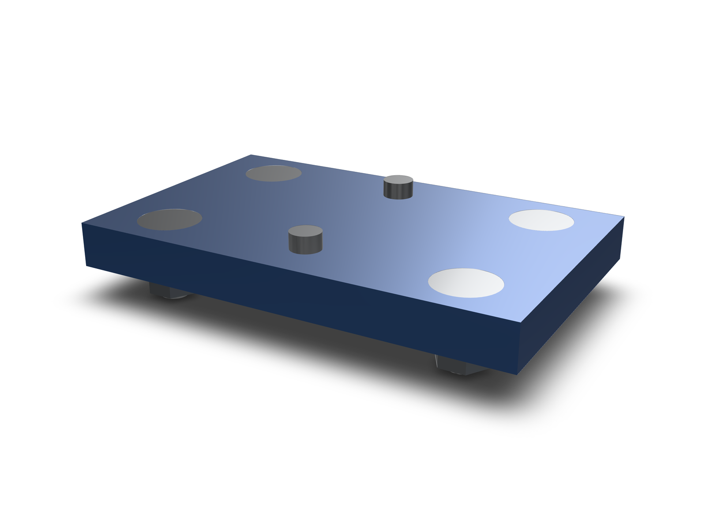
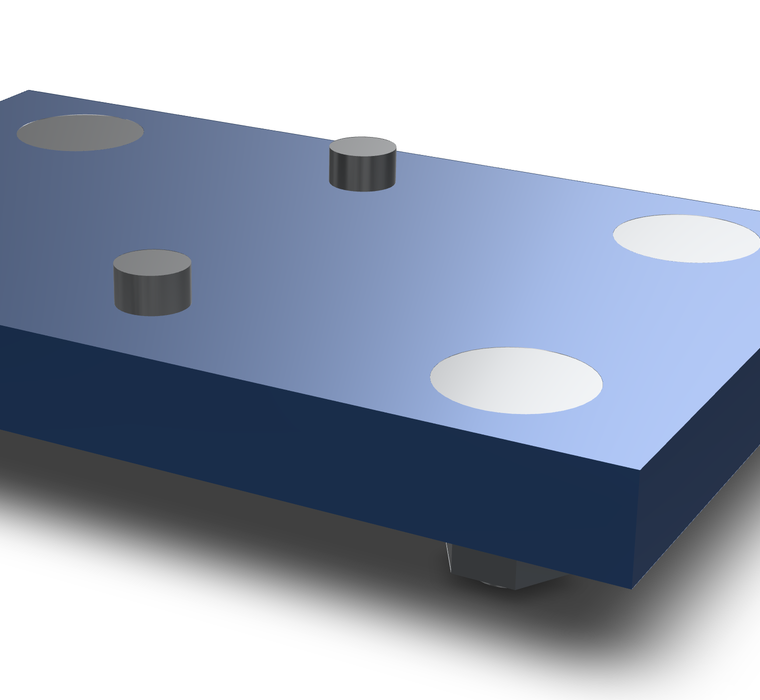
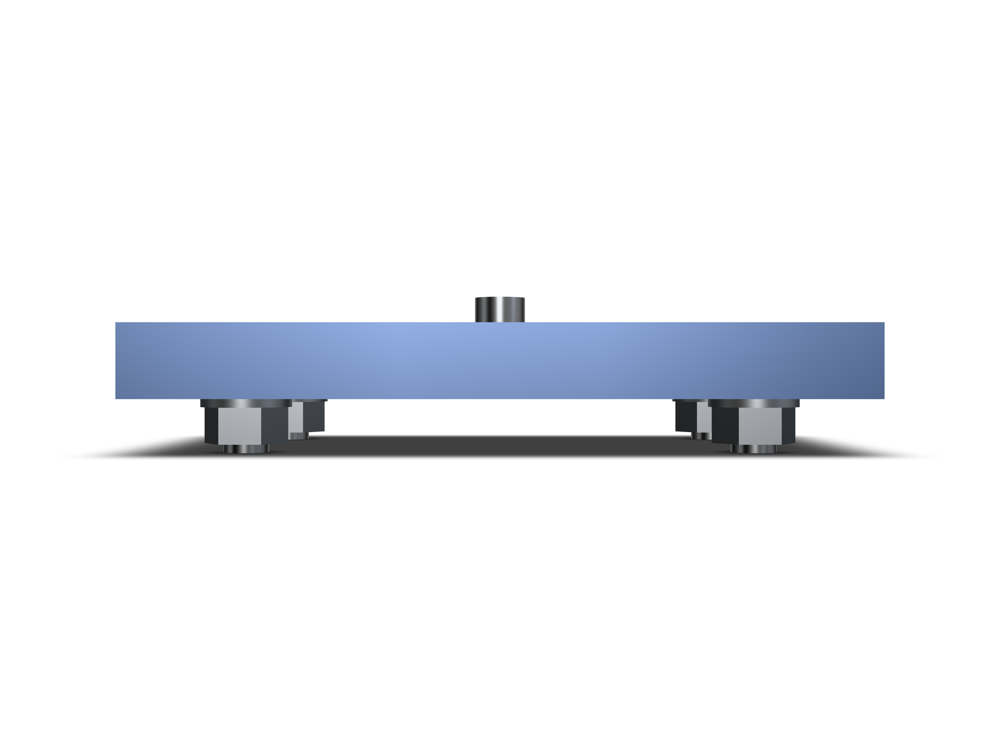

`lib.insert(shape, request)` works from the holes a part already has. It
sizes the thread from the bore diameter, covers every similar hole, and cuts
the seat the fastener family needs. No hole feature id and no face frame is
required: any bore in the lowered model behaves the same, whether it came
from `hole()`, `holes()`, a pattern or an import.

## What the holes decide

- **Size.** The bore diameter is matched against ISO 273 clearance, all three
  fit classes. Normal is Ø2.4 for M2, Ø2.9 for M2.5, Ø3.4 for M3, Ø4.5 for M4,
  Ø5.5 for M5, Ø6.6 for M6, Ø9 for M8, Ø11 for M10 and Ø13.5 for M12; the
  close and loose bores of each thread match too, and each hole reports the
  class it matched as `fit` (`'close' | 'normal' | 'loose'`). A bore that matches none of them is refused with the diameters the
  shape actually has.
- **Similar holes.** Every bore with the same diameter and a parallel axis
  is covered, so a patterned hole comes along without naming the pattern.
  `near` seeds from the nearest bore; `diameterMm` selects across the shape.
- **Seat.** A flat head cuts a 90° countersink to the head diameter; cap
  heads cut nothing unless `seat: 'counterbore'` is asked for; `seat: 'none'`
  leaves the hole alone.
- **Mode.** `bolt` (the default) adds a washer under the head and a washer
  plus hex nut on the back and needs a through bore. `screw` places the
  screw alone and, in a blind hole, picks the longest stocked length that
  still fits.

```kcad
const plate = box(40, 40, 8, true)
  .holes('top', {
    positions: [{ u: -10, v: 0 }, { u: 10, v: 0 }],
    diameter: 5.5,
    depth: 'through',
  });
const fitted = await lib.insert(plate, {
  diameterMm: 5.5,
  family: 'flat-head-countersunk',
  mode: 'bolt',
});
return fitted.shape;
```

A pattern is just similar holes: pattern the part and every instance is
covered, because the selection is diameter and axis, not feature identity.

```kcad
const patterned = box(20, 10, 6, true)
  .hole('top', { u: 0, v: 0, diameter: 3.4, depth: 'through' })
  .patternLinear({ count: 3, direction: [1, 0, 0], spacing: 15 });
const fitted = await lib.insert(patterned, {
  near: [0, 0, 3],
  family: 'socket-head-cap-screw',
  mode: 'screw',
});
return fitted.shape;
```





The committed example's second call is the same shape of request:

```ts
const countersunk = await lib.insert(plate, {
  diameterMm: 5.5,
  family: 'flat-head-countersunk',
  mode: 'bolt',
  gripMm: 8,
});
```

<!-- check examples/parts/hole-driven-insert.kcad.ts: source contains block -->

## Placement and what comes back

`lib.insert` returns `{ shape, holes }`. `shape` is the input with the seats
cut (the same shape when nothing was cut). Each entry in `holes` carries the
head-side mouth center and the direction into the material, the resolved
thread and screw length, and the placed members: `screw`, plus `headWasher`,
`tailWasher` and `nut` in bolt mode. The members are oriented along the
detected axis, so they drop straight into an assembly.



Two bores get a second look. A bore that sits exactly on a larger thread's
tap drill (ISO 2306: Ø2.5 for M3, Ø3.3 for M4, Ø4.2 for M5, Ø5.0 for M6,
Ø6.8 for M8) comes back as `pilotFor`, because a tapped pilot and a
clearance bore cannot be told apart from geometry alone. And a coaxial
larger bore already reaching the mouth (a counterbore) is reported as
`existingSeatMm`; `seat: 'auto'` then leaves the hole alone rather than
cutting a second seat into it.

## Limits

The members are the library's envelope solids: heads and shanks, no helical
thread. The seat cut is a boolean, so it does not become a hole feature that
drawings or DFM checks classify. Nothing here proves thread contact,
engagement, strength, torque or preload, and a tapped hole is not classified
as a thread.

## Reproduce

In a repository checkout with dependencies installed:

```sh
npx tsx examples/parts/verify-insert.mts
npx tsx src/agent/cli/index.ts evaluate examples/parts/hole-driven-insert.kcad.ts
```

The example evaluates to 38 features with 0 diagnostics; the verifier
rewrites `docs/demos/hole-driven-insert/geometry-evidence.json` with the
part bounds, the countersink volume removed and 105 interference-free part
pairs.

<!-- check examples/parts/hole-driven-insert.kcad.ts: featureCount = 38 -->
<!-- check examples/parts/hole-driven-insert.kcad.ts: diagnostics.length = 0 -->
