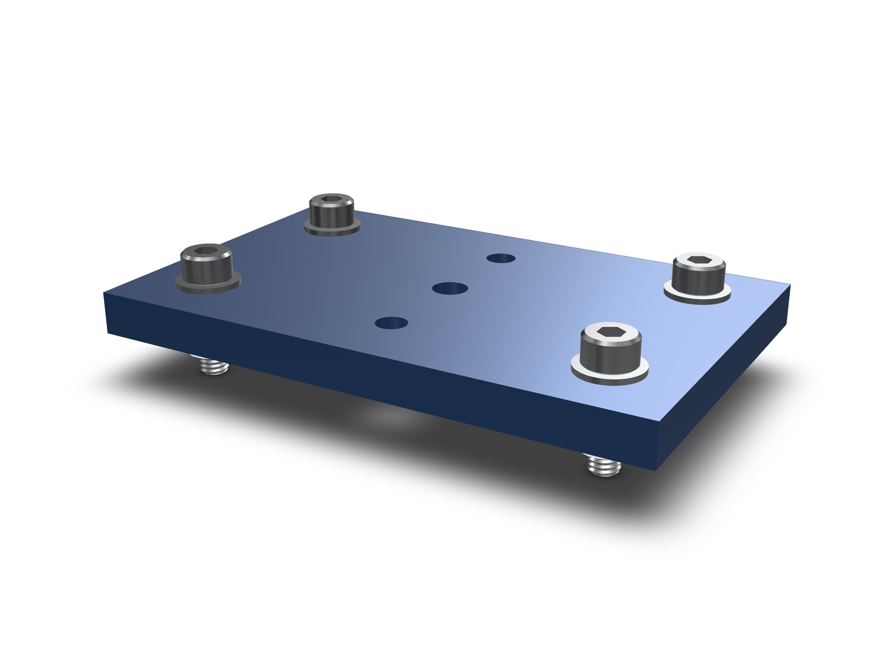

A clearance hole for M3 is 3.4 mm in normal fit, 3.2 mm in close fit and
3.6 mm in loose fit. For M4 it is 4.5 mm normal, for M5 5.5 mm, for M6
6.6 mm. Those numbers come from ISO 273 (ASME B18.2.8 gives the same metric
sizes), and the full chart is below. The harder question is which column to
use. Pick too tight and the second bolt will not go in when hole positions
drift. Pick too loose and the part slides around and the head loses bearing
area. A wrong guess usually shows up late: at assembly, or as a rejected
quote. This guide gives you the numbers and a fast way to choose.

## Contents

1. [Metric clearance hole chart (ISO 273)](#1-metric-clearance-hole-chart-iso-273)
2. [What close, normal and loose fit mean](#2-what-close-normal-and-loose-fit-mean)
3. [How to choose a fit class](#3-how-to-choose-a-fit-class)
4. [Common clearance hole mistakes](#4-common-clearance-hole-mistakes)
5. [Clearance holes in kernelCAD: a worked example](#5-clearance-holes-in-kernelcad-a-worked-example)
6. [FAQ](#6-faq)
7. [Key takeaways](#7-key-takeaways)

## 1. Metric clearance hole chart (ISO 273)

All sizes in mm. ISO 273 calls the three series fine, medium and coarse;
most charts and CAD tools call them close, normal and loose. The tap drill
column is for coarse-pitch threads (ISO 2306) and is there so you do not mix
the two up.

| Thread | Close (fine) | Normal (medium) | Loose (coarse) | Tap drill, coarse |
|---|---|---|---|---|
| M2 | 2.2 | 2.4 | 2.6 | – |
| M2.5 | 2.7 | 2.9 | 3.1 | – |
| M3 | 3.2 | 3.4 | 3.6 | 2.5 |
| M4 | 4.3 | 4.5 | 4.8 | 3.3 |
| M5 | 5.3 | 5.5 | 5.8 | 4.2 |
| M6 | 6.4 | 6.6 | 7.0 | 5.0 |
| M8 | 8.4 | 9.0 | 10.0 | 6.8 |
| M10 | 10.5 | 11.0 | 12.0 | 8.5 |
| M12 | 13.0 | 13.5 | 14.5 | 10.2 |
| M16 | 17.0 | 17.5 | 18.5 | 14.0 |
| M20 | 21.0 | 22.0 | 24.0 | 17.5 |

The listed size is the smallest the hole may be. Each series also carries a
plus tolerance: H12 for close, H13 for normal and H14 for loose. For an M3
hole that works out to 3.2 to 3.32 mm close, 3.4 to 3.58 mm normal and 3.6
to 3.9 mm loose.

**How kernelCAD helps.** This exact table is built into kernelCAD for M2 to
M20, all three classes. You never type a clearance diameter from memory, and
when you hand kernelCAD a part with holes, it tells you which thread and
which fit class each hole already is.

## 2. What close, normal and loose fit mean

- **Close (fine).** About 0.2 to 0.3 mm over the thread for small sizes. The
  part sits where the bolt puts it. Use it when the bolt itself does some of
  the locating and the hole positions are held tight.
- **Normal (medium).** The general-purpose default. It absorbs ordinary
  drilling and machining position error on a two- to four-bolt pattern.
  Most standard parts, brackets and enclosures use it.
- **Loose (coarse).** Extra room for parts that are welded, bent, cast or
  laser cut, for long bolt patterns, and for parts you want to shift into
  place before tightening.

The gap grows with size. M3 normal leaves 0.4 mm of total clearance; M12
normal leaves 1.5 mm.

## 3. How to choose a fit class

Start from normal and move only when you have a reason.

**Count the fasteners.** One bolt fits in any hole. Two bolts must both find
their holes, and every extra bolt adds another position that has to line up.
The more fasteners in a pattern, the more the loose column earns its keep.

**Check the position tolerance you can hold.** For two parts that both have
clearance holes (a bolt and nut through both), the classic floating-fastener
rule says the positional tolerance on each hole, as a diameter, is the hole
size minus the bolt size. An M4 bolt in a 4.5 mm normal hole allows 0.5 mm.
If one part is tapped instead (a fixed fastener), that allowance is split
between the two parts, so each gets half: 0.25 mm. If your shop or process
cannot hold that, step up to loose.

**Decide who does the locating.** If you need the parts to sit in an exact
spot, a tighter clearance hole is a weak way to get it. Use dowel pins or a
shoulder and keep the bolts in normal holes. Choose close fit when the bolt
is the only practical locator and the parts are machined together.

**Think about the head.** A loose hole under a small socket head leaves less
bearing area. Add a washer, or stay at normal.

**How kernelCAD helps.** Fit class is something kernelCAD reports, not
something you have to keep in your head. Every hole that lib.insert fastens
comes back tagged `close`, `normal` or `loose`, so a design review is a
glance at the output instead of a caliper session with the drawing.

## 4. Common clearance hole mistakes

1. **Using the tap drill as a clearance hole.** Ø5.0 is the M6 tap drill.
   It is too big for M4 and too small for M5. A 5 mm hole in a drawing is a
   question, not a clearance hole.
2. **Drawing the hole at the nominal size.** A 4.0 mm hole for an M4 screw
   has no clearance at all. Machined holes need the chart value.
3. **Specifying close fit everywhere "to be safe".** Close holes need tight
   hole positions on both parts. Use them only where the bolt really has to
   locate; everywhere else, normal fit assembles faster and costs less.
4. **Forgetting the process.** 3D-printed holes often come out undersize,
   and punched sheet metal holes have their own rules. Test a coupon or use
   a looser class.
5. **Seating with the wrong feature.** Flat-head screws need a 90°
   countersink; socket heads that must sit flush need a counterbore. A plain
   clearance hole leaves the head proud.

**How kernelCAD helps.** kernelCAD catches the first two by refusing to
size a fastener for a bore that is not a real clearance size, and it cuts
the seat the fastener family needs. That means fewer surprises at assembly
and fewer re-spins after the first parts arrive.

## 5. Clearance holes in kernelCAD: a worked example

kernelCAD models are `.kcad.ts` source files. You can write them yourself
or ask ChatGPT or Claude to write and run them over MCP. The example
[`examples/gallery/clearance-hole-plate.kcad.ts`](../../examples/gallery/clearance-hole-plate.kcad.ts)
is a 80 × 50 × 6 mm plate with three kinds of hole:

- four Ø4.5 holes in the corners (M4 normal),
- two Ø4.3 holes on the centre line (M4 close),
- one Ø5.0 hole in the middle (the M6 tap drill).

```kcad
const plate = box(80, 50, 6, true)
  .holes('top', {
    positions: [{ u: -30, v: -15 }, { u: 30, v: -15 }, { u: -30, v: 15 }, { u: 30, v: 15 }],
    diameter: 4.5, // M4 normal (ISO 273 medium)
    depth: 'through',
  })
  .holes('top', {
    positions: [{ u: 0, v: -15 }, { u: 0, v: 15 }],
    diameter: 4.3, // M4 close (ISO 273 fine)
    depth: 'through',
  })
  .hole('top', { u: 0, v: 0, diameter: 5.0, depth: 'through' }) // M6 tap drill
  .finish('anodized');

const normal = await lib.insert(plate, {
  diameterMm: 4.5,
  family: 'socket-head-cap-screw',
  mode: 'bolt',
});
```

`lib.insert` reads the holes the part already has. It matches each bore
against the ISO 273 table, finds every other hole with the same diameter
and a parallel axis, and places the fastener stack. In bolt mode that is a
screw, a washer under the head, and a washer and hex nut on the far side.
More on the API in [Fasten a part from its holes](hole-driven-fastening.md).

For the corner holes, each of the four entries in `normal.holes` came back
as:

```json
{"thread":"M4","fit":"normal","lengthMm":14,"nut":true}
```

The two Ø4.3 holes came back as `{"thread":"M4","fit":"close"}`. The screw
length is chosen from the stocked lengths to clear the plate, both washers
and the nut.

Then the Ø5.0 hole. Asking `lib.insert` to fasten it returns this message
instead of a guess:

```text
lib.insert(shape, { diameterMm, family, ... }): diameterMm — got 5; requires
an ISO 273 clearance bore for a stocked thread (close, normal or loose);
normal bores: Ø2.4 (M2), Ø2.9 (M2.5), Ø3.4 (M3), Ø4.5 (M4), Ø5.5 (M5),
Ø6.6 (M6), Ø9 (M8), Ø11 (M10), Ø13.5 (M12), Ø17.5 (M16), Ø22 (M20) (mm).
```

That is mistake number one from the list above, caught in the model. A
bore that lands exactly on a larger thread's tap drill, such as Ø3.3, is
sized as M3 but also flagged with `pilotFor: 'M4'`, so a tapped hole is not
quietly treated as a clearance hole.

The full example fastens both hole sets and evaluates to 54 features, 25
parts and 0 diagnostics.

<!-- check examples/gallery/clearance-hole-plate.kcad.ts: featureCount = 54 -->
<!-- check examples/gallery/clearance-hole-plate.kcad.ts: diagnostics.length = 0 -->



**How kernelCAD helps.** The holes drive the hardware. Change a hole from
4.5 to 4.3 and the next run reports close fit; change it to 5.0 and you get
told before anyone orders parts. For flat-head screws the same call cuts a
90° countersink to the head diameter, and `seat: 'counterbore'` cuts a seat
for socket and button heads. A whole bolt pattern is one line of code, and
the review is reading the output.

## 6. FAQ

**What size clearance hole for M3?**
3.4 mm for normal fit. Use 3.2 mm for close fit and 3.6 mm for loose fit.

**What is the clearance hole for M4?**
4.5 mm normal, 4.3 mm close, 4.8 mm loose. The M4 tap drill is 3.3 mm.

**What size hole for an M5 bolt?**
5.5 mm for a normal clearance hole. For tapping M5, drill 4.2 mm.

**What is the M6 clearance hole size?**
6.6 mm normal, 6.4 mm close and 7.0 mm loose. A 5.0 mm hole is the M6
tap drill, not a clearance hole.

**Is ISO 273 the same as ASME B18.2.8?**
For metric fasteners the clearance sizes agree. ISO 273 covers M1 to M150.

## 7. Key takeaways

- Normal fit is the default: M3 3.4, M4 4.5, M5 5.5, M6 6.6, M8 9, M10 11 mm.
- Use close fit only when the bolt has to locate the part and hole positions
  are held tight. Use loose fit for many fasteners, fabricated parts or
  adjustment.
- Hole size minus bolt size is the positional tolerance you can give each
  hole when both parts have clearance holes; halve it when one part is
  tapped.
- Never use a tap drill or the nominal diameter as a clearance hole.
- In kernelCAD, `lib.insert` sizes the fastener from the hole, reports its
  fit class, and refuses bores that are not clearance holes.

**Try kernelCAD free — connect it to ChatGPT or Claude in a minute:
https://app.kernelcad.com/connect** (or run `npx -y kernelcad mcp`).
