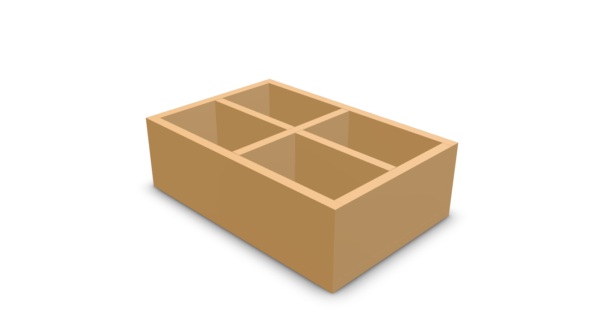
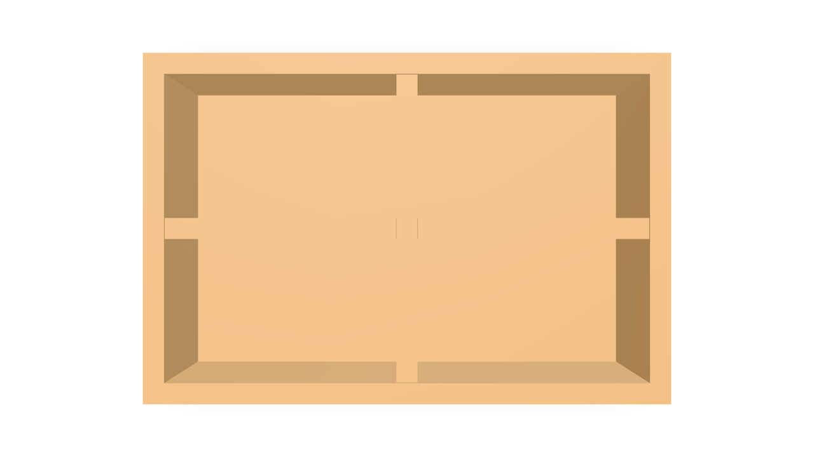
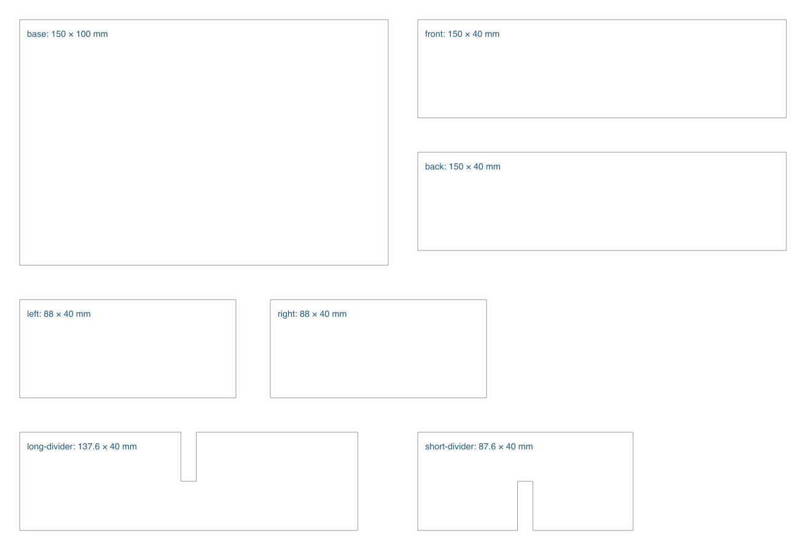
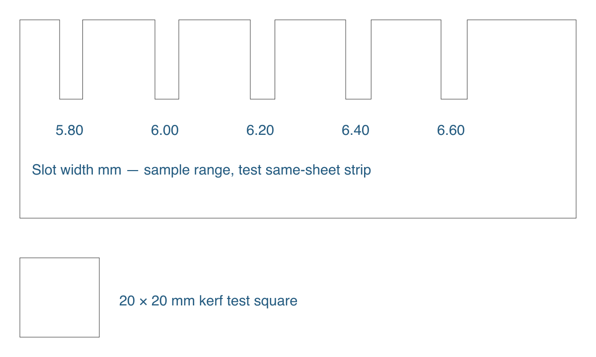

This original desk organizer example uses kernelCAD to model seven plywood panels, check how they fit together, and prepare outlines for a laser cutting test. The digital checks are complete. The physical cutting and dry fit are still pending.

The video combines actual hosted MCP renders with cutting diagrams generated from the model source. It is an annotated still sequence, not a screen recording or a physical cutting demonstration. Its [evidence file](/blog/plywood-organizer-laser-workflow/video-evidence.json) records the source hash and video provenance.



## 1. Measure the sheet

Measure the plywood at several points. Record the thickness range and confirm that the material is suitable for your laser. [Trotec's guidance](https://www.troteclaser.com/en/laserable-materials/laser-cutting-plywood) recommends plywood intended for laser processing.

This example assumes 6.00 mm stock. That is a sample value, not a measured sheet thickness. The assembled organizer is 150 × 100 × 46 mm. Its base is 6 mm thick, and the walls and dividers are 40 mm high.

The laser model and usable bed area are still unknown. Power, speed, air assist and number of passes must be tested on the actual machine and sheet. This example supplies no tested machine settings.

## 2. Model separate panels

The assembly has seven named parts: base, front, back, left, right, long-divider and short-divider. The outer walls use plain butt joints, which need adhesive and a square assembly setup.

The dividers cross in a half-lap joint. One notch opens from the top, the other from the bottom. Each is 20 mm deep. The sample notch width is 6.20 mm: 0.20 mm total clearance around the assumed stock. Each divider also has 0.20 mm clearance at both ends.

```ts
const thickness = 6;
const slotClearance = 0.20;
const slotWidth = thickness + slotClearance;
```

These are sample clearances. Choose the final fit with a coupon. The model's fixed connections describe the review position; the dividers can remain removable in the real organizer.

Download the [editable source](/blog/plywood-organizer-laser-workflow/organizer.kcad.ts). Change the source when a dimension changes, then regenerate the affected outputs.

## 3. Evaluate and inspect through MCP

The agent ran `evaluate_script({ code: source })` on the full source and used `render_preview` for the isometric and top images below.

The hosted evaluation returned seven parts, 19 features and no diagnostics. It reported valid native geometry, a volume of 256,800 mm³ and bounds of 150 × 100 × 46 mm. An independent native check tested all 21 panel pairs and found no positive-volume overlaps above 0.000001 mm³. Touching faces, such as walls resting on the base, are intentional.

Download the [MCP receipt](/blog/plywood-organizer-laser-workflow/mcp-evaluation-evidence.json) and [native evidence](/blog/plywood-organizer-laser-workflow/geometry-evidence.json). These checks establish digital geometry, not physical fit or glue strength.



## 4. Prepare cutting outlines

The generator reads the model constants and produces seven closed contours at 1:1 scale. Download the [panel SVG](/blog/plywood-organizer-laser-workflow/organizer-nominal.svg), [generator](/blog/plywood-organizer-laser-workflow/generate-cut-layout.py) and [contour receipt](/blog/plywood-organizer-laser-workflow/cut-layout-evidence.json).

These outlines have no kerf compensation. In the laser software, enable only the cut layer, check for duplicate lines and confirm that the base measures 150 × 100 mm. Keep the label layer disabled for cutting. Arrange the panels within the actual bed area.



## 5. Cut a fit coupon first

The [coupon SVG](/blog/plywood-organizer-laser-workflow/fit-coupon-nominal.svg) has slots from 5.80 to 6.60 mm. Adjust this range for the measured stock, then test with a strip from the same sheet. Record the selected slot, fit and machine settings.

Cut the 20 mm square and measure both the piece and its opening to estimate kerf. An uncompensated internal opening usually grows with kerf; an external piece shrinks. Taper and char also affect fit. Apply compensation once and check the result with the coupon.



## 6. Dry fit and assemble

Update the fit, regenerate the contours and cut the panels with tested settings. Dry fit the dividers before gluing the tray. Check that the tray is square, the bottom is flat and the divider tops align with the walls.

Physical measurements, cutting results and assembly photos remain pending.

## Reproduce the digital checks

In a repository checkout with dependencies installed, run:

```sh
npx tsx examples/plywood-organizer/verify.mts
python3 examples/plywood-organizer/generate-cut-layout.py
```

The [native verifier](/blog/plywood-organizer-laser-workflow/verify.mts) writes fresh geometry evidence. Put it beside the model in the example directory; it needs the repository source. The generator writes fresh panel and coupon SVGs.
