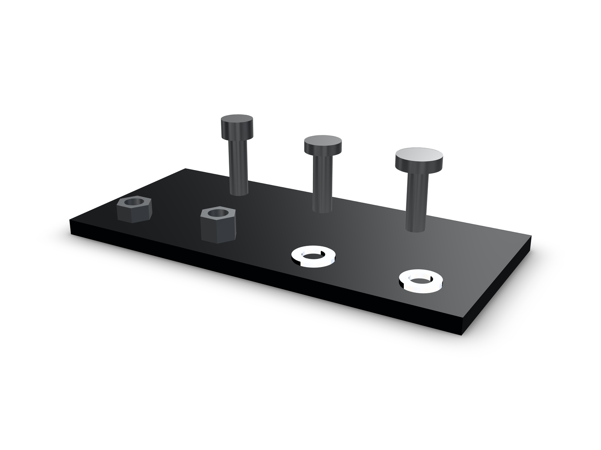
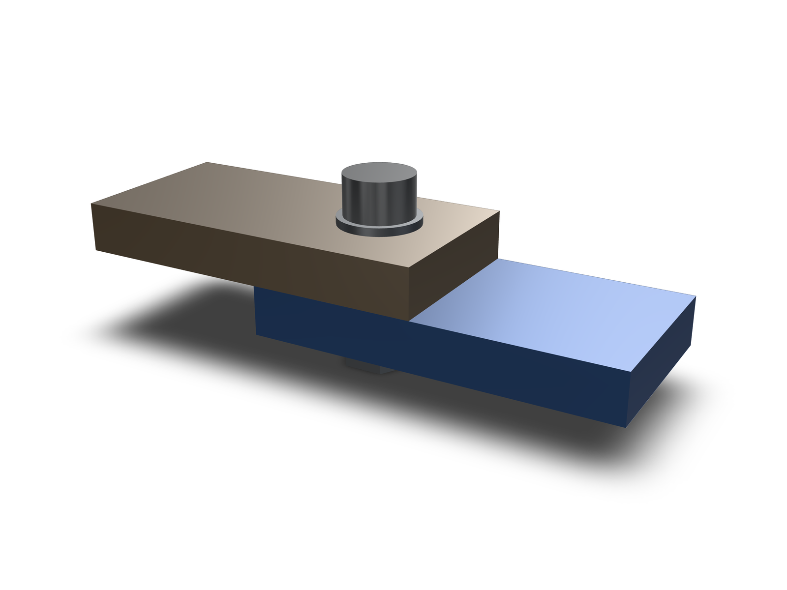
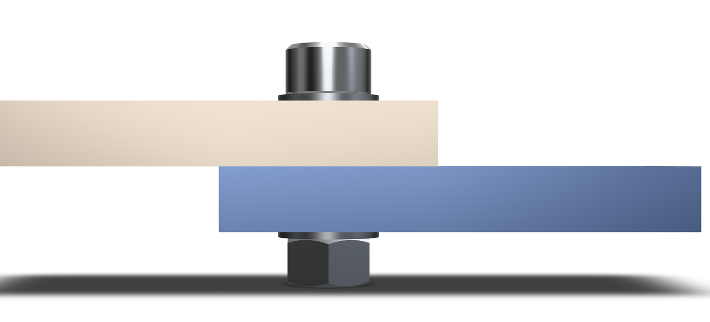

kernelCAD ships a table of ISO metric fasteners. `lib.part` builds one part from
it, and `lib.stack` builds a bolted joint around a grip thickness. Both return
envelope solids, a head plus a shank, and the browser builds them in memory.

## What the table stocks

- `socket-head-cap-screw` (ISO 4762): M2–M20
- `button-head-cap-screw` (ISO 7380): M3–M10
- `flat-head-countersunk` (ISO 10642): M3–M12
- `hex-head-bolt` (ISO 4017): M3–M20
- `set-screw` (ISO 4026): M3–M12
- `threaded-rod` (DIN 975): M3–M12, stocked 250 and 1000 mm
- `hex-nut` (ISO 4032): M2–M20
- `lock-nut` (DIN 985): M3–M12
- `flat-washer` (ISO 7089): M2–M20
- `lock-washer` (DIN 127B): M3–M12

Screws also take a stocked length, and the lengths are per thread from the
standard's preferred series: socket head 4–200 mm (M2–M20), button head
5–60 mm, countersunk 6–100 mm, hex head 8–200 mm. An unknown family, thread or
length fails with a diagnostic that names the stocked values.



The geometry is an envelope. A socket head is its cylinder, a countersunk head
is the seated ISO 10642 frustum that fills its countersink, and the lock washer
is a plain annulus without the split. That covers fit checks and assembly layout. It is not a threaded part,
and it makes no claim about thread contact.

## Place one part

`lib.part({ family, thread, lengthMm })` resolves the row and returns the solid.
Screws need a stocked length; nuts and washers take only a thread.

```kcad
const nut = await lib.part({ family: 'hex-nut', thread: 'M5' });
const screw = await lib.part({ family: 'socket-head-cap-screw', thread: 'M5', lengthMm: 16 });
const pair = assembly('pair');
pair.part('screw', screw);
pair.part('nut', nut.translate(0, 0, -20));
return pair.model();
```

The resolved ids are the catalog ids (`iso-4762-m5x16` and `iso-4032-m5`
above), so `lib.part` resolves the same record as `lib.standard.boltSHCS`.
`lib.fetchPart`, `lib.findPart` and `lib.standard.*` keep their behavior.

On a host with the catalog on disk, the STEP for that id is loaded instead of
the in-memory envelope. The committed STEPs are exported from this same table,
so both doors lead to the same geometry. To override records, point
`KERNELCAD_PARTS_DIR` at a directory with an `index.json`, or place one in
`~/.kernelcad/parts`. Those records win over the generated catalog.

## The stack, in one call

`lib.stack({ thread, gripMm, mode })` returns the chosen `lengthMm` and the
members. Each member is positioned against a seat at z = 0, the grip's top
face.

- `mode: 'screw'` places the screw alone. The length is the shortest stocked
  one at or above the grip.
- `mode: 'bolt'` adds a flat washer under the head, and a flat washer plus a
  hex nut on the back. The length is the shortest stocked one at or above
  grip + washer + nut.

```kcad
const stack = await lib.stack({ thread: 'M5', gripMm: 12, mode: 'bolt' });
const placed = assembly('stack');
placed.part('screw', stack.screw);
placed.part('head-washer', stack.headWasher!);
placed.part('tail-washer', stack.tailWasher!);
placed.part('nut', stack.nut!);
return placed.model();
```

For the 12 mm grip in the example the sum is 17 mm and the shortest stocked
socket-head length at or above it is 18 mm. The members come back placed:
washer on the seat, screw head above it, tail washer and nut below the grip.





The `examples/parts/bolt-stack.kcad.ts` source places the stack like this:

```ts
const seat = lift + gripMm;
const stack = await lib.stack({ thread: 'M5', gripMm, mode: 'bolt' });
```

<!-- check examples/parts/bolt-stack.kcad.ts: source contains block -->

## Limits and checks

Envelopes carry no thread, so nothing here proves thread contact, engagement,
strength, torque or preload. The committed STEP files and the in-memory
envelope come from the same table and agree; neither is a strength model.

`examples/parts/bolted-flange.kcad.ts` extends the same table to a drilled
flange: eight Ø6.6 bores on an 85 mm bolt circle size to M6 (ISO 273 normal),
the seat cut fills each countersink, and `examples/parts/verify-flange.mts`
checks the eight placed stacks (300 part pairs, zero overlaps,
`docs/demos/standard-parts/flange-evidence.json`).

`lib.insert` reports which ISO 273 fit class a bore matched
(`'close' | 'normal' | 'loose'`), so a 6.4, 6.6 or 7.0 mm hole all resolve to
M6.

`examples/parts/verify.mts` re-evaluates both examples and writes
`docs/demos/standard-parts/geometry-evidence.json`: per-part bounds and
volumes, pairwise interference (zero positive-volume overlaps), and the source
hashes. The two examples evaluate with 0 diagnostics: `fastener-lineup.kcad.ts`
reports 17 features and `bolt-stack.kcad.ts` reports 15.

<!-- check examples/parts/fastener-lineup.kcad.ts: featureCount = 17 -->
<!-- check examples/parts/bolt-stack.kcad.ts: featureCount = 15 -->
<!-- check examples/parts/bolt-stack.kcad.ts: diagnostics.length = 0 -->

## Reproduce

From a repository checkout:

```sh
npx tsx examples/parts/verify.mts
```

The script prints a JSON summary and rewrites the evidence file. The demo
bundle, its renders and the review video are in `docs/demos/standard-parts/`.
