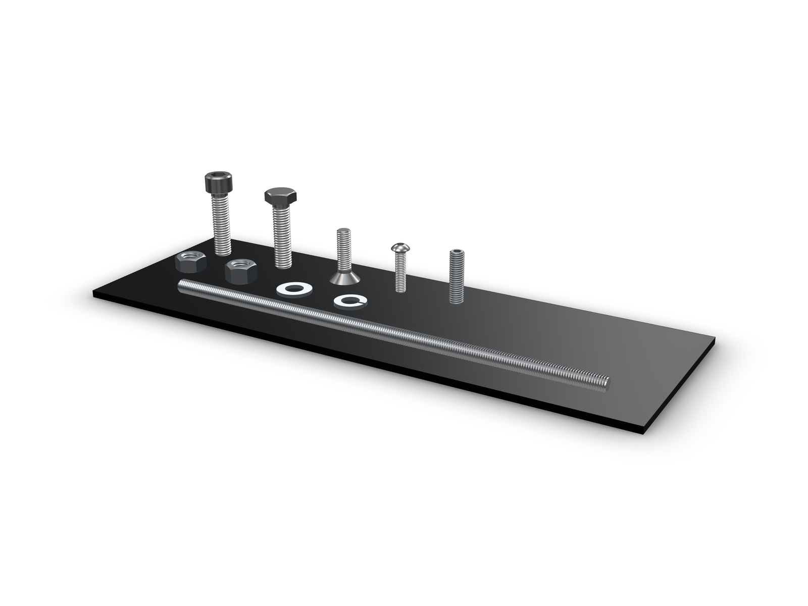
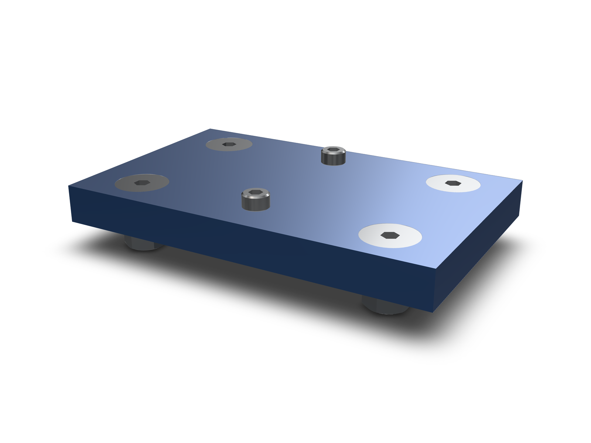
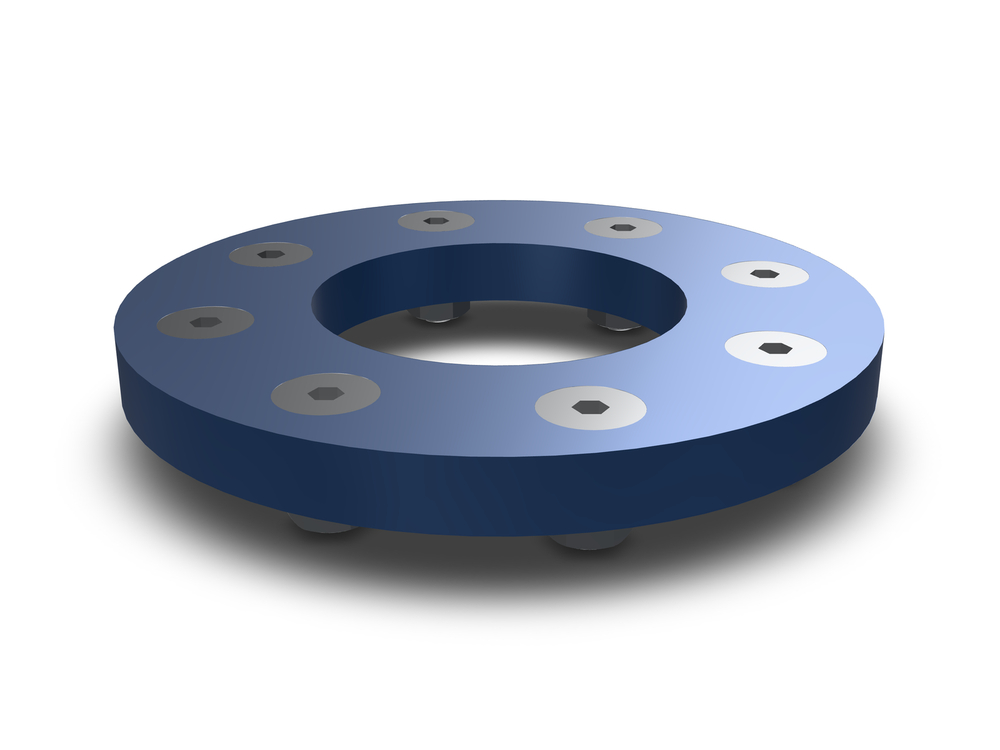
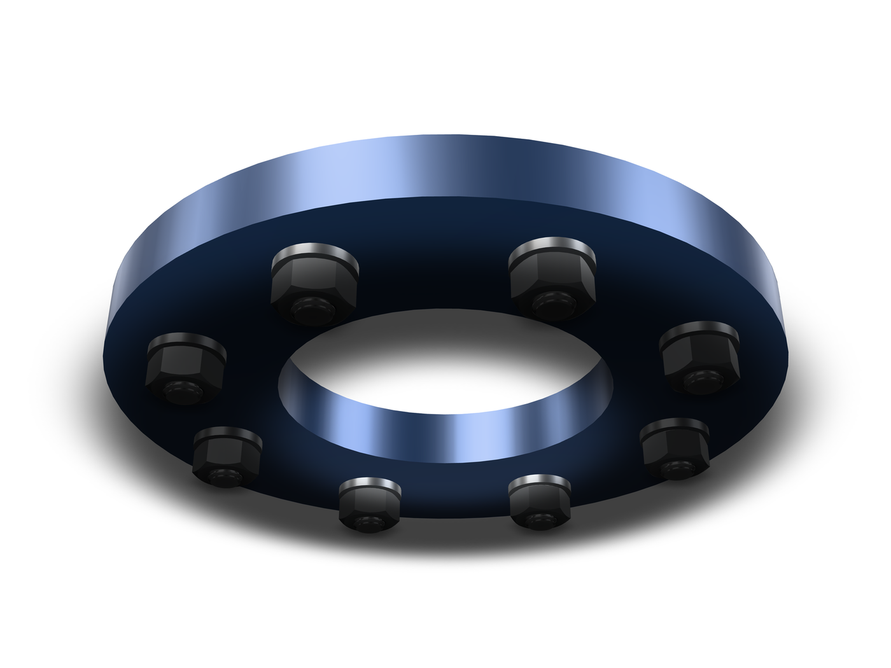

kernelCAD ships one table of ISO metric fasteners. Socket head, button head, countersunk and hex head screws and bolts, set screws, threaded rod, hex nuts, lock nuts and washers. Sizes run M2 to M20 where the standard has them, and every stocked length is per thread.

Each part is drawn the way its standard draws it: the hex socket with its drill-point bottom, the 30° chamfer on a hex head, the washer face, the button dome, the 90° countersunk cone, a nut chamfered and countersunk on both faces, and an ISO 68-1 thread at the coarse pitch with a chamfered start. The browser builds them in memory, without a filesystem.



, hex head bolt (ISO 4017), countersunk (ISO 10642), button head (ISO 7380) and set screw (ISO 4026); ISO 4032 nut, DIN 127 B spring washer and ISO 7089 washer.")

## What the table stocks

One row is a family, a thread and a length. Adding a size is a row, not a new function. The in-memory solid and the generated STEP come from that row through one builder.

```ts
const screw = await lib.part({ family: 'socket-head-cap-screw', thread: 'M5', lengthMm: 16 });
const bolt  = await lib.part({ family: 'hex-head-bolt', thread: 'M10', lengthMm: 40 });
const rod   = await lib.part({ family: 'threaded-rod', thread: 'M8', lengthMm: 250 });
```

Socket head runs M2 to M20 (ISO 4762), hex head bolts M3 to M20 (ISO 4017), countersunk M3 to M12 (ISO 10642), button head M3 to M10 (ISO 7380). Set screws are M3 to M12 (ISO 4026), threaded rod M3 to M12 in 250 and 1000 mm lengths (DIN 975). Hex nuts and flat washers go to M20, lock nuts and lock washers to M12.

An unknown family, thread or length fails with a message that names the stocked values, which keeps an agent from inventing an M2 × 50 that no supplier sells.

## A 12 mm lap joint

Two 6 mm bars overlap by 24 mm. One M5 bolt holds them. `lib.stack` takes the grip and returns the chosen length plus the members, each positioned against the seat:

```ts
const stack = await lib.stack({ thread: 'M5', gripMm: 12, mode: 'bolt' });
```

The arithmetic is open. Grip 12 mm, a 1.0 mm washer and a 4.7 mm ISO 4032 hex nut under it: 17.7 mm. The shortest stocked M5 length is 18, so the screw is an M5 × 18. `mode: 'bolt'` adds the washer under the head plus the tail washer and the nut; `mode: 'screw'` places the screw alone.


## The plate is already drilled

The other direction is to start from the part. `lib.insert` reads the bores on a lowered shape, sizes the thread from the diameter, covers every similar hole and cuts the seat the family needs.

The example plate has four Ø5.5 bores and two Ø3.4 bores. Ø5.5 is the ISO 273 normal clearance for M5, so the four become countersunk M5 bolts; the two Ø3.4 bores take socket head M3 screws with no seat. A 90° countersink to the Ø11.2 ISO 10642 head is cut for each flat head, and the washers and nuts land on the back.



Selection is by geometry, not by feature id: every bore with the same diameter and a parallel axis comes along. A patterned hole is covered without naming the pattern, which is why eight bolts on a bolt circle cost no more code than one.

Two edges are reported instead of guessed. A bore that sits exactly on a larger thread's tap drill comes back as `pilotFor`, so you can tell a tapped pilot from a clearance hole. A coaxial larger bore already at the mouth, a counterbore someone modelled, is reported as `existingSeatMm` and the automatic seat is left alone.

## A flange ring, eight bolts

The flange is a ring with eight Ø6.6 bores on an 85 mm bolt circle, 10 mm thick. Ø6.6 is the normal clearance for M6, and the same 10 mm grip gives an M6 × 18 stack per hole. One `lib.insert` call covers all eight.





## Threads you can see, envelopes the checks measure

`detail` picks the solid. The default `'full'` is the hardware above. `'envelope'` is the nominal head plus a nominal-diameter shank, and a nut with a nominal bore:

```ts
const quick = await lib.part({ family: 'socket-head-cap-screw', thread: 'M6', lengthMm: 20, detail: 'envelope' });
const stack = await lib.stack({ thread: 'M8', gripMm: 20, mode: 'bolt', detail: 'envelope' });
```

Fit, clash and installation checks always measure the envelope, whatever detail is drawn. A clearance hole, a tapped hole and the mating nut are designed around the nominal diameter, so a modeled thread inside them is not a clash: an M5 bolt through two bars into its nut reports zero interferences. The envelope travels with the part through moves and rotations. A boolean on the part drops it, because it no longer describes the result.

Mass and BOM volume come from the drawn solid. At `'full'` that is the threaded part; the envelope overestimates by about 20 % on a socket head screw, because a thread holds less material than a plain rod of the nominal diameter.

A threaded part costs time. A socket head screw builds in about 4 to 6 s the first time and is copied after that, so eight M6 bolts with their nuts add about 12 s to a script. Meshing it for display takes about 3 s for an M3 × 10 and up to 27 s for an M20 × 100. Use `'envelope'` for large assemblies.

Two limits are stated on the part record rather than hidden. Threads longer than 100 turns, which covers all DIN 975 rod, are the ISO profile revolved as rings instead of a helix, and the record says `threadForm: 'annular'`. Partial thread length on ISO 4762 and ISO 10642 screws follows a rule close to the standards' tables: a screw keeps the reference length b only when the plain shank left would be at least half the diameter. The DIN 127 B spring washer is drawn flat with its split, without the twist. The bundled catalog STEP files stay at envelope detail, so a threaded STEP is built in memory. All dimensions are nominal table values, not certified geometry.

## Close, normal or loose

ISO 273 gives three clearance classes per thread. For M6 the bores are 6.4 mm close, 6.6 mm normal and 7.0 mm loose. All three find the thread and each hole reports the class it matched, so a plate drilled for a loose fit still sizes correctly. The match tolerance is 0.1 mm, which keeps a 5.0 mm tap drill from reading as an oversized M4 hole.

```ts
const fitted = await lib.insert(plate, { diameterMm: 7.0, family: 'socket-head-cap-screw', mode: 'bolt' });
// fitted.holes[0].thread === 'M6', fitted.holes[0].fit === 'loose'
```

The model above is live: drag it to rotate, and the eight stacks are the parts the examples place. The same calls work in Studio, in the browser and through kernelCAD's MCP tools. See the [docs](/docs/) for the API.
