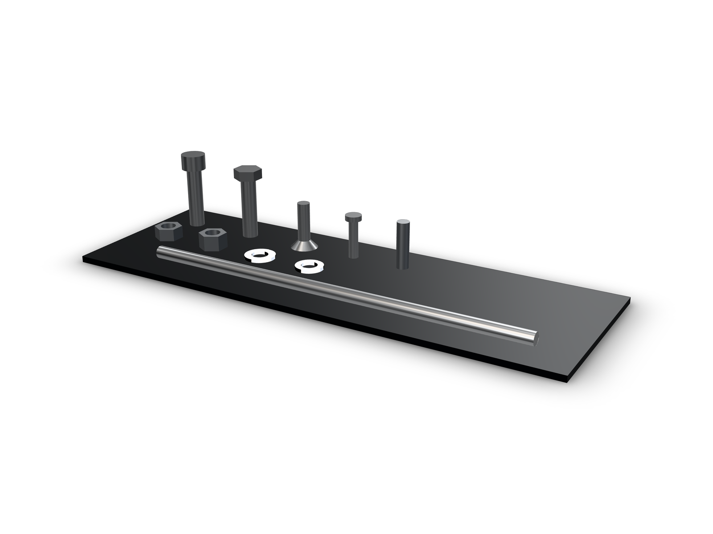
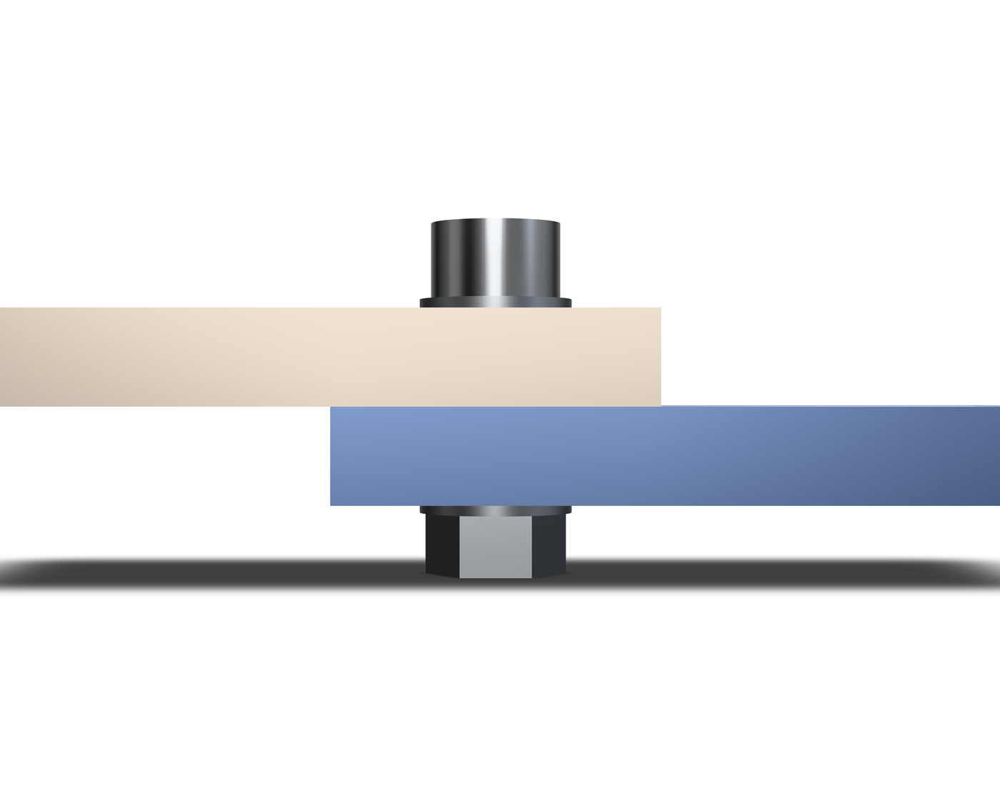
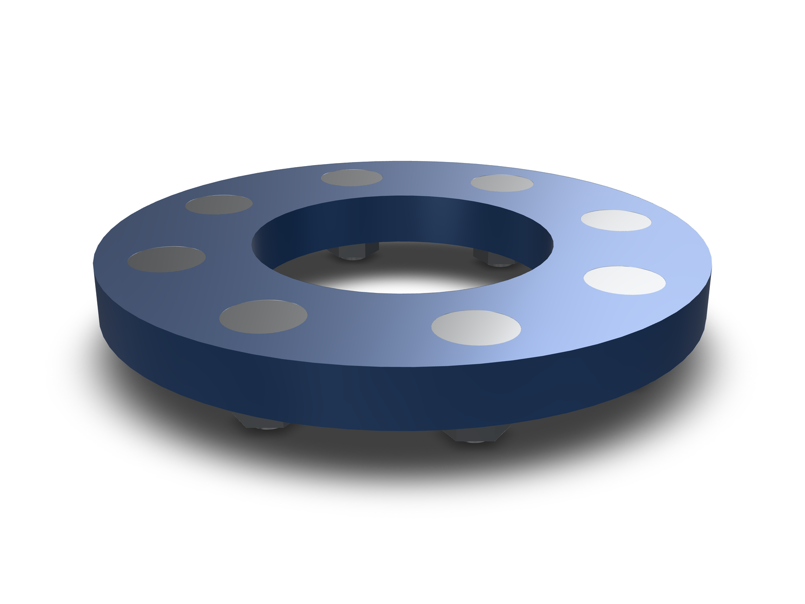
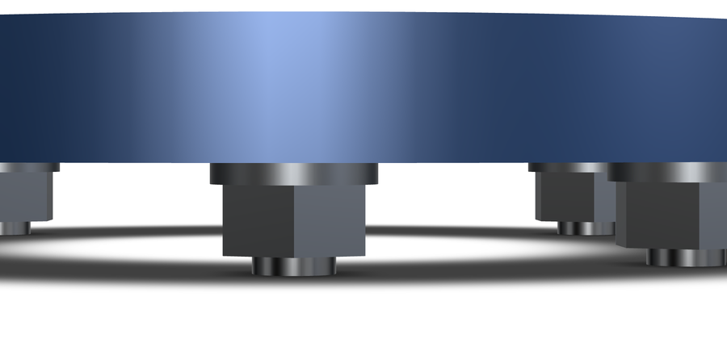

kernelCAD ships one table of ISO metric fasteners. Socket head, button head, countersunk and hex head screws and bolts, set screws, threaded rod, hex nuts, lock nuts and washers. Sizes run M2 to M20 where the standard has them, and every stocked length is per thread.

The solids are envelopes: a head plus a shank, no helical thread. That is enough to pick hardware, check a fit and lay out an assembly, and the browser builds them in memory without a filesystem.



, countersunk screw seated frustum, button head and set screw. Envelope geometry, no thread modelled.")

## What the table stocks

One row is a family, a thread and a length. Adding a size is a row, not a new function, and both the in-memory envelope and the generated STEP come from that row.

```ts
const screw = await lib.part({ family: 'socket-head-cap-screw', thread: 'M5', lengthMm: 16 });
const bolt  = await lib.part({ family: 'hex-head-bolt', thread: 'M10', lengthMm: 40 });
const rod   = await lib.part({ family: 'threaded-rod', thread: 'M8', lengthMm: 250 });
```

Socket head runs M2 to M20 (ISO 4762), hex head bolts M3 to M20 (ISO 4017), countersunk M3 to M12 (ISO 10642), button head M3 to M10 (ISO 7380). Set screws are M3 to M12 (ISO 4026), threaded rod M3 to M12 in 250 and 1000 mm lengths (DIN 975). Hex nuts and flat washers go to M20, lock nuts and lock washers to M12.

An unknown family, thread or length fails with a message that names the stocked values, which keeps an agent from inventing an M2 × 50 that no supplier sells.

## A 12 mm lap joint

Two 6 mm bars overlap by 24 mm. One M5 bolt holds them. `lib.stack` takes the grip and returns the chosen length plus the members, each positioned against the seat:

```ts
const stack = await lib.stack({ thread: 'M5', gripMm: 12, mode: 'bolt' });
```

The arithmetic is open. Grip 12 mm, a 1.0 mm washer and a 4.0 mm hex nut under it: 17 mm. The shortest stocked M5 length is 18, so the screw is an M5 × 18. `mode: 'bolt'` adds the washer under the head plus the tail washer and the nut; `mode: 'screw'` places the screw alone.




## The plate is already drilled

The other direction is to start from the part. `lib.insert` reads the bores on a lowered shape, sizes the thread from the diameter, covers every similar hole and cuts the seat the family needs.

The example plate has four Ø5.5 bores and two Ø3.4 bores. Ø5.5 is the ISO 273 normal clearance for M5, so the four become countersunk M5 bolts; the two M3.4 bores take socket head M3 screws with no seat. A 90° countersink to the Ø11.2 ISO 10642 head is cut for each flat head, and the washers and nuts land on the back.


Selection is by geometry, not by feature id: every bore with the same diameter and a parallel axis comes along. A patterned hole is covered without naming the pattern, which is why eight bolts on a bolt circle cost no more code than one.

Two edges are reported instead of guessed. A bore that sits exactly on a larger thread's tap drill comes back as `pilotFor`, so you can tell a tapped pilot from a clearance hole. A coaxial larger bore already at the mouth, a counterbore someone modelled, is reported as `existingSeatMm` and the automatic seat is left alone.

## A flange ring, eight bolts

The flange is a ring with eight Ø6.6 bores on an 85 mm bolt circle, 10 mm thick. Ø6.6 is the normal clearance for M6, and the same 10 mm grip gives an M6 × 18 stack per hole. One `lib.insert` call covers all eight.





The video after the lede is an annotated still sequence of local renders, not a screen recording.

## Close, normal or loose

ISO 273 gives three clearance classes per thread. For M6 the bores are 6.4 mm close, 6.6 mm normal and 7.0 mm loose. All three find the thread and each hole reports the class it matched, so a plate drilled for a loose fit still sizes correctly. The match tolerance is 0.1 mm, which keeps a 5.0 mm tap drill from reading as an oversized M4 hole.

```ts
const fitted = await lib.insert(plate, { diameterMm: 7.0, family: 'socket-head-cap-screw', mode: 'bolt' });
// fitted.holes[0].thread === 'M6', fitted.holes[0].fit === 'loose'
```

## What it is not

Envelopes make no claim about thread contact, strength, torque or preload. The countersunk head is the seated ISO 10642 frustum; the other heads are cylinders and the lock washer is a plain annulus without the split. Head and nut dimensions are the standards' maximums where the standards give a range, so an envelope fits a hole that a real part will also fit. Check the supplier drawing before ordering hardware for a production part.

## Reproduce the checks

In a repository checkout with dependencies installed:

```sh
npx tsx examples/parts/verify.mts
npx tsx examples/parts/verify-insert.mts
npx tsx examples/parts/verify-flange.mts
npx tsx examples/parts/verify-catalog.mts
```

Each verifier re-evaluates the committed example and writes fresh evidence. The flange check tested 300 part pairs with zero positive-volume overlaps and 1,305 mm³ of countersink removed; the insert check tested 105 pairs and 377.66 mm³. The evidence files are [catalog-evidence.json](/blog/standard-parts-library/catalog-evidence.json) and [flange-evidence.json](/blog/standard-parts-library/flange-evidence.json); the feature tests live in `src/modeling/parts/familyTable.test.ts` and `src/modeling/parts/holeInsert.test.ts`.

The same calls work in Studio, in the browser and through kernelCAD's MCP tools, so an agent can bolt a model together without a CAD file on disk. See the [docs](/docs/) for the API.
