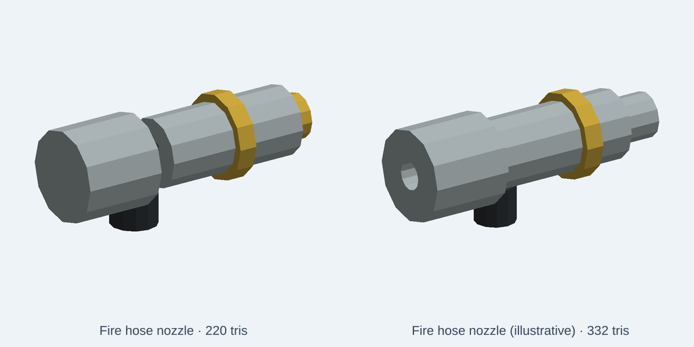

# Fire hose nozzle: continuous flow body instead of disconnected solid cylinders

15 November 2026. This change corrects a recognizable geometric defect in an **illustrative CC0 fire-rescue scene prop**. It is **not** a pressure-rated fire nozzle, an adjustable physical spray-pattern device, a validated hose-thread interface or manufacturer-grade CAD. No external dimensions, metal grades, leakage limits, hose fit or flow certifications are claimed as tested.

## Before

The public `fire-rescue/fire-hose-nozzle` showed a barrel, tip, collar, hose tail and pistol grip as **five separate source solids**. Only the tail had a hollow channel; the main `nozzle-body` and `tip` were solid cylinders. Axial inlet-to-outlet fluid flow was blocked despite the title and nominal nozzle silhouette. In addition, the hose-tail and main cylinder had an uncovered axial gap. Native rendering and the published PNG nevertheless passed basic transport/triangle checks.

## After

The three coaxial metal tube segments overlap and are **fused to one connected metal flow body**. A common axial **Ø28 mm** fluid bore is then subtracted across the entire **266.6 mm nominal length**, including the coupling tail and fixed front tip. The selector sleeve is a separate annular body with an actual central clearance; its static position makes no claim to a working valve or spray-pattern mechanism. The pistol-style grip remains a separate visible material body seated against the barrel. The resulting model has **three named native bodies** and 332 triangles within the unchanged 2,200 triangle budget; the overall 266.6×111×90 mm envelope remains illustrative.

Original visual: one apparently closed entrance and segmented cylinders. Corrected visual: visible outlet bore with connected body and separate sleeve/grip. The user-facing title now says *Fire hose nozzle (illustrative)*; color knobs are expressly appearances, not certified materials.



[Six-second native before/after comparison](evidence/fire-hose-nozzle-20261115/native-comparison.mp4). Both frames are actual software renderings, not WebGL acceptance, working spray valves or hardware pressure tests. The original [source fixture](evidence/fire-hose-nozzle-20261115/original-source.kcad.ts) is preserved for a negative control.

## Tested geometry acceptance

`tests/integration/catalog/fireHoseNozzleFidelity.test.ts` verifies standard, 0.7× and 1.3× sizes. The inspected GLB must have one connected metal body, a separate annular selector and a separate grip. Axial ray checks from the coupling side verify the entire bore is open, with positive wall controls and independent radial cross-section checks at hose inlet, middle barrel and tip. The original five-body solid source still compiles but fails the geometry contract; the test explicitly checks that the original main nozzle cylinder blocks the bore. The final test also rerenders default GLB and compares the resulting canonical 512×512 PNG byte-for-byte with the committed preview.

Local focused results: **9/9** pass (three size variants, original negative, preview byte parity, four catalog-module cases). Targeted ESLint passes and the 2,402-entry index/source hash consistency check changes only this source record. Native execution is not manufacturer certification.

Reproduce (Node 24.22.2, reused dependencies, one Vitest worker, 2 GiB heap):

```sh
NODE_OPTIONS=--max-old-space-size=2048 node node_modules/vitest/vitest.mjs run \
  tests/integration/catalog/fireHoseNozzleFidelity.test.ts tests/integration/catalog/assetModule.test.ts \
  --maxWorkers=1 --no-file-parallelism
node node_modules/eslint/bin/eslint.js \
  tests/integration/catalog/fireHoseNozzleFidelity.test.ts catalog/kits/fire-rescue/fire-hose-nozzle.kcad.ts
```

Require exact-head repository CI and protected review before merge. Production acceptance requires actual live source and both PNG routes to match the reviewed merged commit, a live part page/browser check, cache purge, and rerunning these geometric assertions against the **downloaded production source**. A successful local render or merged PR is not a shipped fix.

## External feature comparison (15 November 2026)

Commercial selectable-flow nozzle descriptions and cutaway drawings typically distinguish inlet connection, open waterway, shutoff valve, selectable spray head and optional pistol grip. For example, the [Elkhart Brass Select-O-Flow description](https://elkhartsales.com/select-o-flow-fire-hose-nozzle.php) identifies selectable flow and pistol-grip versions, while the [Rylstatic Viper nozzle cutaway](https://pacificandfire.com/en/product/fire-nozzles/nozzle-viper-rylstatic-model-bd-1560-bd-3012-bd-7515-bd-9520) identifies internal valve/seats. The public CC0 prop has a hole and exterior grip/collar, but intentionally **does not model** those internal working elements. Its dimensions and performance are not derived from any particular nozzle specification.
