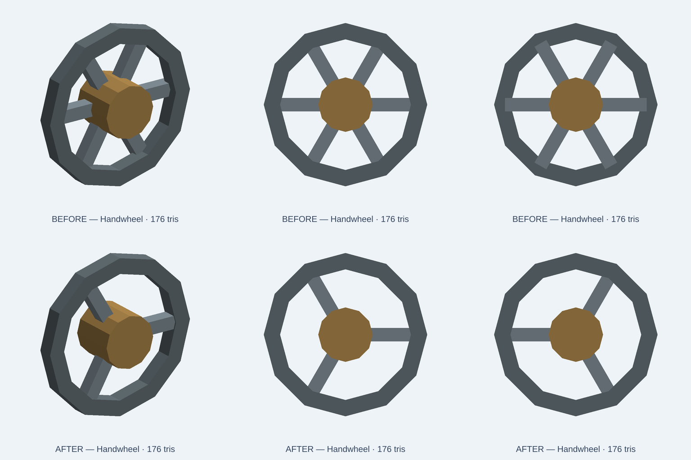

# Handwheel: three radial spokes, not three diametral bars

12 November 2026. Repairs the identity mismatch in issue #1350. This remains an illustrative CC0 prop, not manufacturer-grade CAD. The solid hub is explicitly an envelope: it has no shaft bore, keyway, vendor interface, tolerance or torque rating.

## Geometry change
The original model uses three centered full-width bars at 0°, 60°, 120°. Each bar extends on both sides of the hub, so the result has six radial spokes despite its description promising three.

The repair uses three single radial bars at 0°, 120°, 240°. Each nominal 22×5×5 mm bar spans radii 5 to 27 mm and is centered axially on the rim. This gives real overlap with the 10 mm-radius hub and the 24–30 mm-radius rim. The overall 60 mm diameter, 18 mm hub depth, original colors and three size presets are unchanged.



Before is the top row. After is the bottom row. The repaired front view has exactly three radial connections and three open sectors. The six-second [native comparison](evidence/handwheel-20261112/native-comparison.mp4) shows before/after end views, not motion or hardware tests. Both exports contain 176 triangles, below the unchanged 340-triangle budget. These are deterministic OCCT-to-GLB software renders, not WebGL/browser-renderer acceptance.

## Native acceptance
`tests/integration/catalog/handwheelFidelity.test.ts` verifies all three supported scales: 0.75, 1, 1.25.

- Three radial spokes and three open sectors, measured using mesh ray intersections, not merely names.
- Each spoke is a connected solid with overlap at the hub and rim and ±2.5 mm nominal axial bounds.
- Spoke volume is 550 mm³ nominal; overall bounds remain 60×18×60 mm.
- Five named mesh parts remain. Rim and hub are connected solids.
- Solid-hub test matches the explicit envelope limitation.
- Original-source negative control hits all six spoke positions and fails the corrected acceptance.

Original: 3 positive cases fail and 1 negative-control case passes. Repair: 4/4 geometry tests plus 4/4 existing asset-module tests pass. Targeted ESLint and all 2,402 bundled index/source hashes pass. Full native catalog-index CI is a separate merge gate.

```sh
NODE_OPTIONS=--max-old-space-size=2048 node node_modules/vitest/vitest.mjs run \
  tests/integration/catalog/handwheelFidelity.test.ts \
  tests/integration/catalog/assetModule.test.ts \
  --maxWorkers=1 --no-file-parallelism
node node_modules/eslint/bin/eslint.js \
  tests/integration/catalog/handwheelFidelity.test.ts \
  catalog/kits/standard-components/handwheel.kcad.ts
```

Node 24.22.2; reused dependencies; one worker; 2 GiB heap. Fresh isolated worktree from `c3a9c65c1e2bb5e3c816868d4b501f609f6eb94b`. The root partition was used because /data had only 7.5 GiB free with concurrent CI. No other worktree or active implementation was modified.

## Release gate
Require review and exact-head repository checks before normal merge. Verify actual marketing upload, cache purge, live source and both PNG routes against this commit. Rerun the geometry acceptance against the downloaded live source. Do not infer deployment, manufacturer-grade geometry or product UI repairs from a successful source test.
