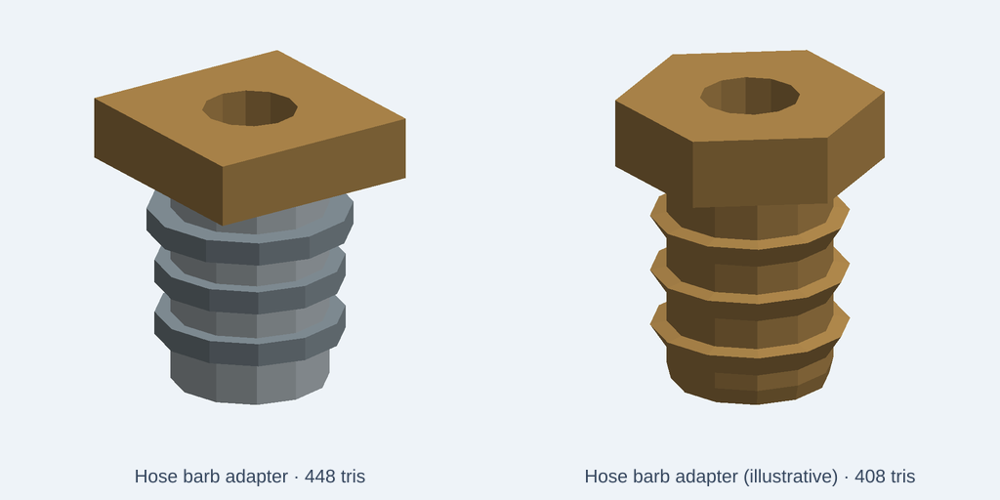

# Hose barb adapter: tapered retention features, not separate flat collars

November 15, 2026. This fixes the semantic identity of an **illustrative CC0 prop**; it does **not** certify a pressure-rated fitting, a specific hose material or ID, fatigue, insertion force, machining tolerance, thread, metal alloy or production interface.

## Confirmed original defect

The published model titled *Hose barb adapter* displayed five detached source bodies: hollow spigot, three flat cylinders (labelled “barbs”), and a square wrench block. The “barbs” were radially uniform stacked rings; they had **no taper ramp or retention shoulder**. The nominal hex was a square block rather than six wrench flats. All these pieces individually compiled and a PNG existed, but the model lacked the advertised functional geometry.

## Focused change

One connected machined-form fitting with a through passage Ø12 mm and a hex wrench at the rear, **28 mm across flats**. The retained nose/spigot is a revolved profile with *three actual conical retention ramps*, stepping down sharply after the peaks. The overall nominal axial extent remains 36 mm. The illustrative metal color remains the `brass` appearance control; the old `steel`/`stainless` knobs and presets were removed because a one-piece fitting cannot truthfully present different body finishes. These are appearance controls, not metal specifications; saved models relying on removed color knobs must use `brass` instead.

[Six-second before/after native-render comparison](evidence/hose-barb-20261115/native-comparison.mp4). The before image was downloaded from the live catalog; the after image is the deterministic canonical `renderCatalogPreviews.ts` output of the tested source. Neither demonstrates mechanical pullout tests, pressure service, manufacturing readiness or WebGL acceptance. The [unmodified original source](evidence/hose-barb-20261115/original-source.kcad.ts) is a deliberately failing negative control.

## Repeatable native tests

`tests/integration/catalog/hoseBarbFidelity.test.ts` checks all three default/compact/large presets and the original defect. It verifies **one connected body** instead of five separate pieces; the outer radial occupancy at each of three taper starting points, high flanks and sharp retaining shoulders; Ø12 mm continuous axial bore with positive wall control; real six flats at the 28 mm width; actual top/bottom dimensions; and source metadata limiting manufacturing claims. The original five-body/square-block source still compiles but fails the intended checks.

Targeted result: **9/9** focused cases, consisting of 5 native/fidelity/preview cases and 4 existing asset-module cases, passed. ESLint passed. All **2,402/2,402** catalog source/index hashes match; only the adapter record changed. The new preview is **408 triangles within the unchanged 500 budget**, generated with the canonical asset-title caption and verified byte-equal from native GLB in a regression test. No all-asset native CI is claimed here; exact-head GitHub lint/build/test/catalog-index remains the merge gate. Native geometry is not a manufacturer certification.

Node 24.22.2, reused dependency checkout, max 1 Vitest worker and 2GiB heap. Fresh isolated source worktree; no private Studio code, supplier quotations, customer models or concurrent PR modified.

## Production gate

Merge only after normal review/CI. After the marketing publication completes, compare actual source and both PNG bytes against the exact merged commit, check the live per-asset page and Studio link, then rerun the native checks against the **downloaded live source**. Do not call an open or merged PR a deployed repair.
