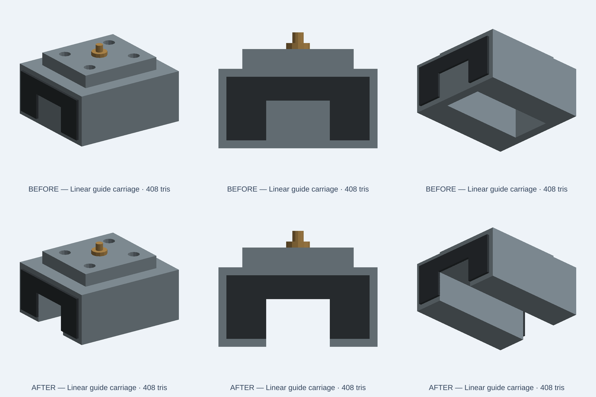

# Linear-guide carriage: open rail channel

12 November 2026. This change repairs a CC0 illustrative scene prop. It does not certify a commercial carriage, ball circulation, vendor raceways, tolerances, stiffness or load capacity.

## Defect and focused change
The original 44 x 40 x 20 mm steel body has a 36 mm-long blind underside pocket. Four-millimetre walls at both ends block a rail. The new subtraction runs from X=-23 to +23 mm, beyond the body ends, retaining the nominal 16 x 12 mm channel. No colors, presets or external dimensions change. The separate wipers, mounting pad and grease fitting remain.



The top row is the original source. The bottom row is the repair. These are native OCCT-to-GLB software renders, not a browser/WebGL acceptance result. Both meshes have 408 triangles, below the unchanged 460-triangle limit. The six-second [comparison clip](evidence/linear-guide-carriage-20261112/native-comparison.mp4) shows the generated end views; it is not a motion simulation.

## Geometry acceptance
`tests/integration/catalog/linearGuideCarriageFidelity.test.ts` checks all three size choices (0.75, 1.0, 1.25 scale):

- Nine interior rays in each travel direction clear the entire assembly.
- Positive wall/roof controls and connected-component count prevent a deleted-body false pass.
- Steel-body bounds remain 44 x 40 x 20 mm at nominal scale; volume is 26,752 mm³, including the through-channel cut.
- Ten named mesh parts, six wiper members and the four mounting-pad wells remain.
- The original blind pocket is a failing negative control.

Original: 3 positive geometry cases fail; the negative-control case passes. Repair: 4/4 cases pass. Asset-module integration: 4/4 pass. Targeted ESLint passes. All 2,402 bundled source hashes match the committed index. Live marketing separately lists 2,418 assets because it also publishes manufacturing showcase assets.

Commands (Node 24.22.2, reused dependency tree, one worker, 2 GiB heap):

```sh
NODE_OPTIONS=--max-old-space-size=2048 node node_modules/vitest/vitest.mjs run \
  tests/integration/catalog/linearGuideCarriageFidelity.test.ts \
  --maxWorkers=1 --no-file-parallelism
NODE_OPTIONS=--max-old-space-size=2048 node node_modules/vitest/vitest.mjs run \
  tests/integration/catalog/assetModule.test.ts --maxWorkers=1 --no-file-parallelism
node node_modules/eslint/bin/eslint.js \
  tests/integration/catalog/linearGuideCarriageFidelity.test.ts \
  catalog/kits/standard-components/linear-guide-carriage.kcad.ts
```

The local full native index rebuild was interrupted at the command time limit and is NOT counted as passed. The exact-head `catalog-index` CI job remains a merge gate. These focused results are not a full clean packaged-runtime test. No product regression is claimed repaired by this asset change.

## Release acceptance
Require the exact-head repository gates before normal merge. After the marketing deployment completes, compare the actual source and canonical PNG against this reviewed commit and inspect the live per-part page. A merged PR, accepted workflow dispatch or passing source test alone does not prove production publication.
