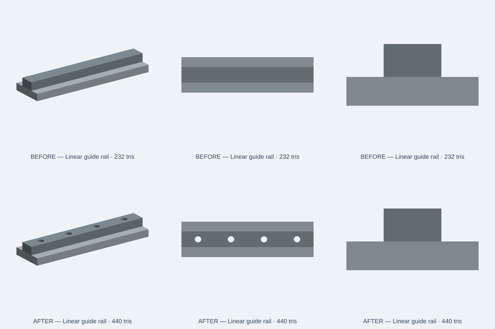

# Linear-guide rail: accessible top mounting passages

13 November 2026. Fixes the component identity error in the CC0 illustrative rail. This is **not** a vendor rail: no recirculating elements, mating carriage raceways, fasteners, tolerances, loading or preload rating are claimed.

## Fault and focused repair

Original model: the 120×32×7 mm foot has four Ø6 mm holes at X=-45,-15,15,45 mm. Its separate 120×14×8 mm upper rail is solid, covering every lower hole. An installer cannot access the bottom hole pattern from above.

Repair: apply a matching four-position native `holes('top', { positions, diameter, depth:'through' })` to the upper rail. This preserves geometry and part identity while opening the holes through both bodies. The native preview now shows four access holes in the top bar. Colors, overall envelope, mounting pattern and size presets do not change. The low-poly count grows from 232 to 440 triangles; the catalog limit increases from 300 to **460** to allow the real openings rather than suppressing triangles. No cosmetic-only workaround is used.



Top row = original. Bottom row = repair. The [6-second native comparison clip](evidence/linear-guide-rail-20261113/native-comparison.mp4) is a static before/after preview, not a motion or load simulation. Source/GLB generated with KernelCAD native OCCT and a deterministic software renderer; these do not establish browser WebGL or physical correctness.

## Geometry contract

`tests/integration/catalog/linearGuideRailFidelity.test.ts` verifies three size choices (compact/standard/large) and an original-source negative control. It requires 12 clear ray positions through all four mounting passages, retained solid upper rail and foot controls, two connected named meshes and the 120×32×15 mm nominal envelope. The original source fails the three positive size cases. The new source passes **4/4** native regression cases and **4/4** existing catalog module cases. Targeted ESLint and all **2,402** source/index hashes pass. Full exact-head catalog CI remains a merge gate.

```sh
NODE_OPTIONS=--max-old-space-size=2048 node node_modules/vitest/vitest.mjs run \
  tests/integration/catalog/linearGuideRailFidelity.test.ts \
  tests/integration/catalog/assetModule.test.ts \
  --maxWorkers=1 --no-file-parallelism
node node_modules/eslint/bin/eslint.js \
  tests/integration/catalog/linearGuideRailFidelity.test.ts \
  catalog/kits/standard-components/linear-guide-rail.kcad.ts
```

Node 24.22.2, reused dependencies, one worker, 2 GiB heap. Source worktree branched from the then-current `origin/develop` SHA `e2d13871ee7da8648d7f74fbce243cd271b08aa2`; user dirty checkouts untouched.

## Release and independent acceptance

Normal protected merge only after exact-head CI, review and catalog checks. Marketing deployment is a separate surface; confirm the actual uploaded source/PNG, edge purge and visible per-part page. Rerun the geometry contract against downloaded live source before declaring production fixed. This repair does not fix any Studio product/export defect.
