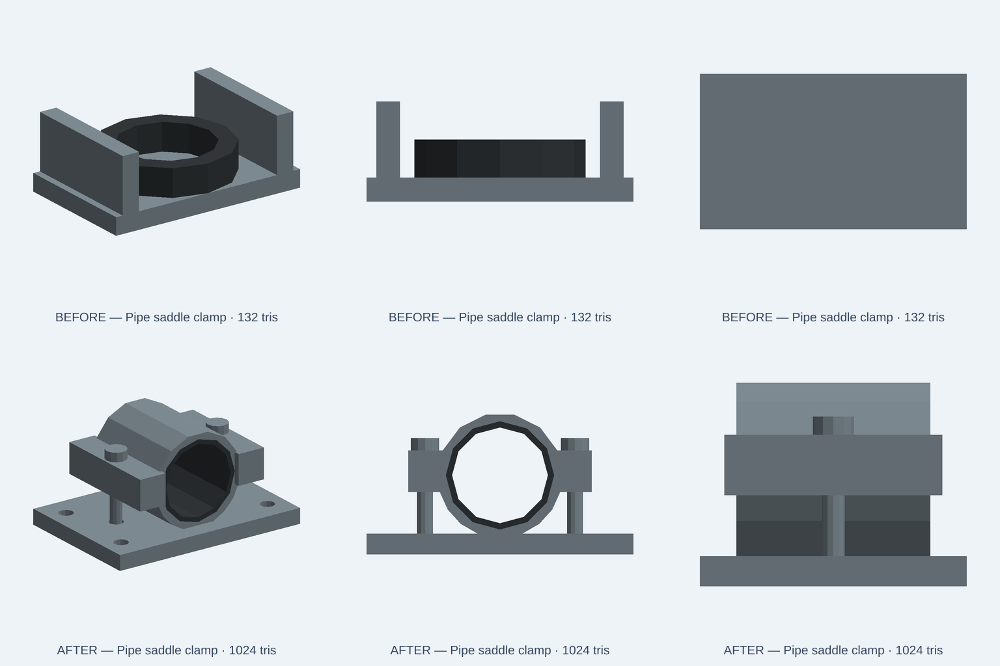

# Pipe saddle clamp: replace a vertical donut with a two-piece pipe seat

13 November 2026. Fixes [catalog defect #1366](https://github.com/w1ne/kernelCAD-web/issues/1366). This is an illustrative CC0 low-poly scene prop. It is not vendor CAD, a dimensioned pipe standard, a verified fastening solution or a load-rated design.

## Confirmed semantic defect

The live baseline described a *two-piece pipe saddle clamp*, but the source modeled a 56 × 36 × 5 mm foot, two vertical walls, and a rubber ring with its axis along Z. The PNG showed a donut trapped between parallel walls. There was no lower curved pipe cradle along the horizontal pipe axis, no separate upper saddle cap, and no actual fastener passages or mounting holes. The old model evaluated, rendered, and passed thumbnail transport checks despite having the wrong component identity.

The source fix creates two separate steel half-saddles around a Y-axis pipe opening, a connected lower steel cradle and mounting foot, separate upper cap, separate rubber half-liners, two bolt shafts/heads through real aligned ear bores, and four mounting-foot holes. It does not change material appearance presets into invented physical material properties. The revised descriptive copy explicitly states no validated pipe-standard fit, tolerance, bolt specification or load rating. A physical pipe, torque preload and assembly motion were not modeled or verified.



Top row is the original source (132 triangles). Bottom row is the repaired 1,024-triangle model, below the 1,500-triangle budget. These are native OCCT-to-GLB software views, not browser/WebGL proof. The [six-second native front-view clip](evidence/pipe-saddle-clamp-20261113/native-comparison.mp4) provides before/after visual evidence, not a simulated assembly action.

## Functional geometry acceptance

`tests/integration/catalog/pipeSaddleClampFidelity.test.ts` evaluates the nominal model and all three published size presets (0.75×, 1×, 1.25×) using exported triangle geometry. It tests both Y-axis openings through the assembled clamp, actual curved material at four positive-control points, separate connected lower and upper steel parts, two connected rubber liners, real through-bores in both steel ears, two separate clamp bolts, four base through-holes, and the nominal 64 × 44 mm foot envelope. The exact original published source is retained as the negative-control fixture `tests/fixtures/catalog/pipeSaddleClampOriginal.kcad.ts`; its native output succeeds, but correctly fails the structural identity contract.

Before: three new positive cases fail; the original-source negative control passes. After: **4/4 native geometry regressions pass**. Existing catalog asset-module integration **4/4 passes**. Targeted ESLint and the 2,402 bundled source-hash/index consistency checks pass. Full native catalog-index and repository CI remain separate exact-head PR gates.

```sh
NODE_OPTIONS=--max-old-space-size=2048 node node_modules/vitest/vitest.mjs run \
  tests/integration/catalog/pipeSaddleClampFidelity.test.ts \
  tests/integration/catalog/assetModule.test.ts \
  --maxWorkers=1 --no-file-parallelism
node node_modules/eslint/bin/eslint.js \
  tests/integration/catalog/pipeSaddleClampFidelity.test.ts \
  catalog/kits/standard-components/pipe-saddle-clamp.kcad.ts
```

Node 24.22.2, reused compatible dependency tree, one Vitest worker and 2 GiB heap. Fresh isolated worktree from remote `develop` at `7986fd635c2a5127469a3ad8fe2d09ed7eda942b`. This source-only acceptance is not clean packaged-runtime validation or physical manufacturing approval.

## Release acceptance

Do not mark production repaired on merge alone. Require reviewed exact-head CI and protected merge. After marketing publication and cache purge, compare the actual served `.kcad.ts` and gallery/per-part PNGs byte-for-byte with the merged commit. Re-evaluate the downloaded live source with this same geometry test, inspect the live gallery page and its explicit limitations, then update the evidence ledger. Keep private Studio/product QA in private repositories.
