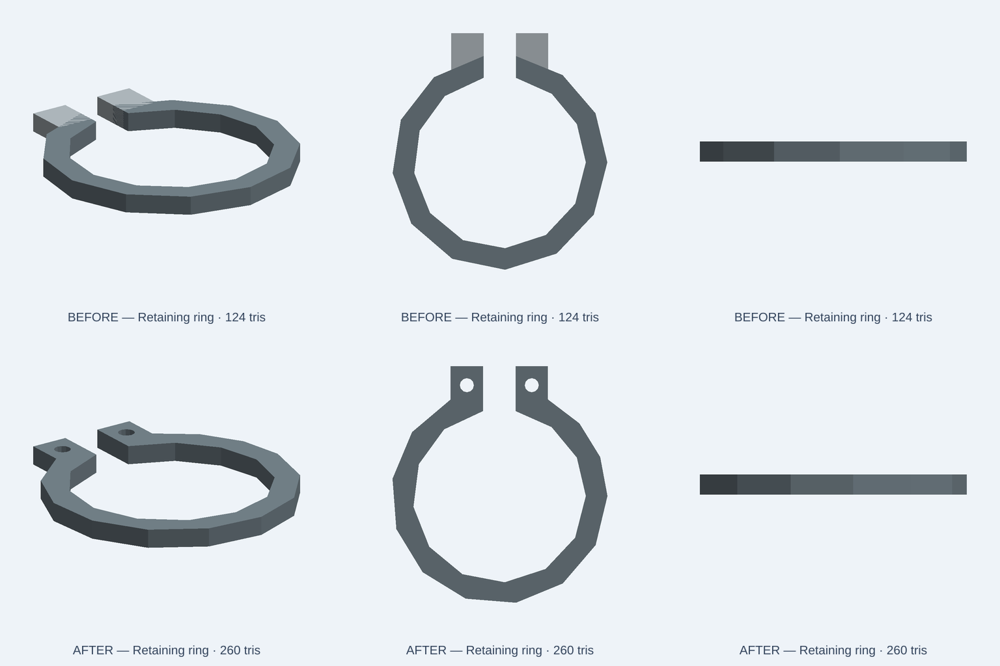

# Retaining ring: integral ears and through-holes

November 13, 2026. This repairs the actual retaining-ring geometry of an **illustrative CC0 scene asset**. It does not certify a DIN 471 spring clip, fit into a manufacturer groove, spring force, fatigue, load, metal hardness or tolerances.

## Before

The original source creates an open C arc and two **separate, solid box-shaped ears** named `ear-left` and `ear-right`. Those ears have no plier holes. The old preview shows visually adjacent tabs but does not prove a one-piece spring ring. Three detached CAD bodies cannot represent the manufactured single-piece stamped clip claimed by the assembly title and the installation-ear description.

## After

The source fuses the C ring and two ears into **one connected solid**. It subtracts real **Ø2.6 mm** through-holes at the integral ear tips, with clearance beyond both faces. The open gap remains and the back retaining arc is intact. The nominal thickness remains 3 mm. The geometry remains intentionally polygonal (low-poly CC0, 260 triangles under the original 300-triangle budget).

A one-piece clip has one meaningful metal appearance color. We retain `springSteel` and the `size` parameter with the three compact/standard/large choices. We remove the previous `stainless` *ear color* knob and its matching preset entries because after the Boolean union those color settings became inert. That parameter removal is explicit and intentional; saved appearance settings using `stainless` no longer affect this asset. Neither color selects an engineering steel grade.



[Actual six-second top-view comparison](evidence/retaining-ring-20261113/native-comparison.mp4) illustrates the newly drilled tips. Both images are OCCT-to-GLB software renders, **not** a browser/WebGL or mechanical spring acceptance. The [unmodified original source](evidence/retaining-ring-20261113/original-source.kcad.ts) is retained as a failing negative control.

## Tests and limits

`tests/integration/catalog/retainingRingFidelity.test.ts` checks all three scaling presets, then independently re-evaluates the exact original source. Its mesh ray tests verify:

- Exactly **one connected spring body**, not three detached pieces.
- Both nominal hole centers are empty through thickness; adjacent ear material is present as positive controls.
- The open slit is still clear, the rear retaining arc remains solid and the shaft interior is open.
- Positive bounds around the ring and ears and nominal **3 mm** axial thickness.
- Original source exports normally but fails the expected one-body/two-hole contract.

**8/8 local focused tests pass:** four geometry cases (three presets plus negative control), four existing asset-module integration cases. Targeted ESLint passes. The 2,402 authored catalog index entries retain matching source hashes. Normal exact-head CI including `catalog-index` remains required before merge. The downstream published source and preview must be rechecked after marketing deployment; local PNG or source evaluation does not prove production acceptance.

```sh
NODE_OPTIONS=--max-old-space-size=2048 node node_modules/vitest/vitest.mjs run \
  tests/integration/catalog/retainingRingFidelity.test.ts \
  tests/integration/catalog/assetModule.test.ts \
  --maxWorkers=1 --no-file-parallelism
node node_modules/eslint/bin/eslint.js \
  tests/integration/catalog/retainingRingFidelity.test.ts \
  catalog/kits/standard-components/retaining-ring.kcad.ts
```

Node 24.22.2, reused dependencies, one worker, 2 GiB heap; fresh isolated worktree from `develop` `88c009e92ef6df0e5c9a3fb486599dc441c5d3f2`. No user models, private Studio code, vendor CAD or other active PR modified.
