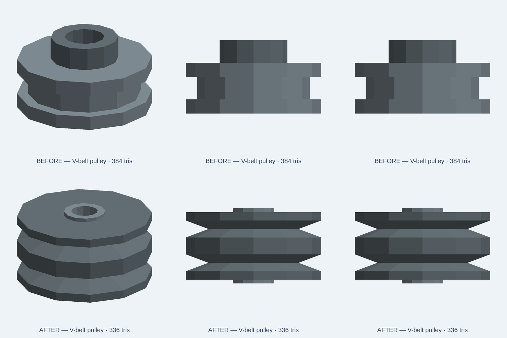

# Two V grooves rather than one flat step

November 13, 2026. This is an illustrative CC0 scene asset, **not** a manufacturer-certified V-belt drive component. Do not use the model for groove-standard fit, shaft fit, transmission torque, loading, tolerance or material specifications.

## Confirmed defect

The published [V-belt pulley](https://kernelcad.com/catalog/standard-components/v-belt-pulley/) was four stacked cylindrical rings. Its source says it has **two** belt grooves, but the actual outside profile had **one flat annular step**, no taper-sided V flanks and no second groove. The normal source evaluation passed and its PNG looked superficially like a pulley. Color or transport checks did not expose the mismatch.

## Focused repair

The new main sheave is one connected revolved profile, not stacked cylinders. Its nominal **72 mm diameter** has two **12 mm deep** annular V grooves at axial positions 11 and 29 mm, with **9 mm top mouth** and an approximately **41-degree included angle**. The distinct steel bushing envelope has a continuous **14 mm diameter bore** and extends 2 mm beyond either sheave end. The main sheave and bushing are two separately named solids with an illustrative 0.05 mm radial gap. The overall axial envelope is 40 mm. This is a new illustrative envelope, **not** a backwards-compatible vendor fit or a verified ISO groove section.

The three original compact/standard/large scaling choices and existing parameter names/presets remain. Their steel/cast-iron parameters now explicitly label **appearance colors only**, not real material grades.



The [six-second native comparison](evidence/v-belt-pulley-20261113/native-comparison.mp4) shows the original flat-step side silhouette and new taper-sided double-V profile. These are actual native OCCT-to-GLB software renders, **not** motion simulation, WebGL/browser acceptance or physical belt engagement tests. Retained original source is in [the negative-control fixture](evidence/v-belt-pulley-20261113/original-source.kcad.ts).

## Native regression and integration results

`tests/integration/catalog/vBeltPulleyFidelity.test.ts` runs compact, standard and large presets, and an original-source negative control. It measures actual GLB vertices and ray intersections:

- The individual sheave and bushing are each connected, named solids. Sheave OD 72 mm, axial span 2–38 mm; bushing OD 22 mm, axial span 0–40 mm.
- Both V roots are open at radius 28 mm. Their four intermediate flanks are occupied at that same radius; the three full-radius land regions remain.
- The 14 mm center bore and 0.05 mm illustrative bushing clearance are open along the complete axial length, with positive occupancy controls through the bushing ring and sheave body.
- The original published source compiles but fails the two-groove/taper acceptance tests; the negative-control case checks this.

**8/8 focused tests pass:** 4/4 geometry and negative controls plus 4/4 existing catalog module integration. Targeted ESLint and **2,402/2,402** source/index hash checks pass. The repaired native preview has **336 triangles**, below the original unchanged 420-triangle budget. This is not a complete clean package test; exact-head repository CI, including native `catalog-index`, remains the merge gate.

```sh
NODE_OPTIONS=--max-old-space-size=2048 node node_modules/vitest/vitest.mjs run \
  tests/integration/catalog/vBeltPulleyFidelity.test.ts \
  tests/integration/catalog/assetModule.test.ts \
  --maxWorkers=1 --no-file-parallelism
node node_modules/eslint/bin/eslint.js \
  tests/integration/catalog/vBeltPulleyFidelity.test.ts \
  catalog/kits/standard-components/v-belt-pulley.kcad.ts
```

Node 24.22.2, reused dependencies, one worker, 2 GiB heap. Per-asset evidence is preserved in the 2026-11-13 work-1 audit ledger. The separate 66-asset sweep has **63 native default passes and three catalog dependency blockers**, and is **not** declared manufacturer-grade acceptance for all 66.

## Release gate

Normal code review and exact-head CI must pass before merge. After the server's marketing publication and cache purge, verify actual source and both PNG routes by byte hash, per-part page/Studio action and rerun these geometry controls against the **downloaded production source**. Do not claim deployment on PR merge alone.
