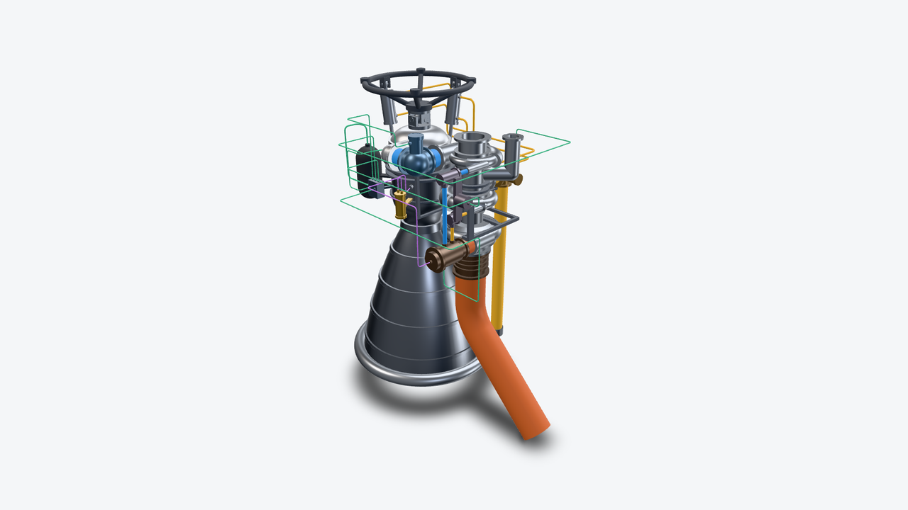
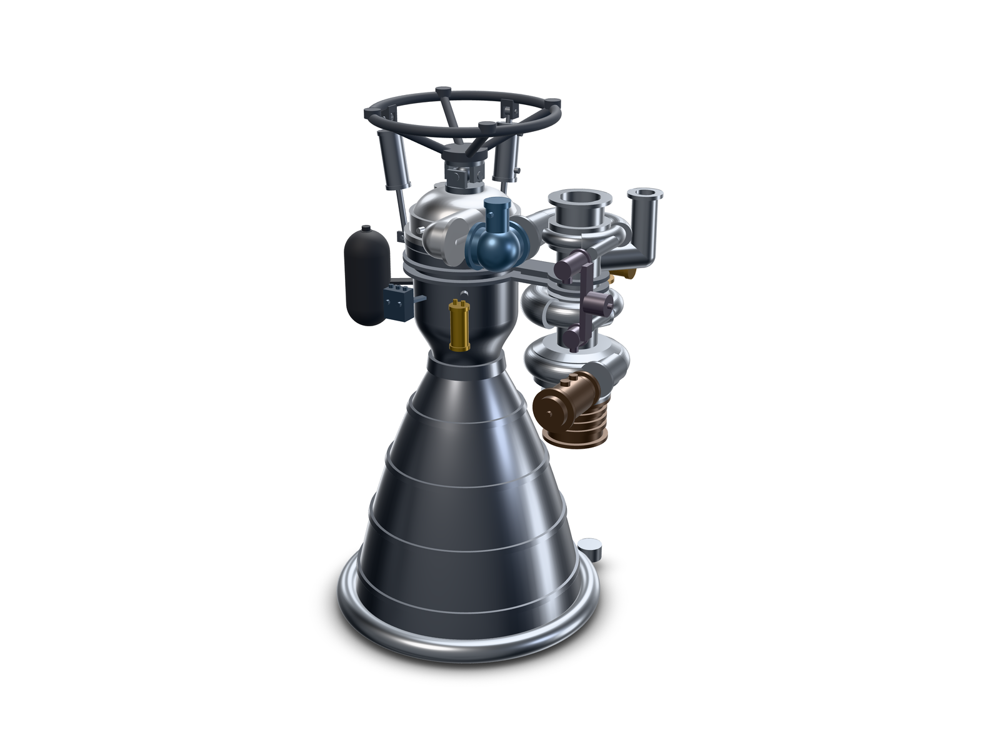

# Gas-generator kerolox engine: 23 routed lines

[`engine-routed.kcad.ts`](engine-routed.kcad.ts) is a self-contained copy of the bare model with 23 real hollow tubes. Corner points are authored by hand; the model performs no path search. The bare source remains the original comparison model.



The services are 4 blue LOX, 9 amber fuel, 2 copper hot-gas, 2 violet igniter and 6 green pneumatic lines. Every tube uses actual `part.port()` endpoints. Of the 46 ports, 45 are used once by a tube. `turbopump.turbine-out` is covered by the directly bolted exhaust collar; `hotgas-exhaust` starts at the collar's `out` and ends in free air. A zero-length tube is deliberately not invented for that bolted interface.

The routed copy adds `main-valve-support` and `generator-valve-support`: visible static metal support fabrications with contact pockets cut against the actual housings. These give the valves and generator a visible path back to the chamber and pump mount. They are illustrative geometry, with no fastener, load, vibration, thermal-expansion or structural acceptance. There are no mates: assembly `validate` still reports floating-part warnings for this display assembly. Tube validation and interference evidence are separate from mechanical acceptance.

The default tube-to-part and same-service surface clearance is 6 mm. LOX/fuel tube pairs require 12 mm; each hot-gas/other-service tube pair requires 25 mm. These are display layout estimates, not thermal separation or pressure-system design limits. Cold rigid lines use a minimum centreline bend radius of 3 OD and an end straight of 2.5 OD. The formed exhaust duct uses 1.5 OD and 1 OD respectively. The straight hot-gas feed has no bend and is exempt from bend/end-straight rules. Tube walls are illustrative; no flow or operating pressure is declared.

The [broken twin](engine-routed-twin.kcad.ts) differs by one parameter: `IgniterRunRise` is 308 instead of 268 mm. That moves the generator igniter run into the GG-valve pilot line. Its documented diagnostic is `tube.clearance.overlap`; returning the parameter to 268 repairs that one route. A failed tube gate blocks STEP export.

Placement parameters move their actual port endpoints. Hand-authored routing still has to meet the new port axes and clearances; changing an engine station may require new corners or layout changes. The cartridge-movement contract checks a 10 mm shift with both igniter tube ends staying on their ports.

The generator and actuator circuits retain the separate pump galleries present in the bare model. This example makes no tee or automatic branching claim. End fittings, internal drilled bores, valve internals, clamps along long tube runs and catalog-qualified components are not modeled.

Reproduce the deterministic checks with Node 22 after `npm run build:cli`:

```bash
node dist/cli/index.js evaluate examples/rocket-engine-lines/engine-routed.kcad.ts --json
node dist/cli/index.js interference examples/rocket-engine-lines/engine-routed.kcad.ts --json
node dist/cli/index.js evaluate examples/rocket-engine-lines/engine-routed-twin.kcad.ts --json
npx vitest run tests/integration/examples/rocketEngineRouted.test.ts --maxWorkers=1 --no-file-parallelism
```

For browser-backed renders, attach the existing browser with `PW_CDP_URL`; keep the user browser running and close only owned render tabs/helpers.

## Verified routing contract

The local OCCT checks on 2026-10-12 passed all five integration cases. These establish the example's geometry and routing behavior, not fabrication or operating approval.

| Check | Measured result |
|---|---|
| Evaluation | 441 features, 23 tubes, 46 resolved ports; no errors or warnings |
| Endpoint inventory | 45 ports used once; turbine outlet covered by the bolted collar; one intentional free exhaust end |
| Minimum reported surface clearance | 7.55 mm, fuel manifold line to main-valve support |
| Assembly interference | 42 parts, 181 comparisons, no overlapping pairs at 0.01 mm³ tolerance; no ignored pairs |
| Connected solids and STEP | Each of 19 hardware parts and 23 tubes is one solid; STEP contains 42 solids |
| Broken twin | Exactly one `tube.clearance.overlap`; STEP exits with failure and writes no file |
| Moved cartridge | A 10 mm station shift keeps both igniter ends on their moved ports and preserves the port axes |
| Mechanical constraints | No mates; floating-part warnings remain for all 42 display parts |

The integration contract is [`rocketEngineRouted.test.ts`](../../tests/integration/examples/rocketEngineRouted.test.ts). Returning the twin's one changed parameter to the good value reproduces the evaluated good source byte for byte.

## Endpoint and bend inventory

All dimensions are mm. Corner count is the number of authored bend corners; long straight ducts have zero.

| System | Tube | From | To | OD | Wall | Radius | Corners |
|---|---|---|---|---:|---:|---:|---:|
| lox | `lox-pump-main` | `turbopump.lox-out` | `main-lox-valve.in` | 114.3 | 1.65 | 343 | 0 |
| lox | `lox-main-dome` | `main-lox-valve.out` | `injector-dome.lox-in` | 114.3 | 1.65 | 343 | 0 |
| lox | `lox-pump-gg` | `turbopump.gg-lox` | `gg-valve.lox-in` | 25.4 | 1.24 | 80 | 0 |
| lox | `lox-gg-generator` | `gg-valve.lox-out` | `gas-generator.lox-in` | 25.4 | 1.24 | 80 | 0 |
| fuel | `fuel-pump-main` | `turbopump.fuel-out` | `main-fuel-valve.in` | 88.9 | 1.65 | 270 | 0 |
| fuel | `fuel-main-manifold` | `main-fuel-valve.out` | `coolant-manifold.fuel-in` | 88.9 | 1.65 | 270 | 0 |
| fuel | `fuel-coolant-dome` | `chamber.coolant-out` | `injector-dome.fuel-in` | 88.9 | 1.65 | 270 | 0 |
| fuel | `fuel-pump-gg` | `turbopump.gg-fuel` | `gg-valve.fuel-in` | 19.05 | 1.24 | 60 | 0 |
| fuel | `fuel-gg-generator` | `gg-valve.fuel-out` | `gas-generator.fuel-in` | 19.05 | 1.24 | 60 | 0 |
| fuel | `fuel-act1-supply` | `turbopump.act-supply-1` | `tvc-actuator-1.supply` | 12.7 | 0.89 | 40 | 3 |
| fuel | `fuel-act1-return` | `turbopump.act-return-1` | `tvc-actuator-1.return` | 12.7 | 0.89 | 40 | 3 |
| fuel | `fuel-act2-supply` | `turbopump.act-supply-2` | `tvc-actuator-2.supply` | 12.7 | 0.89 | 40 | 3 |
| fuel | `fuel-act2-return` | `turbopump.act-return-2` | `tvc-actuator-2.return` | 12.7 | 0.89 | 40 | 3 |
| hot-gas | `hotgas-generator-turbine` | `gas-generator.out` | `turbopump.turbine-in` | 101.6 | 1.65 | 155 | 0 |
| hot-gas | `hotgas-exhaust` | `turbine-exhaust-collar.out` | `intentional free exhaust end` | 203.2 | 2 | 305 | 1 |
| igniter | `igniter-chamber` | `igniter-cartridge.out-chamber` | `chamber.igniter` | 6.35 | 0.71 | 20 | 3 |
| igniter | `igniter-generator` | `igniter-cartridge.out-gg` | `gas-generator.igniter` | 6.35 | 0.71 | 20 | 4 |
| pneumatic | `pneumatic-helium-block` | `helium-bottle.out` | `pneumatic-block.in` | 9.525 | 0.89 | 30 | 4 |
| pneumatic | `pneumatic-main-lox` | `pneumatic-block.out-lox-valve` | `main-lox-valve.pneumatic` | 6.35 | 0.71 | 20 | 4 |
| pneumatic | `pneumatic-main-fuel` | `pneumatic-block.out-fuel-valve` | `main-fuel-valve.pneumatic` | 6.35 | 0.71 | 20 | 5 |
| pneumatic | `pneumatic-gg-valve` | `pneumatic-block.out-gg-valve` | `gg-valve.pneumatic` | 6.35 | 0.71 | 20 | 5 |
| pneumatic | `pneumatic-purge-dome` | `pneumatic-block.purge-dome` | `injector-dome.purge` | 6.35 | 0.71 | 20 | 5 |
| pneumatic | `pneumatic-purge-generator` | `pneumatic-block.purge-gg` | `gas-generator.purge` | 6.35 | 0.71 | 20 | 5 |

Two minimum layout repairs exist only in the routed copy: the dome oxygen elbow knuckle centre moves 1 mm inward so it ends on the flange plane; the turbine inlet boss extends 25 mm beyond its torus so the hot-gas tube starts on an unobstructed face. Its generator-to-turbine gap is therefore 65 mm. These remove measured fitting overlaps without relaxing tube gates.

## Bare model history

The following notes describe the original bare example. Its historical tooling findings predate the routed release; per-system rules and actual port reports now exist.

## Original bare comparison model

An open-cycle (gas-generator) kerosene / liquid-oxygen display model, built without its fluid lines. Its source and renders remain as historical comparison artifacts.



This comparison model uses illustrative dimensions and estimated proportions. It does not reproduce a qualified engine design.

Units are mm.

## Coordinate convention

- The engine axis is Z. Forward (toward the vehicle) is +Z, aft (the nozzle exit) is -Z.
- Z = 0 is the throat plane.
- The turbopump side is +X. The pump shaft is parallel to the engine axis.
- Azimuth is measured from +X toward +Y. The two actuators sit at 90° (+Y) and 180° (-X).

## Sizing

The model uses illustrative class-scale dimensions. Published-class sizing provenance is retained in the private design ledger; the public example makes no claim to reproduce a particular engine or its performance. All housing, bracket, wall and line dimensions are estimates for this display assembly.

Dimensions used in the model:

| Dimension | Value (mm) | Status | Source or reasoning |
|---|---|---|---|
| Nozzle exit diameter (inside) | 920 | illustrative | selected class-scale dimension |
| Expansion ratio | 16 | illustrative | selected class-scale dimension |
| Throat diameter | 230 | derived | exit diameter / sqrt(16) |
| Bell length, throat to exit | 1035 | derived | 80 % of the 15° cone of the same ratio: 0.8 x (115 x (4 - 1) + 0.382 x 115 x (sec 15° - 1)) / tan 15° |
| Bell start and exit angles | 30° and 10° | estimated | typical for an 80 % bell at ratio 16 |
| Throat blend radii | 172.5 upstream, 43.9 downstream | estimated | 1.5 and 0.382 x throat radius, the usual bell construction |
| Chamber inside diameter | 370 | estimated | contraction ratio 2.6 |
| Chamber length, injector face to throat | 500 | estimated | characteristic length about 1.1 m |
| Convergent half-angle | 30° | estimated | common practice |
| Wall, liner plus jacket | 12 | estimated | display thickness |
| Overall length as modelled | about 2000 | estimated | exit plane to the top of the thrust frame; display envelope only |
| Turbopump envelope | 360 diameter x 680 long | estimated | sized by eye against photographs of engines of this class |
| Turbine exhaust duct | 203.2 OD | estimated | 8 in duct |
| Gas generator | 130 diameter x 250 long | estimated | |
| Helium bottle | 170 diameter x 370 long | estimated | |

Line sizes use familiar tube outer diameters chosen for a readable service layout. The source declares no flow, chamber pressure or operating temperature. Tube walls, bends and clearances are illustrative estimates; none is a pressure or hot-gas engineering approval.

| Service | System | Tube OD (mm) | Status | Reasoning |
|---|---|---|---|---|
| Main oxygen, pump to valve to dome | `lox` | 114.3 | estimated | display-selected main oxygen line diameter |
| Main fuel, pump to valve to manifold, and coolant return | `fuel` | 88.9 | estimated | display-selected main fuel line diameter |
| Gas-generator oxygen feed | `lox` | 25.4 | estimated | smaller feed diameter for readable service distinction |
| Gas-generator fuel feed | `fuel` | 19.05 | estimated | |
| Actuator supply and return | `fuel` | 12.7 | estimated | |
| Generator to turbine | `hot-gas` | 101.6 | estimated | |
| Turbine exhaust | `hot-gas` | 203.2 | estimated | |
| Igniter fluid | `igniter` | 6.35 | estimated | |
| Helium, bottle to control block | `pneumatic` | 9.525 | estimated | |
| Valve pilot and purge | `pneumatic` | 6.35 | estimated | |

The exit diameter and expansion ratio establish the display outline. They are not evidence of thrust, chamber pressure, flow rate or engine performance.

## Intent

The model has to read as a real engine at a glance: the bell is the dominant shape, the chamber is a narrow cylinder above the throat, the turbopump stands beside the chamber, the turbine exhaust points down beside the bell, and two actuators brace the chamber from the thrust frame.

Parts and the ports each one carries:

| Part | What it is | Ports (system, tube OD) |
|---|---|---|
| `chamber` | chamber, throat and bell as one revolved wall, with bands, flanges, igniter boss, coolant collector and actuator lugs | `igniter` (igniter, 6.35), `coolant-out` (fuel, 88.9) |
| `coolant-manifold` | inlet ring at the nozzle exit with one inlet boss | `fuel-in` (fuel, 88.9) |
| `injector-dome` | injector body and oxygen dome with an inlet elbow | `lox-in` (lox, 114.3), `fuel-in` (fuel, 88.9), `purge` (pneumatic, 6.35) |
| `gimbal-mount` | gimbal block on the dome | none |
| `thrust-frame` | tubular frame from the gimbal to the vehicle ring | none |
| `turbopump` | oxygen pump, fuel pump and turbine on one shaft | `lox-out` (lox, 114.3), `fuel-out` (fuel, 88.9), `gg-lox` (lox, 25.4), `gg-fuel` (fuel, 19.05), `turbine-in` (hot-gas, 101.6), `turbine-out` (hot-gas, 203.2), `act-supply-1`, `act-supply-2`, `act-return-1`, `act-return-2` (fuel, 12.7) |
| `pump-mount` | two link plates and a web between chamber and pump | none |
| `turbine-exhaust-collar` | collar on the turbine outlet, where the exhaust duct starts | `out` (hot-gas, 203.2) |
| `gas-generator` | small combustor feeding the turbine | `lox-in` (lox, 25.4), `fuel-in` (fuel, 19.05), `out` (hot-gas, 101.6), `igniter` (igniter, 6.35), `purge` (pneumatic, 6.35) |
| `main-lox-valve` | angle valve between pump and dome | `in`, `out` (lox, 114.3), `pneumatic` (pneumatic, 6.35) |
| `main-fuel-valve` | angle valve between pump and manifold | `in`, `out` (fuel, 88.9), `pneumatic` (pneumatic, 6.35) |
| `gg-valve` | twin valve on the generator feeds | `lox-in`, `lox-out` (lox, 25.4), `fuel-in`, `fuel-out` (fuel, 19.05), `pneumatic` (pneumatic, 6.35) |
| `tvc-actuator-1`, `tvc-actuator-2` | fuel-driven actuators between frame and chamber | `supply`, `return` (fuel, 12.7) |
| `igniter-cartridge` | igniter fluid cartridge | `out-chamber`, `out-gg` (igniter, 6.35) |
| `helium-bottle` | helium bottle | `out` (pneumatic, 9.525) |
| `pneumatic-block` | control block | `in` (pneumatic, 9.525), `out-lox-valve`, `out-fuel-valve`, `out-gg-valve`, `purge-dome`, `purge-gg` (pneumatic, 6.35) |

What is simplified:

- No internals: no injector, impellers, turbine wheel or valve mechanisms. Housings are solid apart from the open ends that show.
- The wall is smooth between its stiffening bands. Axial cooling-channel grooves were tried and dropped for build time (see the findings).
- Vehicle-side feed lines, the heat exchanger, sensors, harnesses and fasteners are left out.
- Brackets are plain plates.

## Room for the lines

This historical inventory records the original bare port pairs and gaps before routing. Gaps are measured between the two port faces with the bare placement parameters at their defaults; the current routed endpoint inventory above takes precedence.

| Line | From | To | OD (mm) | Gap | Note |
|---|---|---|---|---|---|
| Main oxygen | `turbopump.lox-out` | `main-lox-valve.in` | 114.3 | 65 mm, in line | tight: shorter than one diameter |
| Main oxygen | `main-lox-valve.out` | `injector-dome.lox-in` | 114.3 | 80 mm, in line | tight |
| Generator oxygen | `turbopump.gg-lox` | `gg-valve.lox-in` | 25.4 | 80 mm, in line | |
| Generator oxygen | `gg-valve.lox-out` | `gas-generator.lox-in` | 25.4 | 345 mm, in line | passes 22 mm from the fuel half of the valve |
| Main fuel | `turbopump.fuel-out` | `main-fuel-valve.in` | 88.9 | 70 mm, in line | tight |
| Main fuel | `main-fuel-valve.out` | `coolant-manifold.fuel-in` | 88.9 | 1170 mm, in line | runs down beside the bell, about 44 mm from the wall at the exit |
| Coolant return | `chamber.coolant-out` | `injector-dome.fuel-in` | 88.9 | 72 mm, in line | tight |
| Generator fuel | `turbopump.gg-fuel` | `gg-valve.fuel-in` | 19.05 | 80 mm, in line | |
| Generator fuel | `gg-valve.fuel-out` | `gas-generator.fuel-in` | 19.05 | 85 mm, in line | |
| Actuator supply and return | `turbopump.act-supply-1/2`, `act-return-1/2` | `tvc-actuator-1/2.supply`, `.return` | 12.7 | about 0.6 m and 1.0 m around the chamber | four ports on a 44 x 40 mm pattern on the pump pad |
| Hot gas | `gas-generator.out` | `turbopump.turbine-in` | 101.6 | 90 mm, in line | tight |
| Turbine exhaust | `turbine-exhaust-collar.out` | open end beside the bell | 203.2 | free | the wall is about 100 mm from the duct at the collar and closes in further aft |
| Igniter | `igniter-cartridge.out-chamber` | `chamber.igniter` | 6.35 | about 150 mm | |
| Igniter | `igniter-cartridge.out-gg` | `gas-generator.igniter` | 6.35 | about 0.5 m | |
| Helium | `helium-bottle.out` | `pneumatic-block.in` | 9.525 | about 0.3 m | |
| Valve pilots | `pneumatic-block.out-lox-valve`, `out-fuel-valve`, `out-gg-valve` | each valve's `pneumatic` | 6.35 | 0.5 to 0.9 m around the chamber | outlets are 30 mm apart on the block |
| Purge | `pneumatic-block.purge-dome`, `purge-gg` | `injector-dome.purge`, `gas-generator.purge` | 6.35 | about 0.3 m and 0.8 m | |

That is 23 lines: 4 oxygen, 9 fuel, 2 hot gas, 2 igniter, 6 pneumatic.

The large ducts are laid out so that each one is a straight run between two facing ports, because none of them has room for a bend at the default rule: a bend of 3 x OD needs a 343 mm radius at 114.3 mm and a 610 mm radius at 203.2 mm, on an engine whose chamber is 394 mm across. The elbows are cast into the parts instead (the dome inlet, both angle valves, the pump discharges).

`turbopump.turbine-out` sits on the face the collar is bolted to, so it is covered. The exhaust duct starts from `turbine-exhaust-collar.out`.

## Parts and ports as built

`engine-bare.kcad.ts` is one file: a `.kcad.ts` script cannot import another local file. It builds 17 parts and 46 ports. Every part is placed by its `at` alone and there are no joints, so `validate` reports every part as floating (finding 4).

| Part | Placed at | Moves with |
|---|---|---|
| `chamber`, `coolant-manifold`, `injector-dome`, `gimbal-mount`, `thrust-frame` | origin | nothing; these define the engine axis |
| `turbopump` | `[PumpOffset, 0, PumpStation]` | `PumpOffset` (470), `PumpStation` (310) |
| `turbine-exhaust-collar` | `[PumpOffset, 0, PumpStation - 350]` | the pump |
| `gas-generator` | `[PumpOffset + 150, -240, PumpStation - 215]` | the pump |
| `pump-mount` | `[0, 0, PumpStation]`, link length from `PumpOffset` | the pump |
| `main-lox-valve` | `[PumpOffset - 150, MainLoxValveStation, PumpStation + 260]` | the pump, `MainLoxValveStation` (-315) |
| `main-fuel-valve` | `[PumpOffset - 150, MainFuelValveStation, PumpStation]` | the pump, `MainFuelValveStation` (460) |
| `gg-valve` | `[PumpOffset + 150, GgValveStation, PumpStation + 130]` | the pump, `GgValveStation` (-285) |
| `tvc-actuator-1`, `tvc-actuator-2` | lower pin, `[0, 262, 452]` and `[-262, 0, 452]` | nothing |
| `igniter-cartridge` | `[175, -330, CartridgeStation]` | `CartridgeStation` (190) |
| `helium-bottle` | `[-310, -190, BottleStation]` | `BottleStation` (230) |
| `pneumatic-block` | `[-100, -300, BlockStation]` | `BlockStation` (300) |

Ports, read back from the evaluated script. The origin is in the part's own frame; add the part's placement for the position in the engine frame. The axis points out of the part.

| Part | Port | System | Tube OD (mm) | Origin in the part frame (mm) | Axis |
|---|---|---|---|---|---|
| `chamber` | `igniter` | igniter | 6.35 | 112.5, -194.9, 330 | 0.5, -0.866, 0 |
| `chamber` | `coolant-out` | fuel | 88.9 | -201.5, 201.5, 478 | 0, 0, 1 |
| `coolant-manifold` | `fuel-in` | fuel | 88.9 | 320, 460, -930 | 0, 0, 1 |
| `injector-dome` | `lox-in` | lox | 114.3 | 160, -315, 570 | 1, 0, 0 |
| `injector-dome` | `fuel-in` | fuel | 88.9 | -201.5, 201.5, 550 | 0, 0, -1 |
| `injector-dome` | `purge` | pneumatic | 6.35 | -59.5, -222.2, 556 | -0.259, -0.966, 0 |
| `turbopump` | `lox-out` | lox | 114.3 | -150, -170, 260 | 0, -1, 0 |
| `turbopump` | `fuel-out` | fuel | 88.9 | -150, 320, 0 | 0, 1, 0 |
| `turbopump` | `gg-lox` | lox | 25.4 | 150, -205, 260 | 0, -1, 0 |
| `turbopump` | `gg-fuel` | fuel | 19.05 | 150, -205, 0 | 0, -1, 0 |
| `turbopump` | `turbine-in` | hot-gas | 101.6 | 150, -150, -215 | 0, -1, 0 |
| `turbopump` | `turbine-out` | hot-gas | 203.2 | 0, 0, -350 | 0, 0, -1 |
| `turbopump` | `act-supply-1` | fuel | 12.7 | -22, 124, 178 | 0, 1, 0 |
| `turbopump` | `act-supply-2` | fuel | 12.7 | 22, 124, 178 | 0, 1, 0 |
| `turbopump` | `act-return-1` | fuel | 12.7 | -22, 124, 138 | 0, 1, 0 |
| `turbopump` | `act-return-2` | fuel | 12.7 | 22, 124, 138 | 0, 1, 0 |
| `turbine-exhaust-collar` | `out` | hot-gas | 203.2 | 0, 0, -170 | 0, 0, -1 |
| `gas-generator` | `out` | hot-gas | 101.6 | 0, 0, 0 | 0, 1, 0 |
| `gas-generator` | `lox-in` | lox | 25.4 | 0, -140, 80 | 0, 0, 1 |
| `gas-generator` | `fuel-in` | fuel | 19.05 | 0, -80, 80 | 0, 0, 1 |
| `gas-generator` | `igniter` | igniter | 6.35 | 0, -262, 0 | 0, -1, 0 |
| `gas-generator` | `purge` | pneumatic | 6.35 | 0, -150, -85 | 0, 0, -1 |
| `main-lox-valve` | `in` | lox | 114.3 | 0, 80, 0 | 0, 1, 0 |
| `main-lox-valve` | `out` | lox | 114.3 | -80, 0, 0 | -1, 0, 0 |
| `main-lox-valve` | `pneumatic` | pneumatic | 6.35 | 0, -55, 130 | 0, -1, 0 |
| `main-fuel-valve` | `in` | fuel | 88.9 | 0, -70, 0 | 0, -1, 0 |
| `main-fuel-valve` | `out` | fuel | 88.9 | 0, 0, -70 | 0, 0, -1 |
| `main-fuel-valve` | `pneumatic` | pneumatic | 6.35 | 110, 0, 46 | 0, 0, 1 |
| `gg-valve` | `lox-in` | lox | 25.4 | 0, 0, 130 | 0, 1, 0 |
| `gg-valve` | `fuel-in` | fuel | 19.05 | 0, 0, -130 | 0, 1, 0 |
| `gg-valve` | `lox-out` | lox | 25.4 | 0, -95, 80 | 0, 0, -1 |
| `gg-valve` | `fuel-out` | fuel | 19.05 | 0, -35, -180 | 0, 0, -1 |
| `gg-valve` | `pneumatic` | pneumatic | 6.35 | 135, -30, 0 | 1, 0, 0 |
| `tvc-actuator-1` | `supply` | fuel | 12.7 | 60, 56.1, 365.7 | 1, 0, 0 |
| `tvc-actuator-1` | `return` | fuel | 12.7 | 60, 34.9, 227.3 | 1, 0, 0 |
| `tvc-actuator-2` | `supply` | fuel | 12.7 | -56.1, 60, 365.7 | 0, 1, 0 |
| `tvc-actuator-2` | `return` | fuel | 12.7 | -34.9, 60, 227.3 | 0, 1, 0 |
| `igniter-cartridge` | `out-chamber` | igniter | 6.35 | -16, 0, 178 | 0, 0, 1 |
| `igniter-cartridge` | `out-gg` | igniter | 6.35 | 16, 0, 178 | 0, 0, 1 |
| `helium-bottle` | `out` | pneumatic | 9.525 | 0, 0, 300 | 0, 0, 1 |
| `pneumatic-block` | `in` | pneumatic | 9.525 | -57, 0, 0 | -1, 0, 0 |
| `pneumatic-block` | `out-lox-valve` | pneumatic | 6.35 | -30, 0, 67 | 0, 0, 1 |
| `pneumatic-block` | `out-fuel-valve` | pneumatic | 6.35 | 0, 0, 67 | 0, 0, 1 |
| `pneumatic-block` | `out-gg-valve` | pneumatic | 6.35 | 30, 0, 67 | 0, 0, 1 |
| `pneumatic-block` | `purge-dome` | pneumatic | 6.35 | -25, -42, 10 | 0, -1, 0 |
| `pneumatic-block` | `purge-gg` | pneumatic | 6.35 | 25, -42, 10 | 0, -1, 0 |

By system: 8 `lox`, 18 `fuel`, 4 `hot-gas`, 4 `igniter`, 12 `pneumatic`.

## Checks

Run from the repository root after `npm run build:cli`:

```bash
node dist/cli/index.js evaluate examples/rocket-engine-lines/engine-bare.kcad.ts --json
node dist/cli/index.js validate examples/rocket-engine-lines/engine-bare.kcad.ts
node dist/cli/index.js interference examples/rocket-engine-lines/engine-bare.kcad.ts
node dist/cli/index.js render examples/rocket-engine-lines/engine-bare.kcad.ts --preset publish --no-watermark -o engine-bare.png
```

- `evaluate`: `ok: true`, 265 features, one `info` diagnostic (finding 9 below).
- `validate`: `WARNING (17 parts, 0 joints; 0 errors, 17 warnings)`, one `assembly.part.floating` per part, exit code 1 (finding 4).
- `interference`: no interference, 17 parts and 23 comparisons.
- Envelope: 1291 x 1072 x 2010 mm, from the exit plane at Z = -1035 to the frame pads at Z = 975.
- Build time: `evaluate` takes about 24 s on a laptop that was busy with other work at the time. A publish render takes 1 to 4 minutes on the same machine.

Placement check, on a copy of the file with `PumpStation` 310 to 290 and `MainFuelValveStation` 460 to 430, and on another with `PumpOffset` 470 to 500 (run while the parts still had the fastened mates of finding 4): the model rebuilds, `validate` and `interference` stay clean, and the ports move with their parts. That was measured by routing ten straight probe tubes between the facing port pairs in a scratch copy. At the defaults all ten pass every tube gate, with lengths equal to the gaps in the table above. With the pump lowered 20 mm, the lines between the pump and the parts that follow it keep their lengths, `turbopump.fuel-out` to `main-fuel-valve.in` shortens from 70 to 40 mm, and the two lines that end on a part that did not move (`injector-dome.lox-in`, `coolant-manifold.fuel-in`) fail `tube.port.misaligned` with the new port positions in the message.

`PumpStation` has a narrow range, 270 to 316: the pump mount clamps the chamber cylinder between the bottle bracket and the coolant collector.

## Renders

- `engine-bare.png`: three-quarter view, publish preset.
- `engine-bare-pump-side.png`: looking at the pump from +X (`--pose 90,8`).
- `engine-bare-aft.png`: from below and behind the nozzle (`--pose 35,-35 --no-shadow`).

What the renders show, and where they are weak:

- The bell, throat and chamber read as a rocket engine at a glance, with the pump beside the chamber and the exhaust collar pointing down beside the top of the bell.
- The valves and the gas generator hang in space next to the flanges they will be piped to. Until the lines exist, nothing visibly holds them. The main fuel valve, the generator and the generator valve show this most in the pump-side view.
- The pump is a stack of revolved housings with two stepped scrolls. The scrolls are four pieces each, so the growth of the volute shows as steps. The fuel inlet is a plain elbow.
- The chamber cylinder goes nearly black in the three-quarter view because the metal finish reflects the dark side of the studio.
- The gimbal, the frame and the brackets are plain shapes. There are no fasteners.
- The manifold inlet boss stands alone at the nozzle exit until the fuel line reaches it.

## Findings for phase B

Each one was hit while building this model. The repro is the shortest script or command that shows it.

1. **A script cannot import a local file.** The design asked for one source file per part.
   - `import { pump } from './pump';` as the first line of a `.kcad.ts`
   - `evaluate` fails: `feature.invalid-args: local imports are not supported in .kcad.ts`
   - Used instead: one file with a function per part.

2. **A connector origin does not take a param.** A port can move only through its part's `at`, so a station inside a part (the igniter boss height, the manifold inlet azimuth) is a constant.
   - `const x = param('X', 200); part.connector('p', { type: 'axis', origin: { kind: 'vec3', value: [x, 0, 0] }, axis: [1, 0, 0] })`
   - `evaluate` fails: `JS arithmetic on a ParamRef is not supported: tried to coerce ParamRef 'X'`
   - Used instead: each movable part is built in its own frame and placed with a param `at`.

3. **Historical, superseded: no report of where the ports are.** The current CLI reports all 46 resolved ports and `usedBy`; the following was the earlier limitation. `evaluate --json` lists no ports, and `part.port(name)` returns `base.x.evaluated: 0` when `at` holds a param, so a script cannot read a port's position either.
   - `asm.part('b', shape, { at: [param('X', 200), 0, 0] }).connector('p', { ...port... })`
   - `JSON.stringify(b.port('p'))` shows `"base":{"x":{"expression":"{$param:X}","evaluated":0,"paramRef":"X"}`
   - Used instead: probe tubes in a scratch copy, reading `tubes.lines[].cutLength` and the positions in `tube.port.misaligned`.

4. **`validate` calls every part placed with `at` floating, and a mate cannot hold a part that follows a param.** The shipped tube example warns for all of its parts. Ports need `at`, and `validate` needs a mate.
   - `asm.part('a', box(10, 10, 10), { at: [0, 0, 0] }); asm.part('b', box(10, 10, 10), { at: [50, 0, 0] });`
   - `validate` warns `assembly.part.floating` for both
   - First used: a `frame` connector at `[0, 0, 0]` on both parts and a `fastened` mate between them, 16 mates in all. While a mate's motion was added on top of `at`, those mates were identity and every part stayed where `at` put it.
   - Removed when the mate fix (a mated part's own `at` no longer moves it) came in. Each mate then pulled the child's own origin onto its parent's, so 12 parts collapsed onto the chamber origin and `interference` reported 60 clashes. A mate that keeps a part at its station needs its connector to follow the station's param, which finding 2 rules out. With the mates gone, every position and port is what it was before, `interference` is clean again, and `validate` reports `WARNING (17 parts, 0 joints; 0 errors, 17 warnings)`: one `assembly.part.floating` for each part, including the five at the origin, exit code 1.
   - Left as is until a connector origin can take a param; then real mates can go back in.

5. **The default review render shows metal finishes nearly black, and mid-grey colours very dark.** The publish preset shows the same finishes as metal.
   - `cylinder(120, 60).finish('stainless')` beside `cylinder(120, 60).color('#62666c')`
   - `render file.kcad.ts -o out.png`: both read as black on grey; `--preset publish`: metal and grey
   - Used instead: review renders with `--preset publish --pose az,el`. Mirror-like finishes (`stainless`, `aluminium-brushed`) still lose large or thin parts against the white studio, so the model uses `aluminium` with a tint for most metal.

6. **Booleans against a revolved spline wall are slow, so the cooling-channel grooves were dropped.**
   - the bell wall as one revolve of a spline profile, minus `extrudePolygon(strip, 6).rotateX(90).patternCircular({ count: 72, axis: [0, 0, 1] })`
   - `evaluate` did not finish in 100 s (the wall alone takes 3 s); one band ring unioned onto the wall costs about 2 s; a `variableSweep` volute costs about 20 s
   - Used instead: the bands, flange and collector are steps in the revolved profile itself, and each volute is four partial-revolve pieces.

7. **A spline run through collinear points gave a wall that looks right and makes `interference` report false clashes.** `evaluate` was clean and the render was normal, but any separate solid near the chamber cylinder was reported as overlapping the chamber by its own full volume.
   - a revolve profile whose outside is `.spline([...])` through the convergent section and then two points 230 mm apart on the cylinder line
   - `interference` on that wall plus `box(60, 60, 60, true)` 120 mm outside it: `chamber <-> probe 216000.000 mm^3`
   - Used instead: the cylinder is a `lineTo`, and spline runs stop where the curve stops. With that change the same probes report no interference.

8. **Historical, superseded: one bend rule for the whole script.** Current `tubeSpec.systems` sets the hot-gas rule separately. 3 x OD is a 343 mm radius at 114.3 mm; the chamber is 394 mm across.
   - `tube('duct', { from, to, via: [corner], wall: 1.6, bendRadius: 120 })` with 114.3 mm ports
   - by the tubes skill this fails `tube.bend.radius-too-small`, and lowering `minBendRadiusFactor` in `tubeSpec` lowers it for the 6.35 mm lines too (not run here: this phase routes nothing with a bend)
   - Used instead: every large port pair faces its partner on one line. Phase B needs a per-tube or per-system bend rule, or an elbow fitting.

9. **`authoring.prefer-api.hole-by-cylinder` fires on a bracket trimmed to a cylinder.** The cut is a saddle on the end of a plate, not a hole.
   - `box(180, 30, 12).subtract(cylinder(40, 197).translate(370, 15, -10))`
   - `evaluate` reports the info diagnostic and suggests `holes()`
   - Left as is: it is `info`, and the example test ignores `info`.

10. **Historical, superseded: port-use and open-end reporting.** Current `usedBy` records tube connections and a plain free endpoint is supported; the covered turbine/collar interface remains documented explicitly. `turbopump.turbine-out` is on the face the collar bolts to. The exhaust duct ends in free air beside the bell.
    - a port on a face that another part covers; a tube whose `to` is `{ point, axis }` with no part
    - there is no way to say either in the script; neither was run through a gate in this phase
    - Used instead: the README says which port is covered, and the duct will end on a plain point.

11. **Historical, superseded: branching was unavailable.** Current `tube()` supports a 90-degree tee. This display model retains four separate actuator galleries and does not demonstrate a branch. Four 12.7 mm ports on a 44 x 40 mm pattern stand in for one supply and one return gallery.
    - two `tube()` calls from the same port
    - `tube.clearance.overlap` by the tubes skill (not run here)
    - Used instead: `act-supply-1`, `act-supply-2`, `act-return-1`, `act-return-2`.

## Deviations from the first plan

- One source file, not one per part (finding 1).
- The chamber has a second port, `coolant-out`, and the dome a `purge` port, because the line list needs them. The pump has four actuator ports and the collar an `out` port for the same reason.
- Bands instead of grooves for the cooling-channel look (finding 6).
- The gas generator is fed through two bosses on the side of its body, not through its head, so that both feeds are straight runs from the valve above it.
- The coolant return is a short straight jumper from a boss on the collector to a lug on the dome.
