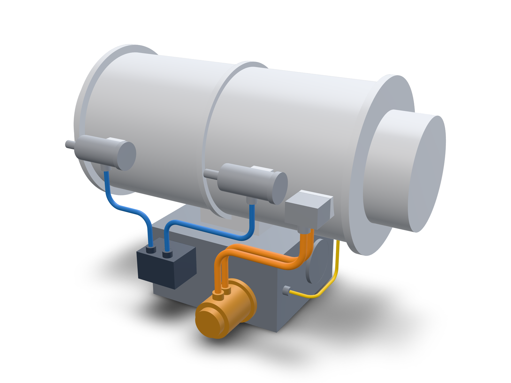

# Tube routing around an engine envelope

Five bent tubes in three fluid systems, routed between ports on an engine-like assembly and checked against bending and clearance rules.



Blue is hydraulic, orange is fuel, yellow is oil.

## What is in it

`engine-lines.kcad.ts` builds seven parts and five tubes:

| Part | What it is | Ports |
|---|---|---|
| `case` | 300 mm cylinder, 600 mm long, with flanges and mounting pads | `oil-in` |
| `gearbox` | box under the case | `oil-out` |
| `pump` | fuel pump on the gearbox front face | `out-a`, `out-b` |
| `manifold` | hydraulic manifold on the gearbox front face | `a`, `b` |
| `actuator-1`, `actuator-2` | cylinders on the case side | `in` |
| `fuel-block` | fuel inlet block on the case side | `in-a`, `in-b` |

| Line | System | OD (mm) | From | To | Bends | Cut length (mm) | Nearest neighbour |
|---|---|---|---|---|---|---|---|
| `fuel-a` | fuel | 12.7 | `pump.out-a` | `fuel-block.in-a` | 2 | 309.29 | 12.30 mm to `fuel-b` |
| `fuel-b` | fuel | 12.7 | `pump.out-b` | `fuel-block.in-b` | 2 | 309.29 | 12.30 mm to `fuel-a` |
| `hyd-a` | hydraulic | 9.525 | `manifold.a` | `actuator-1.in` | 2 | 216.45 | 23.81 mm to `manifold` |
| `hyd-b` | hydraulic | 9.525 | `manifold.b` | `actuator-2.in` | 2 | 306.45 | 17.75 mm to `fuel-b` |
| `oil-feed` | oil | 6.35 | `gearbox.oil-out` | `case.oil-in` | 2 | 224.65 | 15.88 mm to `case` |

The rules are `tubeSpec({ clearance: { default: 6, pairs: [{ a: 'fuel', b: 'hydraulic', min: 12 }] } })` with the default bend rules: bend radius at least 3 x OD, 2 x OD straight between bends, 2.5 x OD straight at each end.

Each boss is fused to the part that owns the port. The tube may touch that part along the end straight the rule requires; everywhere else it is measured against it like any other part.

## Run it

Build the CLI once with `npm run build:cli`, then:

```bash
node dist/cli/index.js evaluate examples/tube-routing-engine/engine-lines.kcad.ts --json
node dist/cli/index.js export bend-table examples/tube-routing-engine/engine-lines.kcad.ts -o out/bend-tables
```

`evaluate` prints `"ok": true`, an empty `diagnostics` list and a `tubes` object with `lines` (five entries) and `systems` (three). `export bend-table` writes one CSV per tube into the directory. This is `hyd-b.csv`:

```
name,hyd-b
od_mm,9.525
wall_mm,0.89
bend_radius_mm,28.6
cut_length_mm,306.450

point,x_mm,y_mm,z_mm
1,0.000,0.000,0.000
2,66.000,0.000,0.000
3,66.000,190.000,0.000
4,141.000,190.000,0.000

bend,l_mm,r_deg,a_deg
1,37.400,0.000,90.000
2,132.800,180.000,90.000
last_straight_mm,46.400
```

The points are in the tube's own frame: the first point at the origin and the first leg along +X. Each bend row gives the straight before the bend, the rotation of the bend plane from the previous bend, and the bend angle.

The image was rendered with:

```bash
node dist/cli/index.js render examples/tube-routing-engine/engine-lines.kcad.ts --preset publish --no-watermark -o examples/tube-routing-engine/engine-lines.png
```

## Moving a part

The pump, the manifold, both actuators and the fuel block are placed by parameters (`PumpX`, `ManifoldX`, `Actuator1X`, `Actuator2X`, `FuelBlockX`), and the corners next to them use the same parameters. The gearbox and the case stay at the origin, so the ends of the oil line are fixed.

| Change | Result |
|---|---|
| `PumpX` 60 to 90 | passes; `fuel-a` and `fuel-b` shorten from 309.29 mm to 279.29 mm |
| `Actuator2X` 130 to 160 | passes; `hyd-b` grows from 306.45 mm to 336.45 mm |
| `PumpX` 60 to 150 | fails; the pump is now 85 mm from the fuel block |

The last change produces, for each fuel line:

```
tube.straight.between-bends-too-short: tube 'fuel-a' leg 1 has 8.80 mm straight between bends; the rule needs 25.40 mm.
```

The hint says to move the two corners apart by the shortfall, 16.6 mm. Setting `FuelBlockX` from 235 to 252 does that, and the script passes again with both fuel lines at 236.29 mm.

## How it was routed

The leg lengths were sized from the rule table before any corner was written: an end leg needs `bendRadius + 2.5 x OD` and a leg between two 90 degree bends needs `2 x bendRadius + 2 x OD`. With those numbers in hand the first set of corners passed every gate on the first evaluation. A second evaluation followed changes to the parts (the mounting pads moved into the case, the fuel block and the oil line moved) and a third followed the gearbox cover and the `flow` values; both passed. The only gate diagnostics met while building the example are the ones in the table above and the one in the broken twin.

## The broken twin

`engine-lines-broken.kcad.ts` is the same script with the second corner of `hyd-b` 8 mm lower, toward the fuel lines that run under it.

```bash
node dist/cli/index.js evaluate examples/tube-routing-engine/engine-lines-broken.kcad.ts --json
```

It fails with one error:

```
tube.clearance.violated: tube 'fuel-b' is 11.24 mm from 'hyd-b'; the rule needs 12.00 mm. Closest point on the tube: [101.40, -195.01, -133.97].
```

A pair of tubes is reported once, on the tube declared first, so the message names `fuel-b` although the corner that moved belongs to `hyd-b`. `export bend-table` on this script writes nothing and prints the same error.
